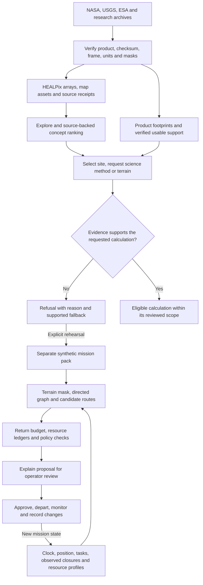
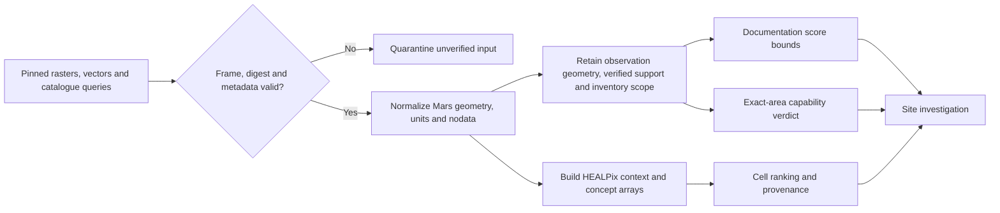
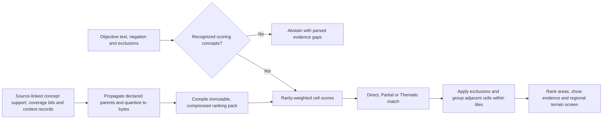
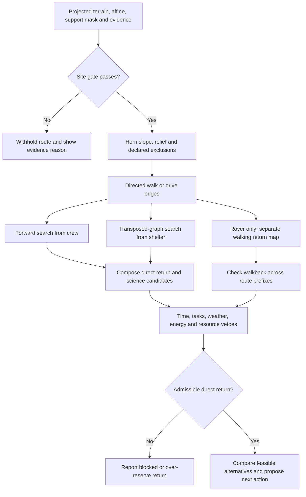
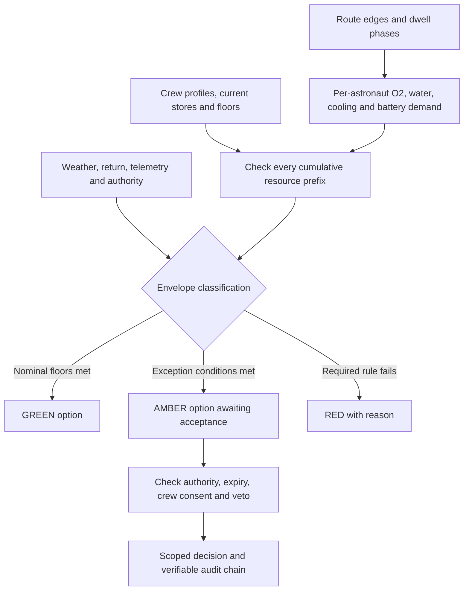
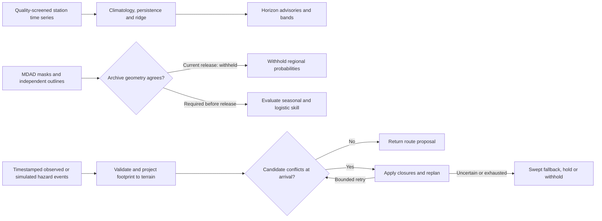
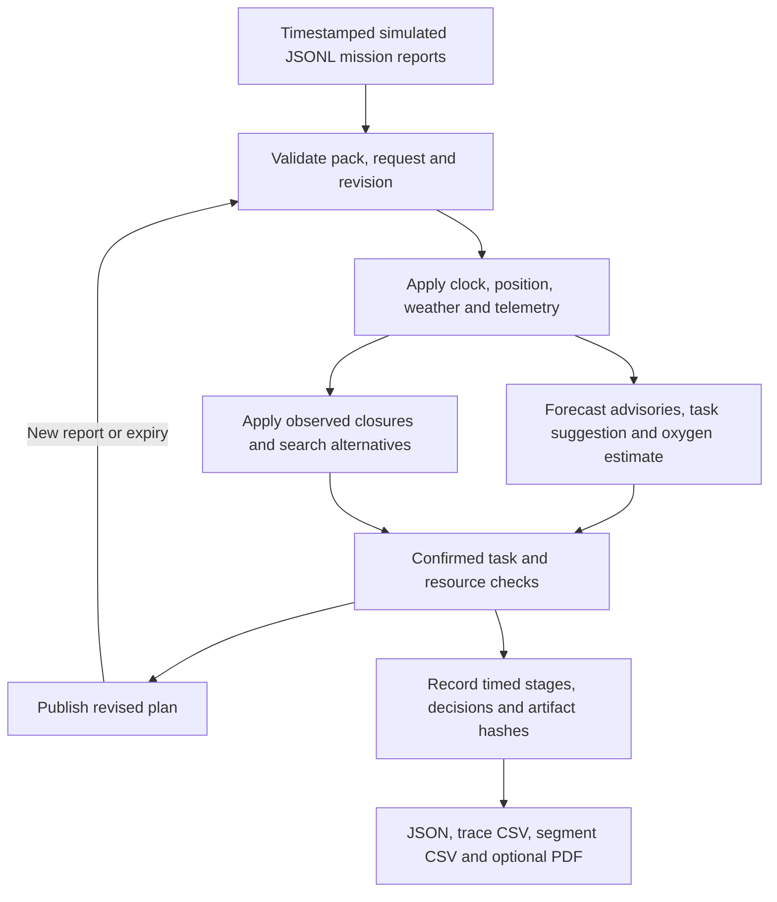

# Return Window

**Can a crew complete one more science stop and still make it back to shelter?**

Return Window is Team Periapsis’s offline Marswalk decision-support prototype for the **2026 NASA International Space Apps Challenge in Colombo, Sri Lanka**. The crew can explore NASA and partner observations, ask what science a site supports, compare a direct return with a science detour, and rehearse replanning when a corridor closes. Every route decision shows the time and reserve that drove it.

At **Arcadia Planitia**, NASA’s MOLA altimetry supports regional elevation context. The reviewed footprint lacks qualifying 20 m stereo elevation, so Return Window withholds tactical routing there. The connected demo then opens a **labeled synthetic Marswalk** where judges can approve a route, close a corridor and inspect the recomputed return to the same base.

[Official submission](https://www.spaceappschallenge.org/2026/find-a-team/periapsis/?tab=project) · [NASA challenge brief](https://www.spaceappschallenge.org/2026/challenges/interplanetary-survival-guide-martian-map/) · [Presentation](https://docs.google.com/presentation/d/1vtyNbbDNGSr-6G04B_6WcsouadTq8Ofg/edit?usp=sharing&ouid=110911028488975018209&rtpof=true&sd=true) · [Team technical paper (PDF)](docs/return-window.pdf)

[Run the demo](#run-the-demo) · [System architecture](#system-architecture) · [Planetary science](#planetary-science-and-evidence) · [Marswalk models](#marswalk-terrain-mobility-and-planning) · [Weather and hazards](#weather-and-hazards) · [Data inventory](#data-source-inventory) · [Validation](#validation-and-limits)


*Explore reference capture. The earlier named-region interaction is pictured here. Use **Ranked cells** in the connected demo to query the sourced HEALPix ranking service.*

## Run the demo

The challenge, **Interplanetary Survival Guide: Martian Map**, asks for a layered view of a Martian site or route that combines observations from several NASA missions and helps a human explorer plan and carry out science on a Marswalk. We use orbital observations to establish what can be inferred at the site, and a mission clock, terrain graph and resource policies to show how a crew could make a return decision locally when communication with Earth is delayed. [Challenge brief](https://www.spaceappschallenge.org/2026/challenges/interplanetary-survival-guide-martian-map/)

### Launch

Use Node 22, Python 3.12, uv and the GitHub CLI. The first build downloads pinned ranking inputs, installs dependencies, builds the web clients and prepares the station model from a synthetic fixture. Subsequent launches can use loopback alone. Keep the bundle, its manifest and matching checkout together. For a second machine, provision the locked Python environment on that machine before disconnecting. [Offline runbook](docs/offline-readiness.md) · [Development setup](docs/development.md)

```sh
uv sync --project documentation --locked --python 3.12
npm ci --prefix web
npm ci --prefix web/mission-preview

gh release download mars-cell-map-v0.1.0 --repo AbhimanthaW/Periapsis \
  --dir data/ranking-inputs --pattern cells-enriched.ndjson.gz
gh release download mars-cell-map-v0.2.0 --repo AbhimanthaW/Periapsis \
  --dir data/ranking-inputs --pattern cell-ranking.ndjson.gz \
  --pattern ranking-features.json.gz --pattern cells-enriched-sourced.ndjson.gz \
  --pattern sourced-catalogue-manifest.json

uv run --project documentation --locked --offline python -m runtime.release build data/offline-release
uv run --project documentation --locked --offline python -m runtime.release serve data/offline-release
```

Open [Explore](http://127.0.0.1:8000/explore) or [Operations](http://127.0.0.1:8000/demo/). The build destination must be new. The release service checks its recorded source files and packaged hashes before binding to loopback. [Release builder](runtime/release.py)

### Judge walkthrough

1. **Explore.** Choose **Demo**. Inspect the Arcadia cell and switch between Viking colour and MOLA relief. Open **Ranked cells** and try “ancient lakes with hydrothermal activity.” Inspect the evidence for the evaluated concepts and the skipped term.
2. **Investigate the evidence.** Arcadia has regional MOLA context and a refusal for the requested local elevation. Compare Jezero (HPX128:96848) as an elevation control, or HPX128:0 as a sparse evidence case.
3. **Enter simulated Marswalk.** Inspect the initial route proposal, including direct return, science detour, dwell and time above reserve. In **Monitor**, approve the proposal, record departure, report a simulated crew position and close the middle corridor.
4. **Replan to the same base.** Inspect the changed return and remaining margin in **Route** and **Analysis**. Review the proposed revision before accepting it. The dedicated hazard replay adds stale data, reopening and explicit approval of a changed route.

[Browser workflow and verification](docs/offline-readiness.md#release-acceptance) · [Route proposal integration](https://github.com/AbhimanthaW/Periapsis/pull/41) · [All UI reference captures](UI%20screenshots)

## System architecture

The architecture uses two spatial scales. HEALPix supports global comparison. A separately qualified, projected terrain raster supplies local edges and travel costs. The Arcadia demo’s regional evidence and the synthetic site pack have independent identities and coordinates.



| Where it runs | What it contains |
| --- | --- |
| **Connected browser on `main`** | React/TypeScript and Vite clients. Explore imagery, region/cell evidence, sourced ranking, synthetic base and sortie setup, computed route geometry, analysis, monitor state and the separate hazard replay. |
| **Python models on `main`** | Source verification, evidence resolver, Marswalk human/rover solvers, environmental and human-cost ledgers, Trade-off Envelope, station forecasts, historical dust classifier, moving-hazard monitor and diagnostic fixtures. Several have their own CLI or test entry points. |
| **Separate routing research branch** | Revisioned JSONL mission feed, learned task suggestions, Bayesian oxygen adjustment, compounded route checks and backend reports. PR #36 merged into this branch. |
| **Design and test references** | The 56 named-region research entries, earlier interface gallery, fixed-fixture simulator, legacy A* and experimental calculations. Their outputs are scoped to their own inputs. |

[Browser setup](web/README.md) · [Mission UI and replay](web/mission-preview/README.md) · [Runtime entry points](runtime/README.md) · [Pinned research branch](https://github.com/AbhimanthaW/Periapsis/tree/cdc63313aee15b7edd1b2c9d38792c597eff8e35) · [Paper flowcharts at PR #35](https://github.com/AbhimanthaW/Periapsis/blob/8a3592ad0e518eecb6c771345c6c50d84b77a0a2/docs/paper-flowcharts.md)

## Planetary science and evidence

### Ingestion, coordinates and spatial support

The pipeline pins archive IDs and SHA-256 digests, validates source labels and raster geometry, and checks byte order, scale, offsets, units and missing-value encodings before unpacking a product. The MOLA MEG004 global 4-pixels-per-degree pair contains 720 × 1,440 native samples each. Elevation is relative to the MOLA areoid. The companion observation-count grid measures sampling support, which can be zero where elevation is interpolated. The global atlas reorders longitude without resampling. Imagery such as Viking colour and shaded MOLA relief supplies display context. [Pipeline](pipeline/README.md) · [MOLA input configuration](pipeline/configs/mola-global-4ppd-topography.json) · [Independent MOLA checks](evidence/mola/mola-independent-check.json)

Canonical evidence uses Mars **planetocentric latitude** and **east-positive longitude**, with explicit signed or unsigned presentation domains. Geometry uses shorter great-circle arcs, with antimeridian handling and Mars-specific frame metadata. A local routing pack instead uses a projected metre grid with an affine and valid/support masks. The regional raster producer computes slope and aspect at native resolution before aggregation, retaining mean elevation, maximum native slope and the aspect at that maximum with separate validity. Source posting, output spacing and effective feature scale are recorded separately. [Evidence contract](documentation/CONTRACT.md) · [Terrain producer](pipeline/src/return_window_pipeline/terrain.py) · [Pack v1](contracts/README.md)



### HEALPix and documentation completeness

The NESTED HEALPix grid has $N_{\mathrm{side}}=128$, so $N=12N_{\mathrm{side}}^2=196{,}608$. Each cell covers roughly 734 km² on the 3,389.5 km indexing sphere, equivalent to a square about 27 km wide. Identifiers are `HPX128:<nested_index>`. Cell-centre samples, catalogue-point joins and approximate named feature bounds are suitable for discovery. Usable pixel support over an exact footprint requires its own geometry. The 56 named Atlas entries are orientation and research anchors, also used by the separate historical dust study. [HEALPix paper](https://doi.org/10.1086/427976) · [Cell-map build and receipts](documentation/cell-map/README.md) · [Regional research](web/public/atlas/MARS_REGIONAL_RESEARCH.md)

The Planetary Documentation Engine scores seven terrain and science/environment modalities. For a modality with posting limits, a source at native spacing $s$ has utility

$$
u(s)=\min\left(1,\max\left(0,\frac{\ln(s_{\mathrm{poor}}/s)}{\ln(s_{\mathrm{poor}}/s_{\mathrm{good}})}\right)\right).
$$

It integrates the highest applicable utility over the query area, so overlapping products receive credit once. Lower and upper bounds reflect known support, inventory completeness and unlocated or unverified coverage. Weighted axes combine modalities. When the two bounds cross a tier boundary, the tier remains unclassified. An inventory can establish a negative result only within its stated catalogue universe, geometry and revision. [Resolver](documentation/marsdoc/engine.py) · [Documentation validation](documentation/VALIDATION.md)

### Exact-area evidence and science methods

The resolver takes a point, polygon or buffered traverse and explicit variable requirements. It verifies usable support, allowed product class and processing level, native posting, effective scale and acquisition window when requested. Full-area support must come from a verified product or prepared derivative for each variable. A multi-variable calculation needs a single product or an audited common compatibility key. It returns the calculation verdict, evidence IDs, limitations and supported fallbacks. A catalogue hit can establish acquisition or product availability while the usable area remains unknown. [Query and sidecar contract](documentation/CONTRACT.md) · [Region evidence API](runtime/region_evidence.py)

| Evidence control | Arcadia Planitia | Jezero |
| --- | --- | --- |
| Scope | Roughly 4 × 4 km near 49.02° N, 171.85° W | Separately checked archive control near the Mars 2020 site |
| Saved CTX stereo catalogue query | 0 intersects in the saved query | 24 in the matched query |
| Elevation result | Coarse MOLA fallback. Centre sample −4,036 m with count 555. The 121-sample browse crop uses 0.25° native posting. | Checked window from the USGS/MRO CTX 20 m-posted DTM supports the defined elevation query. |
| Tactical route | Withheld | Elevation preview/control scope. Posting alone leaves obstacle-scale and route qualification unresolved. |

[Arcadia handoff and verification](pipeline/evidence/arcadia-planitia/README.md) · [Jezero archive control](evidence/jezero/README.md) · [Technical paper, pp. 1–2](docs/return-window.pdf#page=1)

The deterministic **objective-to-method** module maps confirmed terms, requested methods and exclusions to a curated catalogue of required observations. It binds method eligibility to the region, exact geometry and evidence version. In Arcadia it can recommend MOLA context and leave stereo pending. Adding “without MOLA” excludes that fallback and exposes the unresolved prerequisite. A method eligible for remote analysis stays separate from an assigned field task, whose stop and dwell require their own authorized scenario inputs. [Method catalogue and tests](docs/objective-methods/README.md)

[](UI%20screenshots/02b%20Site%20pack%20readiness%20%E2%80%94%20gates%20G1%20to%20G10.png)

*Site-pack reference capture. In the merged Arcadia workflow, the pinned evidence view supplies the terrain verdict and its fallback.*

### Cell ranking and uncertainty

The deterministic ranker uses a **72-concept ledger** across live, flagged, catalogue-only, DEMO and unsupported concepts. The parser reports matched, negated, unavailable and unresolved text. Mapped geologic units, structure lengths, SWIM consistency and non-interpolated TES reflectivity/thermal-inertia proxies enter through declared support rules. Catalogues supply contextual records and detections. A missing point record without a survey mask remains **not reported**. Explicit coverage distinguishes **present**, **weak**, **absent** and **not evaluated**. The sourced release excludes the opt-in synthetic DEMO layers. [Ranking source and sensitivity notes](ranking/README.md) · [Layer rules](ranking/layers.py) · [Concept catalogue](ranking/concepts.json)



Build-time rules can lift parent support to 0.8 of child support, link polar deposits to sedimentary support at 0.6, and derive an exploratory habitability proxy as the smaller of water and age support. The weighted cell score is $S_i=\sum_j w_j u_{ji}$, with byte-valued support $u_{ji}$ in $[0,255]$. When permitted, the score can use 35% of broader support if that exceeds exact support. The exact concept retains its own coverage state. The rarity weight with $n_j$ present cells out of $N$ is

$$
w_j=\mathrm{round}\left[2^{16}a_j\ln\left(1+\frac{N-n_j+0.5}{n_j+0.5}\right)\right],
\qquad a_j=\begin{cases}0.35 & \text{age concept}\\1&\text{otherwise.}\end{cases}
$$

Covered exact support at or above 128 is **Present**. All, some or zero exact hits in positive-score cells give Direct, Partial or Thematic matches. The engine groups the best available tier by adjacency within $N_{\mathrm{side}}=32$ tiles and sorts by integer mean score, then cell count and lowest index. It reports percentages of evaluated cells with mapped mass wasting (`Aa`) or polar dunes (`lApd`) as a separate regional screening statistic, with an unknown result when the denominator is zero. [Pack builder](ranking/build.py) · [Scoring and grouping](ranking/engine.py) · [Regional screening](ranking/risk.py)

The service verifies and memory-maps decoded arrays by content digest and indexes compressed per-cell detail blocks. Release inputs are tied to the pinned v0.1.0 and v0.2.0 map assets. The sensitivity sweep retained **9–10 of 20** shallow-ice areas and **14 of 20** young-volcanism/lava-flow areas under tested perturbations, below the **16 of 20** gate. Ranking supports exploratory comparison with evidence and threshold caveats. [Pack runtime](ranking/pack.py) · [Sensitivity check](tests/ranking/check_sensitivity.py) · [Cell-ranking UI capture](UI%20screenshots/01b%20Cell%20ranking%20from%20the%20service.png)

## Marswalk terrain, mobility and planning

### Site gate and terrain model

A mission pack describes the site and grid, analytical payload and masks, scenario, tasks, source IDs, assumptions and hashes. The validator checks the schema, paths, file bindings, dimensions, affine, supported capability and scenario identity. The planner’s prototype gate requires local evidence and analytical terrain, limits both native and routing-grid posting to 20 m, and bounds the working grid to 1,000,000 cells. The rover gate reports when obstacles at the declared clearance cannot be resolved, using a three-post feature-scale assumption. The supplied Arcadia context, coarse HEALPix cells and Jezero preview each have a narrower supported use. [Pack validation](contracts/pack.py) · [Site gate](runtime/marswalk/site.py)

The local model computes the **Horn 3 × 3** gradient where the full stencil is valid. For a north-to-south raster with neighbourhood rows `a b c / d e f / g h i`, the slope magnitude uses $p=(c+2f+i-a-2d-g)/(8\Delta x)$ and $q=(g+2h+i-a-2b-c)/(8\Delta y)$, with $\theta=\arctan\sqrt{p^2+q^2}$. Signs follow the raster axis convention. Detrending a local fitted plane yields RMS relief and a separate clearance proxy. Invalid stencil support, authorized exclusions, excessive slope and scenario closures remove cells or edges. The graph permits 4 or 8 neighbours with unit-consistent edge length and rejects prohibited diagonal corner cutting. [Horn method](https://doi.org/10.1109/PROC.1981.11918) · [Traversability](runtime/marswalk/traversability.py) · [Directed graph](runtime/marswalk/routing.py)



### Walking and rover edge models

**Walking.** For horizontal length $\ell$ and signed grade $g=\Delta z/\ell$, the default speed is a scaled Tobler curve. Uphill and downhill traverse times can differ for the same pair of cells.

$$
v(g)=v_{\mathrm{flat}}e^{-3.5(|g+0.05|-0.05)},\qquad t=\ell/v(g).
$$

The illustrative flat pace is **0.50 m/s**, with a slow case at 0.7 times nominal. The slope-limited profile applies policy limits to along-edge grade and endpoint Horn slope. With the default flat pace, a 5 m edge rising 0.5 m takes 14.19 s uphill and 10.00 s in reverse. The model adapts a terrestrial relationship and has no fitted Mars EVA parameters. The connected selectable-base rehearsal uses the fixed-fixture linear cost profile at 1 s/m plus 2 s per metre climbed. This control gives repeatable regression results. [Walking model and sensitivity](runtime/docs/mars-tobler-pace.md) · [Mobility code](runtime/marswalk/mobility.py) · [Lunar planning reference](https://ntrs.nasa.gov/citations/20240000165)

**Rover.** Accepted edges satisfy grade, endpoint slope and detrended clearance bounds. For total mass $m$, Martian gravity $g_M$, rolling coefficient $C_{rr}$, efficiency $\eta$ and auxiliary draw $P_{aux}$, the gross electrical use is

$$
t_{drive}=\frac{\sqrt{\ell^2+\Delta z^2}}{v_{nom}},\qquad
E_{drive}=\frac{[mg_M(\Delta z+C_{rr}\ell)]_+}{\eta}+P_{aux}t_{drive}.
$$

The positive-part term floors mechanical work at zero. Nominal speed and rolling resistance are declared assumptions. The hypothetical profile uses 1,150 kg with payload, $g_M=3.721$ m/s², 1.5 m/s, $C_{rr}=0.15$, efficiency 0.70, 400 W auxiliary draw, 0.35 m clearance and a 20° incline cap. The battery policy specifies 20 kWh capacity, 16 kWh initially, a 4 kWh floor and 4 kW maximum discharge. Each drive or dwell checks mean discharge and the reserve after draw before crediting supply and capping at capacity. Wheel slip, sinkage, traction and sub-pixel obstacles remain outside this vehicle model. [Rover implementation](runtime/marswalk/rover.py) · [Resource ledger](runtime/marswalk/resources.py) · [Paper, p. 3](docs/return-window.pdf#page=3)

**Power and illumination.** Supply can be disabled, declared as a power curve, set to a compatible non-solar constant, or derived for a horizontal solar panel. Mars24-style geometry supplies Sun elevation and azimuth, season and local solar time. For terrain-qualified rays, the horizontal solar model uses irradiance projected by the positive sine of elevation, then multiplies by panel area, efficiency and declared atmospheric transmittance. Nodata or an unresolved horizon can leave sun exposure unknown. Weather policy can remove solar generation credit. [Environment model](runtime/marswalk/environment.py) · [NASA Mars24 algorithm](https://www.giss.nasa.gov/tools/mars24/help/algorithm.html)

### Directed search, constraints and walkback

The solver builds a compressed sparse row graph and its transpose with positive edge travel times. Dijkstra from the current cell supplies outbound costs. Dijkstra from shelter on the transpose supplies **costs to shelter in the original movement direction**. The locked environment uses the pure-Python path. An optional SciPy backend gives equivalent costs with possible differences among tied paths. Candidate time adds every leg and dwell. If $B$ is remaining mission time and $R$ is required reserve, then

$$
M_t=B-R-t_{elapsed}.
$$

The crewed rover requires a separate pedestrian return graph. For every sampled route position $x$ and after each dwell, $\tau(x)+T_{walk}(x,\text{shelter})\leq B-R$, where $\tau$ includes elapsed drive and dwell time. The default walkback scenario assumes 0.75 m/s and a 15° slope cap. A rover that can reach shelter can still fail this breakdown criterion. [Dijkstra](https://doi.org/10.1007/BF01386390) · [Algorithm and complexity](runtime/docs/marswalk-algorithm.md) · [Walkback](runtime/marswalk/walkback.py)

The solver preserves completed work, reevaluates remaining science prerequisites, and applies hard constraints for return, closures, time, weather and applicable battery and walkback policy. It forms a Pareto front over travel and dwell time, reserve margin, task priority, steep exposure and energy when available. With an admissible direct return, it prefers eligible science by priority, then margin, or recommends returning. Bounded two-task and alternate-corridor searches cover selected alternatives. A failed fastest route can leave slower feasible routes outside the search bound. Valid requests can return `NO_RETURN_ROUTE`, `RETURN_OVER_RESERVE` or `INSUFFICIENT_TERRAIN_EVIDENCE`, with the reason and no actionable recommendation. [Planner](runtime/marswalk/plan.py) · [Candidate rules](runtime/marswalk/optimization.py)


*Earlier simulated monitor capture. The rover model and walkback checks also have independent runtime entry points. See the [route comparison](UI%20screenshots/03b%20Route%20comparison.png) and [astronaut planning reference](UI%20screenshots/04%20Astronaut%20Route%20Planning.png).*

## Crew resources and Trade-off Envelope

**Human cost.** For each astronaut and ordered walking or dwell phase, positive ascent $H$ contributes work $W=mg_MH$. With mechanical efficiency $\eta_h$, baseline power $P_0$, suit joint power $P_{joint}$ and external heat $P_{ext}$, the model uses

$$
E=(P_0+P_{joint}/\eta_h)t+W/\eta_h,\qquad Q=E-W+P_{ext}t.
$$

The crew policy uses $g_M=3.71$ m/s². Dwell has zero climb and uses the flat phase rates. The non-protein Weir relation gives $V_{O_2}=E/[4184(3.941+1.106\,RER)]$ standard litres of O₂, converted to grams by multiplying by $31.998/22.414$. Drinking water follows a declared hourly rate. Cooling water is $Q/L_{evap}$ and battery use is $(P_{base}t+k_{el}Q)/3600$ Wh. Positive CO₂ production minus assumed removal capacity is an excess mass proxy. Each phase checks stores, slope and mean phase workload versus the declared peak. The sustained mission load is also flagged. The preset uses an effective evaporation energy of 2.4 MJ/kg, 25 W net external load, 115 W base electrical draw and a 0.12 cooling-electric coefficient. Crew and suit profiles record the remaining assumptions. [Human-cost implementation](runtime/humancost/README.md) · [Weir equation](https://doi.org/10.1113/jphysiol.1949.sp004363) · [NASA metabolic design loads](https://ntrs.nasa.gov/citations/20205010692)

**Trade-off Envelope.** Given initial available resource $I_r$, declared use $U_{ir}$ in phase $i$, margin factor $f$ (1.30 in the rehearsal) and floor $F_r$, the module checks every prefix $k$ for each astronaut and resource.

$$
I_r-f\sum_{i\leq k}U_{ir}\geq F_r.
$$

| Class | Deterministic rule |
| --- | --- |
| **GREEN** | Mandatory checks and nominal L1 floors pass. |
| **AMBER** | A pre-authorized science class may use selected L2 floors above non-relaxable L0. Requires a GREEN return, suitable weather, fresh plausible telemetry, current authority and remaining exception count. Drinking water retains its nominal floor. |
| **RED** | A hard rule, absolute floor, return condition or other required condition fails. |

An AMBER decision is scoped to the option and its window, requires the authority and consent checks without crew veto, and expires or can be withdrawn. Remote approval must fit the round-trip communication and response allowance. A configured habitat delegate applies when authorized. Canonical record hashes link the audit chain. These deterministic ledgers quantify margins under declared assumptions. The preflight uncertainty allowances are policy factors. [Envelope, telemetry, consent and audit](runtime/tradeoff/README.md) · [Per-astronaut ledger reference](UI%20screenshots/04b%20Per-astronaut%20resource%20ledger.png) · [EVA contingency reference](UI%20screenshots/07a%20EVA%20contingency%20trade-off.png)



## Weather and hazards

### Station forecast

The station model estimates pressure (Pa), air temperature (K), horizontal wind (m/s) and dust optical depth at +1, +3 and +6 **Mars hours**. Each Mars hour is 1/24 of the roughly 88,775 s sol. It ingests explicit field and time mappings, quality screens readings and bins the record by local solar time and season ($L_s$). The baseline $C(t)$ interpolates time-bin means around seasonal centres (±10° by default), widening the seasonal window when support is sparse. A kit containing the target sensor starts from anomaly persistence $b_{t,h}=C(t+h)+y_t-C(t)$. Other kits start from climatology $C(t+h)$.

For each sensor kit, target and horizon, ridge regression fits the residual $y_{t+h}-b_{t,h}$ on standardized present and lagged sensor anomalies, tendencies and time/season harmonics. The objective adds $\lambda\lVert\beta\rVert_2^2$ to squared error ($\lambda=1$ by default, with an unpenalized intercept). P10/P50/P90 add empirical calibration residual quantiles to the fitted value. Threshold crossing frequencies count the fraction of calibration residuals that would put the forecast past a threshold. Four chronological blocks with one-sol gaps separate fitting, band calibration, kit selection and reporting. Kit selection favours fewer sensors subject to skill and coverage checks against climatology and persistence. Missing, unsupported or out-of-range inputs can fall back to another kit, climatology or abstention. A boosted challenger is available for offline evaluation.

On the **synthetic station only**, the +6 Mars-hour pressure barometer kit had held-out MAE **2.688 Pa** versus **2.961 Pa** for the best baseline, with **83.1%** empirical P10–P90 coverage over 3,577 bins. Wind and dust selected the clock baseline at every horizon, and the selected +3 h temperature kit lost to the best baseline on the test block. Forecast outputs inform crew and command views as advisories. Observations and explicit hazard policy govern closure. [Station model](pipeline/src/return_window_pipeline/forecast/model.py) · [Source and evaluation plan](docs/weather-forecast-datasets.md) · [Synthetic held-out metrics](pipeline/examples/weather/synthetic-forecast-report.md) · [Forecast adapter](runtime/marswalk/forecast.py)

### MDAD regional dust outlook

This research model starts from **MARCI-derived MDAD v1.1**, Mars years 28–32. It counts mapped storm pixels among observed pixels in a 100 km geodesic core and a surrounding annulus reaching 800 km. The core anchor needs at least 50% observed coverage. Ring features need 30%. The label is a mapped storm affecting at least 10% of observed core pixels on a qualifying sol within the next seven sols, with at least five observed sols required to assign the label. Missing pixels stay missing.

A circular ±15° $L_s$ seasonal event frequency shrinks toward a pooled seasonal rate. L2 logistic regression, fitted by iteratively reweighted least squares, uses the climatology logit, current and recent core/ring features, a missing-ring indicator and seasonal harmonics. Leave-one-Mars-year-out validation refits both methods on the other years. The gate checks pooled Brier skill $1-\mathrm{BS}_{model}/\mathrm{BS}_{clim}\geq0.02$ and positive skill in most held-out years, with climatology as the skill fallback. Archive geometry is a prerequisite for either output. The independent outline-to-NetCDF check disagreed in all five reviewed years, so the shipped browser artifact **withholds regional probabilities**. This model would describe historical conditional storm occurrence at regional scale. [MDAD v1.1](https://zenodo.org/records/7480334) · [Archive review and release decision](docs/arcadia-historical-dust.md) · [Dust model](pipeline/src/return_window_pipeline/dust/model.py)

### Timestamped events and moving footprints

A separate backend accepts replayed or simulated timestamped wind/dust rasters, moving storm footprints, outages and solar particle event alerts. It validates units, provenance, time and alignment to the local grid. The demo wind thresholds are 15/20 m/s for caution/warning and the dust optical-depth thresholds are 1/2. Warnings and SEP alerts can stop science under the declared policy, high dust can remove solar credit, and stale conditions can retain restrictions. Caution exposure is route length inside the hazard footprint. Forecasts stay advisory.

For motion-aware routing, an observed storm centre advances as $x_0+v\Delta t$ for up to 1,800 s. The solver checks projected masks around arrival times with a buffer $\max(60\text{ s},0.2t)$. Intersections trigger replanning with bounded retries. The swept union over the lookahead provides a conservative fallback when timing cannot clear the route. If a return cannot be found, the model may report a reachable clear hold cell or withhold movement. The monitor drives this logic with simulated events. No live Mars weather service supplies the prototype. [Hazard policy and scenarios](runtime/docs/live-hazard-map.md) · [Arrival-time implementation](runtime/hazards/route.py) · [Monitor](runtime/hazards/monitor.py)



### Reproduced closure experiment

The paper’s dedicated six-frame replay uses **synthetic** 160 × 160 terrain at 5 m posting, a 5,400 s initial clock and 900 s reserve. It compares two fixed corridors. At caution, A intersects 42 m of the footprint and B intersects none. At closure, the walking return changes from **436 m and 867 s** to **834 m and 1,773 s**. Stale input keeps the closure and suspends new approvals. Fresh simulated data reopens A while the previously approved route remains selected. This fixed-corridor experiment uses separate inputs from the selectable-base browser scenario and the moving-hazard solver. [Replay instructions](web/mission-preview/README.md#hazard-drill) · [Paper scenario and results, p. 4](docs/return-window.pdf#page=4)

| Replay state | Scenario clock | Walking route | Travel time | Margin above reserve |
| --- | ---: | --- | ---: | ---: |
| Clear | 0 s | A | 867 s | 3,633 s |
| Caution | 90 s | A / B | 867 / 1,773 s | 3,543 / 2,637 s |
| Closed | 270 s | B | 1,773 s | 2,457 s |
| Stale | 871 s | B | 1,773 s | 1,856 s |
| Reopened | 1,110 s | A available | 867 s | 2,523 s |

For the same replay, the rover’s travel time is 291 s on A and 557 s on B. The closure leaves 3,673 s above reserve for B at the 270 s replay clock. These are outputs of the declared vehicle and corridor model. The submission’s “about a second” refers to prototype replanning responsiveness. Timing depends on the graph, backend and host. [Runtime benchmark context](runtime/README.md#human-marswalk-pipeline-runtimemarswalk) · [Replay implementation](runtime/hazards/replay.py)

## Diagnostic and comparison models

The documentation engine can display **28 EVA diagnostic fields** alongside its evidence results. The fixture uses constant declared loads or synthetic time series. Historical substitutions are location- and time-scoped. The checked Jezero sol 36 example supplies 238.71 K, 9.08 m/s, 737.47 Pa and 55.49° Sun elevation from MEDA, a 2.77° CTX-derived slope and 859.30 s of one-way Earth-centre to Mars-centre light time from Horizons. Early Gale has a separate Curiosity RAD tissue-like GCR absorbed-dose rate of 0.210 ± 0.040 mGy/day. These inputs remain historical examples at those sites. [All 28 fields and formulas](documentation/EVA-CONTEXT.md) · [Product and query receipt](documentation/marsdoc/eva/historical-v1.json)

| Diagnostic group | Calculation and boundary |
| --- | --- |
| **Ambient conditions and exposure** | Temperature, wind, pressure and dust mass concentration use declared or qualified substituted observations. Radiation integrates a declared constant absorbed dose rate over elapsed time. Solar elevation uses latitude, hour angle and declination. Homogeneous optical visibility is $-\ln(C_{min}/C_0)/\kappa$ for extinction $\kappa$. Column dust optical depth and local mass concentration have different inputs and units. |
| **Footing and mobility** | Compute slope from grade or a valid Horn stencil. Traction is a declared coefficient. Sinkage inverts a synthetic pressure–sinkage law under a static single-foot load. Obstacle density divides counted features above a size cutoff by surveyed area. Suit resistance power equals joint torque × angular speed. Pace uses the scaled Tobler curve. |
| **Physiology and suit** | Metabolic load, O₂, CO₂, energy, cooling and water follow steady phase balances. Battery, oxygen and coolant reserves subtract accumulated use. Heart rate, core temperature and suit pressure interpolate synthetic telemetry. Remaining time is the minimum clock or time to exhaustion at declared constant rates. |
| **Local radio and Earth light-time** | Radio availability requires 60% first-Fresnel-zone clearance along the sampled terrain and nonnegative free-space link margin. One-way latency is range divided by light speed or a selected Horizons result. Network and relay delays require separate evidence. |

A **28-cell synthetic science fixture** uses invented input geometry to test six geospatial calculations. Delta, fan and glacial polygons are clipped and unioned against surveyed cells. Valley segments are clipped, deduplicated and measured along great-circle arcs. Two synthetic magnetic dipoles contribute vectors proportional to $[3(\mathbf a\cdot\hat{\mathbf d})\hat{\mathbf d}-\mathbf a]/d^3$ at a declared altitude. OMEGA-style OSP1/OSP2 ratios use valid spectral bands and area weighting, with an illustrative candidate cutoff above 1.04. Coverage is emitted independently from detections, so an unsurveyed result can stay null. The opt-in global DEMO ranker also uses fixed-seed footprints and toy field kernels. [Synthetic science formulas and qualification targets](documentation/SYNTHETIC-SCIENCE.md) · [Fixture code](documentation/marsdoc/synthetic_science.py)

The **legacy A\*** control in `runtime/python_engine/` uses eight neighbours, corner checks, an octile heuristic and dimensionless synthetic costs. Its separate suitability raster weights clipped slope, roughness and hazard at 0.4/0.3/0.3 and zeros excluded cells. Both are comparison models with their own fixtures. The supported Marswalk timing graph uses directed SI-second costs. [Legacy search](runtime/python_engine/navigation/astar.py) · [Suitability model](runtime/python_engine/analysis/suitability.py)

## Runtime, revisions and reporting

### Connected local API on main

| Interface | Outputs and checks |
| --- | --- |
| `GET /healthz`, `GET /api/v1/site` | Readiness and synthetic pack, grid affine, fixture state and closures. |
| `GET /api/v1/regions/{id}`, `GET /api/v1/evidence` | Reviewed or configured evidence, limitations and fallbacks. Operator-supplied generic evidence reports unverified provenance. |
| `GET /api/v1/cell-at?lon=…&lat=…`, `GET /api/v1/cell-context/{id}`, `GET /api/v1/cell/{id}` | Geographic cell lookup, regional context and per-cell sourced detail. |
| `POST /api/v1/rank` | Scope, parser decisions, ranked areas, source-linked evidence and regional screening. |
| `POST /api/v1/plan` | Fixed regression contract and optional Marswalk model detail. |
| `POST /api/v2/plan` | Selectable-base rehearsal with request, sortie and revision identities. The Mars point must match its HEALPix cell. Route indices are synthetic `[row,col]`. |
| `GET /api/v1/hazard-replay/{frame}` | Local replay-frame result. The UI can also use packaged playback. |

The v2 service validates the pack, base, positions, closure IDs and completed tasks. The first revision starts at the base. Later revisions keep the base and preserve completed work. Identical retry requests can reuse the previous response, while stale revisions and mismatched state are refused. The UI shows a route proposal and tracks departure, closures, updated position and approval in the browser workflow. Analysis can inspect the solver path and returned metrics for the active synthetic sortie. The reference gallery also shows fixture telemetry, contingency choices and export screens from other UI states. [Planning API](runtime/planning_api.py) · [Operations workflow](web/mission-preview/README.md) · [Model inspection reference](UI%20screenshots/05a%20Model%20execution%20and%20inspection.png)

### Integrated routing and reports research branch

The earlier architecture diagrams include an integrated drill on the separate `feature/final-routing-integration` branch. The paper pins its earlier routing experiment at `2dd7388`. PR #36 later merged the reporting backend there, with branch head `cdc63313` at review. The connected demo from `main` uses the endpoints above. [Branch run instructions](https://github.com/AbhimanthaW/Periapsis/blob/cdc63313aee15b7edd1b2c9d38792c597eff8e35/runtime/README.md#integrated-routing-drill) · [PR #36 verification](https://github.com/AbhimanthaW/Periapsis/pull/36)



- **Learned objective suggestion.** A deterministic lexicon handles recognized requests first. A fallback multinomial Naive Bayes classifier deduplicates stemmed tokens and uses Laplace smoothing. For task label $c$ and known stems $W$, its log score is proportional to $\ln n_c+\sum_{w\in W}\ln[(n_{cw}+1)/(\sum_v n_{cv}+|V|)]$. The scores are normalized across labels. Training uses 12 labeled simulation examples. Fewer than two known stems, a winning score below 0.8 or a return-only winner triggers abstention. A suggested existing task still needs operator confirmation. [Classifier](https://github.com/AbhimanthaW/Periapsis/blob/cdc63313aee15b7edd1b2c9d38792c597eff8e35/runtime/objective_model.py)
- **Bayesian oxygen adjustment.** One qualified window per astronaut supplies $y=\ln(\text{observed rate}/\text{nominal flat rate})$. The log multiplier has a zero-mean Normal prior with $\sigma_0=0.20$ and observation noise $\sigma_y=0.15$. Precision adds, so $\sigma_*^2=(\sigma_0^{-2}+\sigma_y^{-2})^{-1}$ and $\mu_*=\sigma_*^2y/\sigma_y^2$. Exponentiating the median and 90th percentile gives consumption factors. The applied factor can rise above the nominal or previously applied factor and persists across missing input. The noise values are illustrative. [Bayesian update](https://github.com/AbhimanthaW/Periapsis/blob/cdc63313aee15b7edd1b2c9d38792c597eff8e35/runtime/tradeoff/burn_rate.py)
- **Integrated search.** The branch reuses graph/search results, includes a shortest-distance reference and evaluates bounded alternate corridors after timing, vehicle battery, walkback or suit resource failures. It checks hazard timing across traversal, science dwell and walkback, with a swept-footprint retry. A calibration utility can fit pace/cost factors to supplied traverse observations and evaluate held-out errors. No Mars calibration corpus is supplied. [Routing study and verification](https://github.com/AbhimanthaW/Periapsis/blob/cdc63313aee15b7edd1b2c9d38792c597eff8e35/runtime/docs/routing-algorithm-report.md)
- **Execution reporting.** The branch records model stages, wall time separately from the simulation clock, normalized inputs, results or failures, and hashed artifact provenance. The loopback reports API serves history, full JSON, stage trace CSV and segment/dwell CSV, with PDF when ReportLab is installed. `--report-db` enables SQLite across runs. Mission feed replay can send a clock-only update at expiry while preserving the previous position and task state. [Report contract and endpoints](https://github.com/AbhimanthaW/Periapsis/blob/cdc63313aee15b7edd1b2c9d38792c597eff8e35/runtime/README.md) · [Reporting engine](https://github.com/AbhimanthaW/Periapsis/blob/cdc63313aee15b7edd1b2c9d38792c597eff8e35/runtime/reporting.py)

## Data source inventory

Each row records a product or archive family and its role. **Processed** means the project prepared source-linked data or catalogue joins. **Display** means rendered imagery. **Control** means a pinned sample, query or check. **Candidate** means a documented input for future qualification or model evaluation. Receipt files retain exact product IDs, filenames, hashes and processing scope.

### Planetary mapping, topography and catalogue coverage

| Source | Role in Return Window | Archive |
| --- | --- | --- |
| MGS MOLA MEG004 elevation and observation counts | Processed. 4 ppd global pair for HEALPix and the Arcadia fallback. Count and elevation are separate grids. | [NASA PDS MEGDR](https://pds-geosciences.wustl.edu/missions/mgs/megdr.html) |
| Viking MDIM 2.1 colorized global mosaic | Display. Nominal 232 m source mosaic for optical context. | [USGS Astrogeology](https://astrogeology.usgs.gov/search/map/mars_viking_colorized_global_mosaic_232m) |
| MGS MOLA global colour shaded relief | Display. Nominal 463 m rendered relief. | [USGS Astrogeology](https://astrogeology.usgs.gov/search/map/mars_mgs_mola_global_color_shaded_relief_463m) |
| Mars Trek imagery tiles | Display delivery for the offline atlas imagery workflow. | [NASA Mars Trek](https://trek.nasa.gov/mars/) |
| Mars 2020 Jezero CTX TRN orthoimage | Display. Bounded subset of the nominal 6 m/pixel optical mosaic. | [USGS/MRO product](https://astrogeology.usgs.gov/search/map/Mars/Mars2020/JEZ_ctx_B_soc_008_orthoMosaic_6m_Eqc_latTs0_lon0) |
| Mars 2020 Jezero CTX TRN DTM mosaic | Terrain producer input configured at 20 m posting for draft elevation preview. | [USGS data release](https://www.usgs.gov/data/mars-2020-terrain-relative-navigation-ctx-dtm-mosaic) · [Producer config](pipeline/configs/jezero-ctx-trn-dtm-20m.json) |
| Mars 2020 science investigation CTX DEM mosaic | Control. Verified 20 m Float32 window for Jezero; also used for the historical slope check. This is a separate product from the TRN DTM configuration. | [USGS DEM](https://astrogeology.usgs.gov/search/map/mars_2020_science_investigation_ctx_dem_mosaic) · [Window receipt](evidence/jezero/README.md) |
| MRO CTX EDR | Processed. Validated ODE acquisition footprints joined at HEALPix centres. | [NASA PDS ODE](https://ode.rsl.wustl.edu/mars/coverage/ODE_Coverage.aspx) |
| MRO HiRISE RDRV11 | Processed. Projected imagery footprint records. | [NASA PDS ODE](https://ode.rsl.wustl.edu/mars/coverage/ODE_Coverage.aspx) |
| MRO HiRISE RDR4 | Processed. Companion projected imagery catalogue. Acquisitions can appear in both HiRISE RDR families. | [NASA PDS ODE](https://ode.rsl.wustl.edu/mars/coverage/ODE_Coverage.aspx) |
| MRO HiRISE DTM | Processed. ODE DTM product associations at cell centres. | [NASA PDS ODE](https://ode.rsl.wustl.edu/mars/coverage/ODE_Coverage.aspx) |
| MRO CTX stereo DTM and orthoimage STAC | Control. Scoped Arcadia/Jezero catalogue query snapshots. | [USGS CTX ASP catalogue](https://stac.astrogeology.usgs.gov/api/collections/mro_ctx_controlled_usgs_dtms) · [Saved searches](pipeline/evidence/arcadia-planitia/catalog-search/searches.json) |
| MRO HiRISE SOCET DTMs and uncontrolled observations STAC | Processed or control by snapshot. Regional stereo/image availability and scoped footprint evidence. | [USGS Planetary STAC](https://stac.astrogeology.usgs.gov/api/) · [Snapshot receipts](documentation/cell-map/receipts/catalogue-snapshots.json) |
| Mars Odyssey THEMIS controlled mosaics STAC | Processed catalogue snapshot for image coverage. | [USGS THEMIS collection](https://stac.astrogeology.usgs.gov/api/collections/mo_themis_controlled_mosaics) |
| MRO CRISM MTRDR | Processed. Spectrometer product availability from catalogue footprints. | [NASA PDS ODE CRISM coverage](https://ode.rsl.wustl.edu/mars/datafile/derived_products/coverageshapefiles/mars/mro/crism/mtrdr/mars_mro_crism_mtrdr_c0a.zip) |

### Geology, minerals, ice and feature catalogues

| Source | Role in Return Window | Archive |
| --- | --- | --- |
| USGS SIM 3292 Global Geologic Map of Mars | Processed. Units and mapped age proxies. Coverage gaps remain unknown. | [Tanaka et al., USGS SIM 3292](https://pubs.usgs.gov/publication/sim3292) |
| USGS SIM 3292 Global Structure linework | Processed. Approximate length per cell from subdivided projected linework and Mars geodesics. | [SIM 3292 data](https://pubs.usgs.gov/sim/3292/) |
| MGS TES apparent nighttime thermal inertia | Processed. Surface texture proxy. The ranker distinguishes measured and interpolated values. | [NASA PDS thermal inertia maps](https://pds-geosciences.wustl.edu/missions/mgs/tes-timap.html) |
| MGS TES Lambert albedo | Processed. Numerical 4 ppd dimensionless reflectivity, used with TES thermal inertia. | [ASU TES albedo](https://www.mars.asu.edu/data/tes_albedo) |
| SWIM4MIM composite ice consistency | Processed. Three separate grids at 0–1 m, 1–5 m and deeper than 5 m. Consistency in [−1,1] measures agreement among indicators. | [Planetary Science Institute products](https://swim.psi.edu/SWIM4MIMProducts.php) |
| Goudge et al. open- and closed-basin paleolakes | Processed. 425 retained catalogue records for water-related discovery. | [UT Austin catalogue](https://www.jsg.utexas.edu/goudge/shared-data/) |
| Leask and Ehlmann chloride deposits | Processed. 642 retained Osterloo site points from the 2021 cross-reference. | [CaltechDATA](https://data.caltech.edu/records/kasms-vp209) |
| Carter et al. OMEGA/CRISM hydrated mineral sites | Processed. 1,851 retained Mars Express/MRO detections with product IDs. Detection locations carry no surveyed absence outside them. | [ESA Mars Express product via NASA PDS](https://pds-geosciences.wustl.edu/mex/mex-m-omega-5-ddr-global-maps-v1/mexomg_2000/data/hydrous/) |
| MOCAAS aqueous mineral classes | Attempted. The referenced ZIP returned HTTP 410 during the build, so class values are absent in this snapshot. | [IAS MOCAAS](https://www.ias.universite-paris-saclay.fr/moccas/) |
| IAU/USGS Gazetteer of Planetary Nomenclature | Processed. Named centres and sampled approximate feature bounds. | [USGS GIS downloads](https://planetarynames.wr.usgs.gov/GIS_Downloads) |
| USGS Global Digital Dune Database | Processed. Equatorial and south polar Stability Index worksheet locations. | [USGS OFR 2018–1164](https://pubs.usgs.gov/publication/ofr20181164) |
| USGS Mars Global Cave Candidate Catalogue | Processed. Candidate entrances and types, with their source interpretation. | [USGS Cushing catalogue](https://astrogeology.usgs.gov/search/map/mars_global_cave_candidate_catalog_v1_cushing) |
| InSight Marsquake Service | Processed. A/B location-quality estimated events from the EarthScope query. | [ETH Zürich catalogue](https://www.insight.ethz.ch/en/seismicity/catalog/v14/) · [EarthScope query](https://service.earthscope.org/irisws/mars-event/1/query?locationquality=A,B&format=text) |

### Atmosphere, radiation and ephemeris

| Source | Role in Return Window | Archive |
| --- | --- | --- |
| MGS TES derived dust/ice maps | Processed historical context. One 9.3 μm column dust optical-depth map, MY25 sol 001 at $L_s=359.93°$, 6° × 3° native grid. Retrieval metadata and missingness are retained. | [NASA PDS TES collection](https://pds.nasa.gov/ds-view/pds/viewCollection.jsp?identifier=urn%3Anasa%3Apds%3Amgs_tes_atmos_dust-ice%3Adata_derived_maps) |
| MRO MARCI daily global maps and MDAD v1.1 | Historical research input. MY28–32 outlines and masks. Numerical regional release withheld at the coordinate gate. | [MDAD data](https://zenodo.org/records/7480334) · [MDAD study](https://doi.org/10.1016/j.icarus.2020.114059) |
| Perseverance MEDA ATS, WS, PS and ancillary records | Control. Jezero sol 36 weather and solar geometry. The broader time series is a candidate for real-model evaluation. | [NASA PDS MEDA](https://pdsatmospheres.nmsu.edu/data_and_services/atmospheres_data/PERSEVERANCE/meda.html) · [Pinned sample receipt](documentation/marsdoc/eva/historical-v1.json) |
| Curiosity RAD | Control. Published early Gale GCR absorbed-dose rate, scoped to the sampled period and detector context. | [Hassler et al.](https://doi.org/10.1126/science.1244797) · [NASA PDS MSL](https://pds-geosciences.wustl.edu/missions/msl/) |
| JPL Horizons observer ephemeris | Control. Historical one-way centre-to-centre light time for a declared timestamp. | [Horizons API](https://ssd-api.jpl.nasa.gov/doc/horizons.html) |
| Viking Lander 2 binned meteorology | Candidate. Pressure, temperature and wind time series for fit and holdout. | [NASA PDS Viking surface meteorology](https://atmos.nmsu.edu/data_and_services/atmospheres_data/MARS/viking/surface_met.html) |
| Viking Lander 1 corrected binned meteorology | Candidate. A separate station for transfer evaluation. | [NASA dataset record](https://catalog.data.gov/dataset/vl1-mars-meteorology-data-resampled-data-binned-p-t-v-v1-0-aa7a7) |
| Viking lander camera opacity | Candidate. Solar-imaging column opacity for a dust sensor kit. | [PDS Viking opacity archive](https://atmos-ah-vs.nmsu.edu/data_and_services/atmospheres_data/MARS/pathfinder/viking.html) |
| InSight APSS PS and TWINS | Candidate. Pressure, temperature and wind for station transfer checks. | [NASA PDS InSight archive](https://atmos.nmsu.edu/data_and_services/atmospheres_data/INSIGHT/insight.html) |
| Curiosity REMS MODRDR/ENVRDR | Candidate. Gale meteorology for transfer and seasonal evaluation. | [NASA PDS REMS](https://atmos.nmsu.edu/data_and_services/atmospheres_data/MARS/curiosity/rems.html) |
| InSight and MEDA convective vortex records | Candidate. Event labels and pressure traces for the proposed local dust-devil detector. | [PDS InSight vortex catalogue](https://atmos.nmsu.edu/data_and_services/atmospheres_data/INSIGHT/vortex.html) · [Jezero vortex study](https://digital.inta.es:8443/jspui/handle/20.500.12666/883) |
| Montabone multi-instrument column dust optical depth | Candidate. TES, THEMIS and MCS gridded products for dust climatology and transfer studies. | [Montabone et al. dust climatology](https://arxiv.org/abs/1409.4841) |
| Mars Climate Database v6.1 and OpenMARS | Candidate references for atmospheric baselines and comparisons. | [Mars Climate Database](https://www-mars.lmd.jussieu.fr/mars/access.html) · [OpenMARS archive](https://ordo.open.ac.uk/articles/dataset/OpenMARS_continuous_MY28-35_standard_database/24573205) |
| CCMC DONKI space-weather notifications | Candidate alert context. Applying events at Mars needs evidence of event timing and connectivity at Mars. | [NASA CCMC DONKI](https://ccmc.gsfc.nasa.gov/tools/DONKI) |

[Weather source, cadence and transfer plan](docs/weather-forecast-datasets.md) · [Additional weather research sources](docs/weather-ml/plan.md)

### Documented scientific and mobility qualification inputs

| Candidate or reference | Intended qualification | Source |
| --- | --- | --- |
| Morgan et al. scarp-fronted deposits and alluvial fans, with Wilson crater comparison | Map supported deposit classes, extents and survey scopes for the delta/fan models. | [Morgan data](https://doi.org/10.25573/data.19952486) · [Wilson et al.](https://doi.org/10.1029/2020GL091653) |
| Hynek, Beach and Hoke valley mapping and Goudge linework | Preserve network/segment IDs and classification before deriving source-backed lengths. | [Hynek et al.](https://doi.org/10.1029/2009JE003548) · [Goudge linework archive](https://doi.org/10.18738/T8/STRFZH) |
| Levy et al. midlatitude glacial polygons | Separate mapped debris aprons and valley/crater fills from any claim about ice content. | [Levy et al. and supporting data](https://doi.org/10.1002/2014JE004685) |
| MGS/MAVEN crustal field coefficients | Validate spherical harmonic synthesis at a specified altitude and normalization. | [Langlais et al.](https://doi.org/10.1029/2018JE005854) · [Author coefficients](https://doi.org/10.5281/zenodo.3876714) |
| Mars Express OMEGA olivine spectra and OSP rasters | Validate band substitutions, valid masks and mineral indicator thresholds. | [PDS OMEGA OSP products](https://pds-geosciences.wustl.edu/mex/mex-m-omega-5-ddr-global-maps-v1/mexomg_2000/data/olivine/) · [Ody et al.](https://doi.org/10.1029/2012JE004149) |
| Mars Express HRSC, MRO CTX and HiRISE stereo comparative datasets | Check effective local resolution, vertical references, raster consistency and obstacle support. | [USGS Jezero stereo quality study](https://www.usgs.gov/publications/evaluating-stereo-dtm-quality-jezero-crater-mars-hrsc-ctx-and-hirise-images) |
| Opportunity, Spirit, Curiosity and Perseverance traverse evidence | Candidate weak-soil, mobility, position and matched-terrain controls for exact segments. | [Opportunity](https://science.nasa.gov/mission/mer-opportunity/) · [Spirit](https://science.nasa.gov/mission/mer-spirit/) · [Curiosity PDS](https://pds-geosciences.wustl.edu/missions/msl/) · [Mars 2020 PLACES](https://pds.nasa.gov/ds-view/pds/viewBundle.jsp?identifier=urn:nasa:pds:mars2020_rover_places) |
| InSight soil-tool measurements and JPL SPOC research | Reference for site-specific soil mechanics and possible image classification. Terrain classification and platform-specific traction require their own validation. | [InSight soil study](https://doi.org/10.1007/s11214-022-00941-z) · [NASA/JPL SPOC](https://ntrs.nasa.gov/citations/20200000183) |
| NASA suits and metabolic design references, JPL illumination and ITU radio reference | Method and hardware requirements for future calibration. | [NASA suit requirements](https://www.nasa.gov/reference/11-0-spacesuits-vol-2/) · [Metabolic loads](https://ntrs.nasa.gov/citations/20205010692) · [SPICE illumination](https://naif.jpl.nasa.gov/pub/naif/toolkit_docs/IDL/icy/cspice_illumf.html) · [ITU-R P.525](https://www.itu.int/rec/R-REC-P.525/en) |

[Catalogue query snapshots](documentation/cell-map/receipts/catalogue-snapshots.json) · [Expansion checksums](documentation/cell-map/receipts/expansion.json) · [Ranking catalogue receipts](documentation/cell-map/receipts/ranking-sources.json) · [56-region research bibliography](web/public/atlas/MARS_REGIONAL_RESEARCH.md) · [Scientific design and reference inventory](reference/architecture/scientific-model-design-review.md)

### Synthetic inputs and scenarios

| Input | Used to test | Recipe or fixture |
| --- | --- | --- |
| Mission pack v1 flat and directed terrain controls | Closure, reserve, return direction, completed-task preservation and selectable-base API behaviour. | [Mission fixture](contracts/fixtures/synthetic-v1/site.json) · [Fixture generator](contracts/fixtures/generate.py) |
| Synthetic Marswalk human/rover terrain, crew profiles and resource policies | Travel, per-phase energy, walkback, human cost, Trade-off Envelope and approval. | [Runtime examples](runtime/examples) · [Marswalk demonstration](runtime/marswalk/demo.py) |
| Synthetic wind/dust rasters, moving footprint and SEP event streams | Caution, warning, stale input, projection, fallback, hold and approval. | [Hazard fixture and replay instructions](runtime/docs/live-hazard-map.md) |
| Deterministic 1,050-sol synthetic station | Four weather targets, diurnal/seasonal structure, data gaps, selection and forecast bands. | [Weather fixture](pipeline/examples/weather/README.md) · [Generator](pipeline/src/return_window_pipeline/forecast/synthetic.py) |
| Synthetic fields, diagnostic telemetry and opt-in DEMO layers | Spatial aggregation, field provenance, resource depletion, model inspection and ranking behaviour. | [Science fixture](documentation/SYNTHETIC-SCIENCE.md) · [EVA diagnostic fixture](documentation/marsdoc/eva/scenario-v1.json) |
| Simulated labeled objectives, reported position and telemetry | Branch-only objective suggestion, Bayesian oxygen and revision/reporting experiments. | [Training examples](https://github.com/AbhimanthaW/Periapsis/blob/cdc63313aee15b7edd1b2c9d38792c597eff8e35/runtime/examples/objective-training-simulated.json) · [JSONL scenario](https://github.com/AbhimanthaW/Periapsis/blob/cdc63313aee15b7edd1b2c9d38792c597eff8e35/runtime/examples/routing-feed-simulated.jsonl) |

## Validation and limits

| What was tested | What the result establishes |
| --- | --- |
| **Pinned Arcadia/Jezero evidence queries** | Source hashes, geometry and requested support reproduce a regional fallback and 20 m refusal for Arcadia, and local elevation support for the pinned Jezero control. The native raster producer/consumer test requires the external Jezero Float32 window. |
| **Routing controls** | The fixed fixture returns in 40 s and completes a science detour in 75 s. With the middle corridor closed, those become 60 s and 95 s. A 70 s clock with the fixture reserve refuses the return, and two closures disconnect it. These exercise directionality, closure, budget and task preservation. |
| **Paper snapshot `main@aa5537a`** | The paper records 574 tests passed with 10 skips, 28 ranking tests with the hash-checked packs, and a separate 12-test routing branch check. These counts apply to the paper's pinned snapshots. |
| **Integrated browser** | PR #38 recorded packaged browser checks with external requests restricted and later PRs exercised the route/analysis/monitor workspace. The runbook separately calls for a disconnected second-machine receipt. |
| **Model uncertainty** | Ranking sensitivity fell below its release-study threshold for two objectives. Station forecast skill is synthetic only. Numerical MDAD regional predictions are withheld. |
| **Operational qualification** | The supplied package remains an evidence and simulation prototype. Operational EVA planning would require independent verification of corridor terrain and obstacle support, suited walking and rover calibration, real chronological and cross-station weather holdouts, and mission review of reserve and hazard policy. |

At the screenshot baseline `8e35f53`, the local release built from pinned inputs. The runtime, documentation and contract suite passed **611 tests** with one external-window skip. A separate rerun with the pinned Float32 window passed **both Jezero producer/consumer tests**. The pinned ranking packs passed **28 tests**, and **17 packaged Chromium checks** passed with external browser requests blocked. The Arcadia handoff verifier also reproduced both scoped evidence verdicts.

[Paper, verification and limitations, p. 6](docs/return-window.pdf#page=6) · [PR #38 verification](https://github.com/AbhimanthaW/Periapsis/pull/38) · [Offline acceptance protocol](docs/offline-readiness.md#release-acceptance) · [Verify workflow](.github/workflows/verify.yml)

Reproduce the local scientific and routing checks from the repository root after provisioning the environment. The full source producer uses its own [locked pipeline setup](docs/development.md#mola-ingestion).

```sh
uv run --project documentation --locked --offline python -m pytest documentation/tests contracts/tests runtime/tests -q -rs
uv run --project documentation --locked --offline python pipeline/evidence/arcadia-planitia/verify_handoff.py pipeline/evidence/arcadia-planitia --repo .
uv run --project documentation --locked --offline python -m runtime.mission simulate contracts/fixtures/synthetic-v1 --closure mid
uv run --project documentation --locked --offline python -m runtime.marswalk demo
```

Use the [ranking build and sensitivity instructions](ranking/README.md) for the pinned release and DEMO packs, and the [browser check instructions](web/mission-preview/README.md#reproduce-explore-slice-verification) for Playwright. The current review baseline `8e35f53` adds the UI capture gallery. Its GitHub Verify run stops on the existing 2 MB tracked-file rule before model jobs run. The preceding application baseline `d4b9db1` passed Verify. [Screenshot commit check](https://github.com/AbhimanthaW/Periapsis/actions/runs/43749701359) · [Preceding application check](https://github.com/AbhimanthaW/Periapsis/actions/runs/43748429500)

## Paper and team

**Return Window: Scientific evidence and return planning for a Mars EVA** was written by Isath Insitha, Abhimantha Wijesundara, Senula Dharmawansa and Yumeth Bandara for NASA Space Apps Colombo, 15 November 2026. The paper records the audited source revision, derivations, archive controls, closure timings, experimental weather results and 24 references. [Read the technical paper](docs/return-window.pdf) · [Paper source baseline](https://github.com/AbhimanthaW/Periapsis/tree/aa5537a) · [Companion flowcharts and validation notes](https://github.com/AbhimanthaW/Periapsis/blob/8a3592ad0e518eecb6c771345c6c50d84b77a0a2/docs/paper-flowcharts.md)

| Team member | Project focus |
| --- | --- |
| Abhimantha Wijesundara | Architecture, GIS, routing integration, frontend and scope |
| Isath Insitha Nanayakkara | Planetary science, research and scientific interpretation |
| Senula Dharmawansa | Terrain cost, routing and mission-planning implementation |
| Yumeth Yuthmika Bandara | Ingestion, backend services and scientific data verification |

The team used AI tools for research, implementation assistance, debugging, design and documentation. The deterministic source rules, route solvers and reserve policies govern the demonstrated decisions. [Submission and AI disclosure](https://www.spaceappschallenge.org/2026/find-a-team/periapsis/?tab=project)
