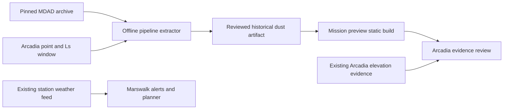

# Return Window historical dust context

> **Update 15 Nov 2026:** the team approved a validated dust outlook model for the Explore region panel (`pipeline/src/return_window_pipeline/dust/`, see the pipeline README). It compares a regional conditional estimate with seasonal climatology on held-out Mars years. The fixed-point historical count below is a separate query with its own coverage checks. The regional model needs archive and science review before bundling numbers in Explore.

**GO for a P2 historical context feature after the Arcadia elevation demo passes offline. The weather prediction model remains out of scope.** Yumeth owns extraction, evidence packaging, and the PR. Isath owns placement and wording review. The release owner signs off on the pinned source, release artifact, and offline replay.

This plan targets Arcadia Planitia (`03`) and its existing advisory workflow. It was checked against repository snapshot `a6f4b42435e40bd056a718cbf00876b32f382dfa`, which includes the Marswalk weather feed. Arcadia dust masks have yet to be extracted. No local count, usable-year total, or release readiness is asserted. [Repository snapshot](https://github.com/AbhimanthaW/Periapsis/commit/a6f4b42435e40bd056a718cbf00876b32f382dfa) · [Arcadia handoff](https://github.com/AbhimanthaW/Periapsis/tree/a6f4b42435e40bd056a718cbf00876b32f382dfa/pipeline/evidence/arcadia-planitia)

## Product outcome

The user opens the Arcadia evidence review and sees how often a mapped dust storm overlapped the reference point during a fixed historical season. The panel explains the season, the archive years used, and the gaps in coverage. Its purpose is to explain historical exposure and flag where better monitoring would be useful. EVA clearance, sol selection, route scoring, science method eligibility, solar credit, and walkback retain their existing inputs.

Use the centre of the reviewed Arcadia query polygon, 49.02° N and 171.85° W (188.15° E), in the shared coordinate convention. Confirm the source longitude domain, axis order, latitude convention and registration before looking up the pixel. The location is a reference point for a mapped grid pixel. The published 0.1° grid spacing describes the sampling grid. Effective storm-boundary precision and conditions along a particular traverse remain unqualified. [Arcadia query](https://github.com/AbhimanthaW/Periapsis/blob/a6f4b42435e40bd056a718cbf00876b32f382dfa/pipeline/evidence/arcadia-planitia/evidence-query.json) · [MDAD methods](https://doi.org/10.1016/j.icarus.2023.115567)

## System integration

| Surface | Implementation |
|---|---|
| Pipeline | Add an explicit offline extraction command in `pipeline/`, with NetCDF support confined to its build environment. Reuse existing coordinate helpers where their conventions match. Read pinned files from an external cache. Emit one deterministic JSON summary and a review receipt. |
| Arcadia evidence | Key the artifact to the canonical region ID, reference point, and scenario ID. Use the same Arcadia context as the elevation advisory flow. Store the dust artifact independently from `evidence.json` and the elevation resolver so the two checks can evolve independently. |
| Browser | Render one card in the Arcadia advisory evidence view through a typed loader. If the Arcadia handoff view is still under development, agree on the shared region identity and mount the card when that view lands. Explore can link to the evidence card from the existing Arcadia scenario. Gate the card on the active context and discard previous display state on context changes. |
| Static hosting and offline | Package the reviewed JSON as a build-time import or local asset in `web/mission-preview`. Verify that it is present in `dist/client` or in the emitted client bundle. Use the same packaged bytes for hosted and loopback builds. Raw archives and NetCDF readers belong in the build workflow. |
| Planning runtime | Keep this summary outside `WeatherFeed`, `MissionState`, `POST /api/v1/plan`, site packs and the elevation evidence resolver. The current feed is for timestamped observed or forecast messages and has alert and planning semantics. A seasonal count cannot satisfy that contract. Leave the existing API and Sites worker compatible with current callers. |

If a later consumer requires a runtime endpoint, serve the same validated artifact through a separately versioned read-only context contract. Keep the static path for offline builds and share the schema across consumers. The MVP has no dependency on a new endpoint, active weather service, or Arcadia mission-site registration. [Marswalk weather contract](https://github.com/AbhimanthaW/Periapsis/blob/a6f4b42435e40bd056a718cbf00876b32f382dfa/runtime/marswalk/weather.py) · [Planning API](https://github.com/AbhimanthaW/Periapsis/blob/a6f4b42435e40bd056a718cbf00876b32f382dfa/runtime/planning_api.py) · [Preview build](https://github.com/AbhimanthaW/Periapsis/blob/a6f4b42435e40bd056a718cbf00876b32f382dfa/web/mission-preview/vite.config.mjs)

## Extraction and counting

1. **Freeze the query.** Review the reference point and one season window with the team before inspecting counts. Record solar longitude in degrees and use a half-open interval `[start, end)` within one Mars year for v1. The season window is a configuration value still to be chosen. A different point, window, or coverage rule produces a new artifact ID.
2. **Pin the inputs.** Use MDAD v1.1, DOI `10.5281/zenodo.7480334`, MY 28–32. Verify archive checksums against Zenodo and record the input filenames and digests. Inspect the official reader and source metadata for axes and the time array. Read the target pixel's time series from each file. Only the compact derived artifact ships. [MDAD archive and reader](https://zenodo.org/records/7480334)
3. **Align by season.** Use the published mean solar longitude to select records and the documented sol-of-year metadata to assign observations to Mars sols. Check time units and compare selected records with the supplied day list. Group multiple observations of the same sol and count that sol once. Flag invalid or ambiguous timestamps. Show actual usable coverage by year because the first and last years are partial and the source has gaps.
4. **Classify sampled sols.** A documented storm-member value is a hit. Zero is a valid observation with no mapped storm. Value 255 and omitted source records are missing. Reject unexpected values. If multiple valid records fall in a sol, any hit wins and the evidence receipt retains the contributing records.
5. **Apply a predeclared coverage rule.** For the initial implementation, propose at least **80% of expected sols** with a valid point observation and at least **three qualifying years** before showing a headline count. Review these thresholds before extraction. They govern display completeness. Determine expected calendar sols from the frozen season using a pinned Mars calendar conversion or verified per-year calendar table independent of observed rows. If expected coverage cannot be established, show insufficient coverage. For each qualifying year, record a hit if any sampled sol hit and otherwise record no mapped overlap in the observations. Show detections in excluded years in the evidence details. Count only qualifying years in both the numerator and denominator.
6. **Check sensitivity.** Report the per-year counts and how the summary changes when each qualifying year is removed. In the review receipt, also compare plausible stricter and looser completeness thresholds. If the headline depends on one year or on the threshold, show the year details without presenting a stable seasonal pattern. A binary historical count does not require training or holdout forecast validation.

## Data contract and rendering

Define a small JSON Schema for the artifact, validate it in pipeline CI, and use matching browser types and boundary checks. Treat these fields as the v1 contract:

| Field | Required content |
|---|---|
| `schema_version`, `artifact_id`, `classification` | Version 1, stable release identifier, and `historical_observation_summary`. |
| `context` | Region ID, scenario ID, normalized reference point, coordinate convention, sampled grid point or pixel index, and `ls_start_deg` / `ls_end_deg`. |
| `source` and `method` | DOI, dataset version, archive digests, extraction method version, temporal alignment, sampling rule, minimum per-year coverage and minimum usable-year count. |
| `years` | One row per archive year with expected, valid, missing and hit-sol counts, coverage fraction, and inclusion status or exclusion reason. Keep source record IDs and checksums in the review receipt. |
| `summary` | Derived hit and usable year counts and status `available` or `insufficient_coverage`. Recompute totals during validation. |

Reject unsupported schema versions, mismatched region or scenario IDs, duplicate years, invalid coordinates or season bounds, and contradictory counts. Handle a missing artifact separately from a valid artifact with insufficient coverage. Both cases leave the evidence view and planner usable.

**Display when qualified:** “Historical dust activity · A mapped storm overlapped this location in **k of n usable Mars years** during **Ls [start]–[end]°**.” The details show the archive years included and excluded, sampling completeness, and the source link. For k = 0, say “No mapped overlap in the usable observations.” For insufficient coverage, show “Insufficient historical coverage for this location and season.” Avoid a risk score, red/green safety cue, or day-level prediction.

## Verification and release

1. **Pipeline tests.** Cover axis order and east/west conversion, time alignment, repeated records, true zero, missing pixel, omitted sol, partial boundary years, excluded-year hits, minimum coverage, malformed input, and deterministic output. Use small controlled fixtures for these branches. Compare representative real entries against the published reader or the source masks, including a missing case. If the frozen query has no positive case, use a separate control pixel to check positive decoding. Preserve the exact frozen query for the release result.
2. **Contract tests.** Validate schema and semantic consistency, then verify the packaged artifact matches the reviewed output by digest. Confirm the browser shows valid zero, insufficient coverage, absent and mismatched artifacts, and clears the card when switching away from Arcadia. Keep generated files outside the read-only `documentation/` tree.
3. **Integration regressions.** Run the preview build, UI suite, and runtime mission and weather regressions. Verify that the same plan request yields the same route, reserve, walkback, weather assessments and solar behavior with the card present or absent. Verify that Arcadia elevation recommendations and Science Tasks advisory behavior pass their existing checks.
4. **Offline acceptance.** Build from provisioned dependencies and serve the built client locally. Use a fresh browser profile with external requests blocked, replay Explore → Arcadia evidence → historical dust details, and confirm local assets load. Repeat on a disconnected second machine before claiming packaged offline acceptance.
5. **Release decision.** Merge only after the elevation demo is usable offline and the PR contains the source manifest, exact query, count receipt, test results, and offline replay evidence. Ship a numerical result only if the coverage and review gates pass. Use the unavailable display or omit the card if the artifact cannot be qualified in time.

**Build order:** Agree on the shared Arcadia context and season → verify one source file end to end → extract all five archive years → review the artifact → wire the card → run regressions and offline replay. Forecasts, tactical dust thresholds, and environment feedback into planning require their own product and validation work.
