# Return Window: flowcharts for the technical paper

Companion figures for *Return Window: Scientific evidence and return planning for a Mars EVA* (Team Periapsis, 15 November 2026).

Every chart was drawn from the code at `main@aa5537a`, the baseline the paper audits, and each one names the paper section and the source files it follows. Constants shown are the values in the code. Where the paper's wording and the code differ, the chart follows the code and the difference is listed in [Validation notes](#validation-notes).

Charts are Mermaid and render on GitHub.

| # | Chart | Paper section |
|---|---|---|
| 1 | [Two-decision workflow](#1-two-decision-workflow) | Decision and experimental design |
| 2 | [Evidence check and refusal](#2-evidence-check-and-refusal) | Arcadia Planitia: evidence and refusal |
| 3 | [Documentation score](#3-documentation-score) | Planetary data: documentation model |
| 4 | [Deterministic science ranking](#4-deterministic-science-ranking) | Planetary data: deterministic science ranking |
| 5 | [Terrain graph and edge cost](#5-terrain-graph-and-edge-cost) | Local mobility: terrain graph, walking, rover |
| 6 | [Search and selection](#6-search-and-selection) | Local mobility: search and selection |
| 7 | [Rover battery ledger and walkback](#7-rover-battery-ledger-and-walkback) | Local mobility: rover, search and selection |
| 8 | [Weather and moving hazards](#8-weather-and-moving-hazards) | Local mobility: weather and moving hazards |
| 9 | [Crew cost](#9-crew-cost) | Crew cost: human cost |
| 10 | [Trade-off envelope](#10-trade-off-envelope) | Crew cost: trade-off envelope |
| 11 | [Closure experiment](#11-closure-experiment) | Crew cost: closure experiment |
| 12 | [Station forecast](#12-station-forecast) | Weather models: station forecasts |
| 13 | [Regional dust outlook](#13-regional-dust-outlook) | Weather models: regional dust outlook |

---

## 1. Two-decision workflow

The paper's central claim: choose an observation the evidence supports, then compare routes against a return budget. The two decisions never share a score.

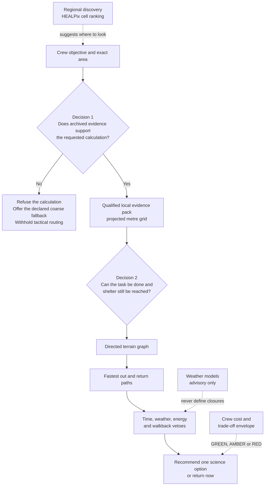

Arcadia Planitia stops at the refusal. The closure experiment in chart 11 runs decision 2 on a separate synthetic grid.

---

## 2. Evidence check and refusal

Sources: `pipeline/evidence/arcadia-planitia/`, `documentation/marsdoc/engine.py`, `runtime/marswalk/site.py`.

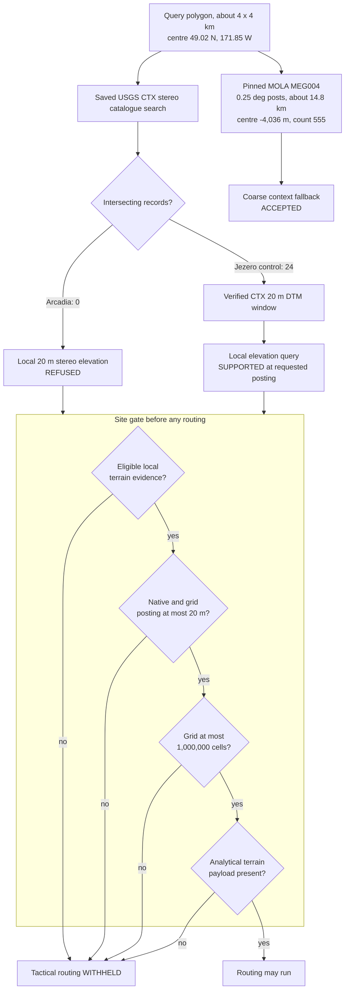

A catalogue count is not a coverage claim. Passing the posting test does not establish effective resolution, obstacle clearance or route safety.

---

## 3. Documentation score

Source: `documentation/marsdoc/engine.py`, policy in `documentation/marsdoc/scoring-v1.json`.

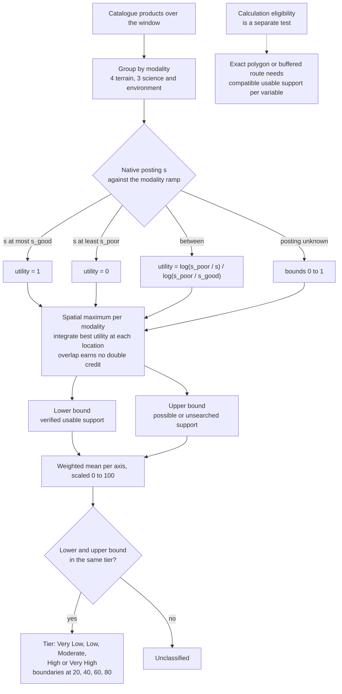

---

## 4. Deterministic science ranking

Sources: `ranking/lexicon.py`, `ranking/build.py`, `ranking/engine.py`, `ranking/risk.py`.

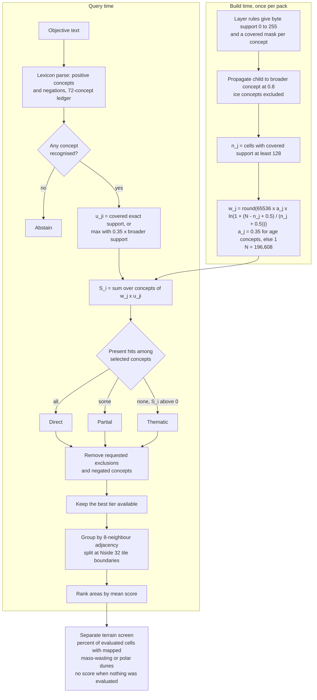

Present, weak, absent and unreported or unevaluated stay distinct states. Record counts and method compatibility do not enter `S_i`.

---

## 5. Terrain graph and edge cost

Sources: `runtime/marswalk/traversability.py`, `routing.py`, `mobility.py`, `rover.py`.

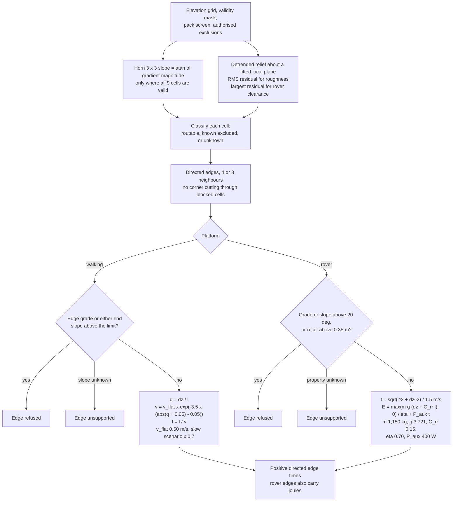

Uphill and downhill costs differ, so the graph is directed. Worked example: a 5 m edge rising 0.5 m takes 14.19 s uphill and 10.00 s in reverse. Downhill rover work earns no regeneration.

---

## 6. Search and selection

Sources: `runtime/marswalk/plan.py`, `optimization.py`, `resources.py`.

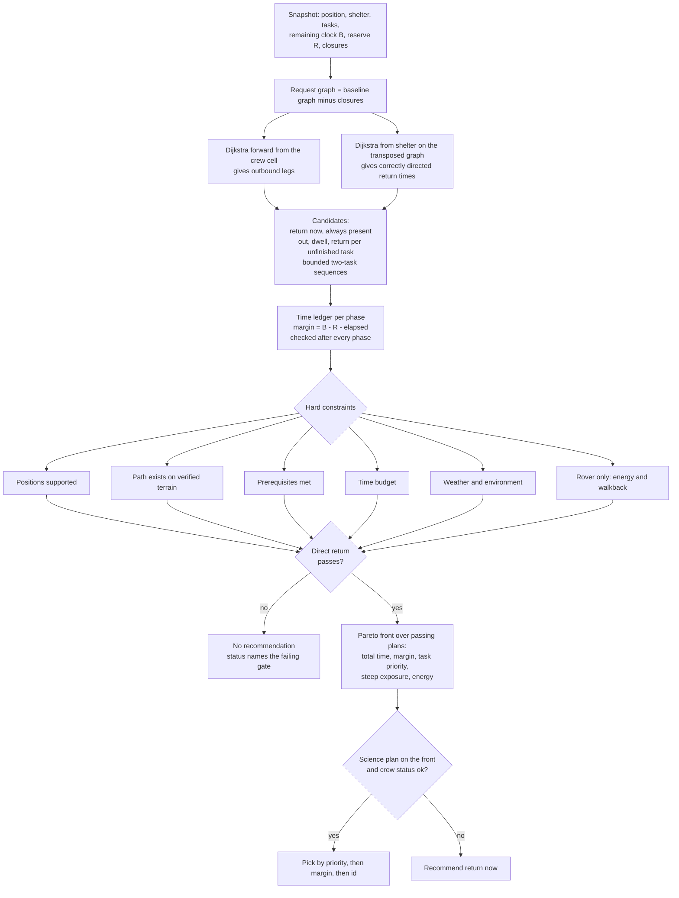

An unknown required value blocks a plan; it is never defaulted. A rejected candidate does not prove that every slower route fails.

---

## 7. Rover battery ledger and walkback

Sources: `runtime/marswalk/resources.py` (`energy_ledger`), `runtime/marswalk/walkback.py`.

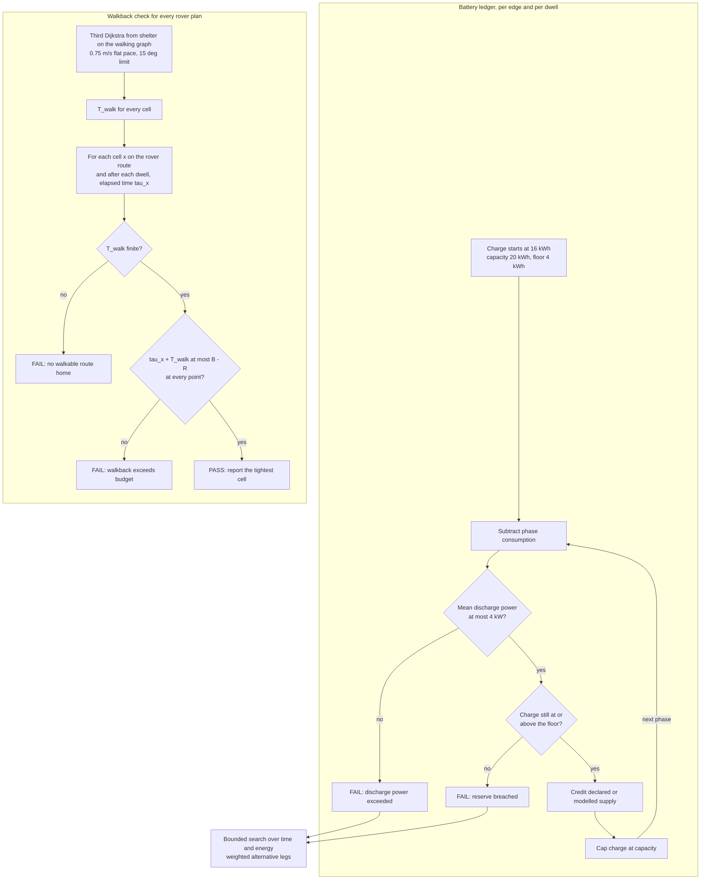

Missing consumption or supply makes the ledger unknown. High observed dust removes solar credit before the ledger runs.

---

## 8. Weather and moving hazards

Sources: `runtime/marswalk/weather.py`, `runtime/hazards/live.py`, `route.py`, `monitor.py`.

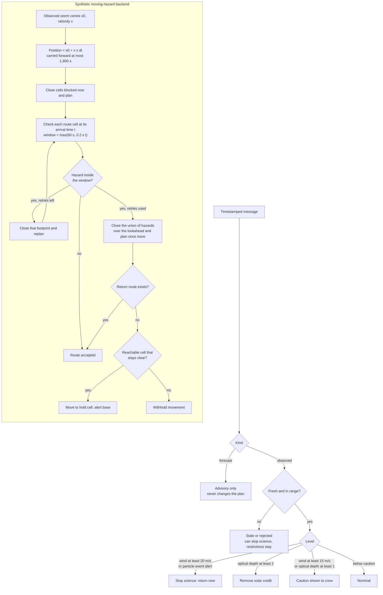

No live Mars feed is shipped. The moving-hazard backend is separate from the scripted replay in chart 11.

---

## 9. Crew cost

Source: `runtime/humancost/calculator.py`, policy in `runtime/examples/human-cost-policy.json`.

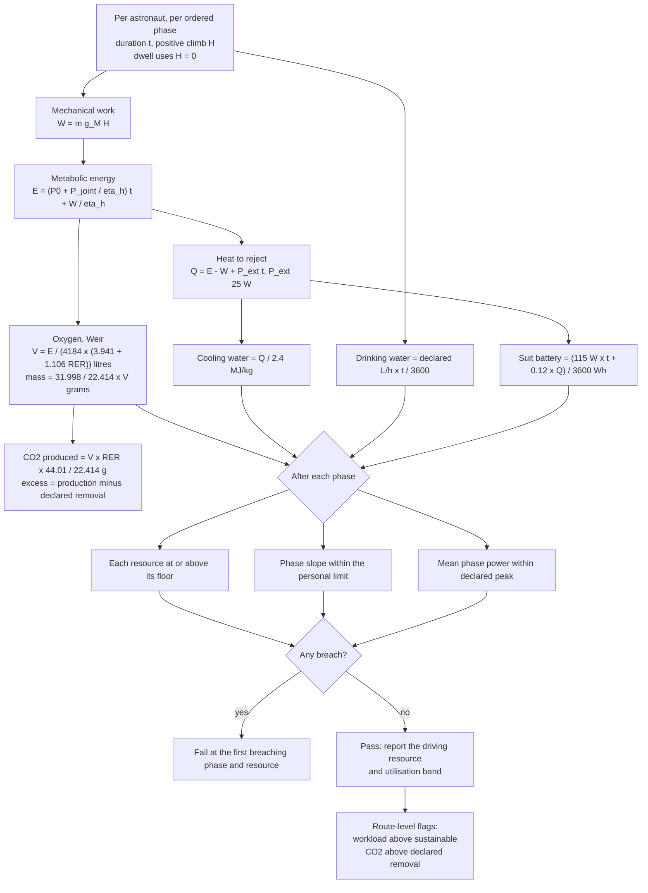

CO2 excess is a mass balance, not suit CO2 partial pressure. Heart rate, suit temperature and visibility readings are informational.

---

## 10. Trade-off envelope

Sources: `runtime/tradeoff/envelope.py`, `classify.py`, `accept.py`, `audit.py`.

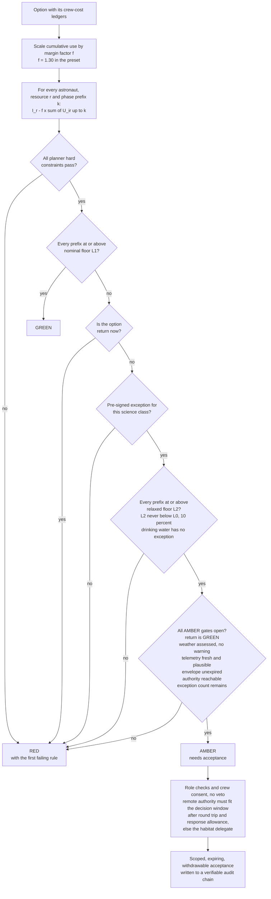

The module estimates no breach probability and approves no real EVA.

---

## 11. Closure experiment

Sources: `runtime/hazards/replay.py`, bundled data in `web/mission-preview/src/hazards/replay.json`. Synthetic 160 x 160 grid at 5 m posting. Clock starts at 5,400 s with a 900 s reserve. Path A is 436 m, path B is 834 m.

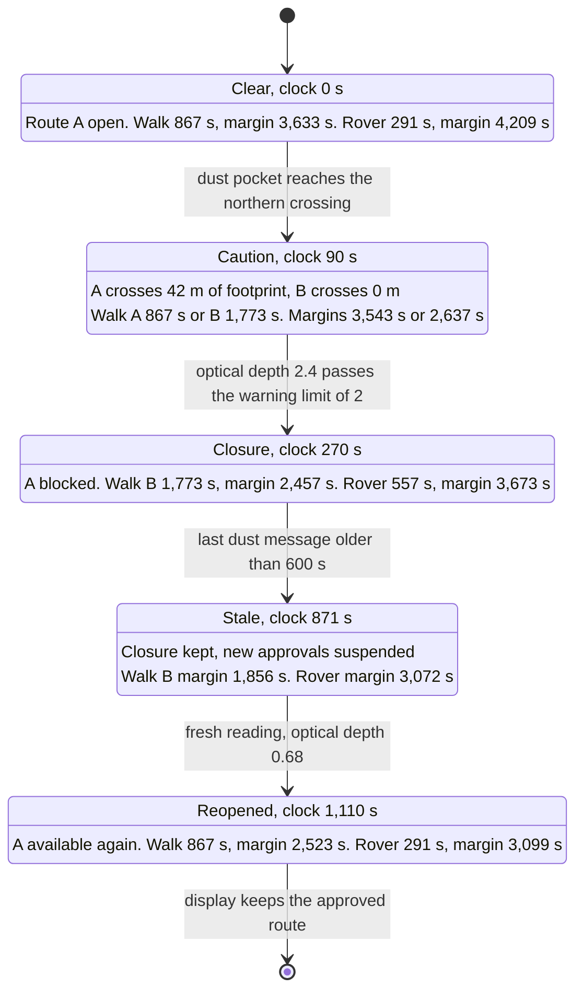

The bundle has six frames; the frame at 180 s repeats the caution state with slightly higher dust and is omitted here, as in the paper's table. Each margin is `5,400 - 900 - clock - travel`.

---

## 12. Station forecast

Sources: `pipeline/src/return_window_pipeline/forecast/model.py`, `station.py`, `marstime.py`.

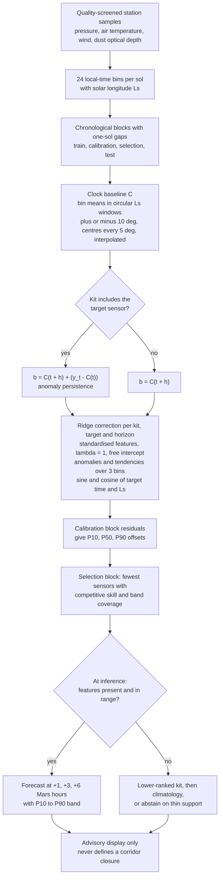

Synthetic-station result quoted in the paper: 630, 157, 103 and 157 sols by block; six-hour pressure with the barometer kit has test MAE 2.688 Pa against 2.961 Pa for the best baseline, with 83.1 percent band coverage over 3,577 bins. A Mars hour is 88,775.244 s / 24.

---

## 13. Regional dust outlook

Sources: `pipeline/src/return_window_pipeline/dust/extract.py`, `model.py`, manifest in `pipeline/evidence/mdad-v1.1/`.

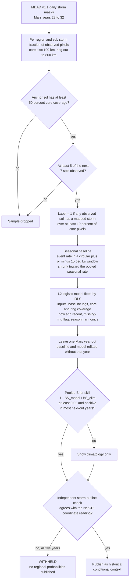

The current release takes the withheld branch. Ring features are used only when at least 30 percent of ring pixels were observed.

---

## Validation notes

The paper's equations, constants and reported numbers were checked against `main@aa5537a`. The uploaded archive is byte-identical to that commit apart from Python cache folders.

**Confirmed against the code and by independent recomputation**

- Scaled Tobler pace and the worked example (14.19 s up, 10.00 s down).
- Rover time and energy equations and every hypothetical-profile value.
- Horn slope, detrended roughness and clearance proxy, site-gate limits.
- Dijkstra on forward and transposed graphs, margin `B - R - elapsed`, Pareto objectives, selection order.
- Battery ledger order of operations and the walkback inequality with 0.75 m/s and 15 degrees.
- Weather thresholds, 1,800 s extrapolation, `max(60 s, 0.2t)` window.
- Crew-cost equations including the Weir conversion and all four consumables.
- Envelope prefix inequality, margin factor 1.30, L0 at 10 percent.
- All ten closure-table values regenerate from the runtime and match a by-hand re-timing of both paths.
- HEALPix count and cell area, IDF weight formula, 0.35 age multiplier, 128 of 255 threshold, 72 concepts.
- Documentation utility ramp, forecast baseline and ridge setup, dust label and release gate.
- All quoted data values: Arcadia MOLA sample, catalogue counts 0 and 24, MEDA sol 36, Horizons light-time, RAD dose rate, synthetic forecast metrics.

**Differences between the paper and the code**

| # | Paper says | Code does | Suggested fix |
|---|---|---|---|
| 1 | One symbol `g_M`, given as 3.721 m/s2 in the rover paragraph and reused in the crew-cost equation | Rover uses 3.721 (`runtime/marswalk/rover.py`). Crew cost and the EVA context fixture use 3.71 (`human-cost-policy.json`, `scenario-v1.json`) | State both values, or align the policy files to 3.721. The effect on crew work is 0.3 percent |
| 2 | `u_ji` is exact covered support, or the larger of it and 35 percent of broader support | Also true, but the stored support already includes a build-time step that lifts each broader concept to 0.8 of its child, sedimentary to 0.6 of polar deposits, and sets habitability to the smaller of water and age support (`ranking/build.py`, `propagate`). `n_j` is counted after this step | Add one sentence on build-time propagation |
| 3 | Clock baseline uses plus or minus 10 degree Ls windows | Same, and it widens to 20 degrees, 40 degrees, then an all-season mean when a window has too few samples (`forecast/model.py`, `Climatology`) | Mention the fallback |
| 4 | Areas are ranked by mean score | Integer floor of the mean, ties broken by cell count then lowest cell index | Optional footnote for reproducibility |

None of these changes a number reported in the paper.

**Not reproduced here**

The paper's test counts (574 passed and 10 skipped, 28 ranking tests, 12 branch tests) could not be re-run in full: the check environment lacked `shapely`, `pyproj`, `affine` and the ranking input assets. Of the tests that could be collected, 355 passed, and every failure was a missing-package import. The `feature/final-routing-integration@2dd7388` branch was not examined.
