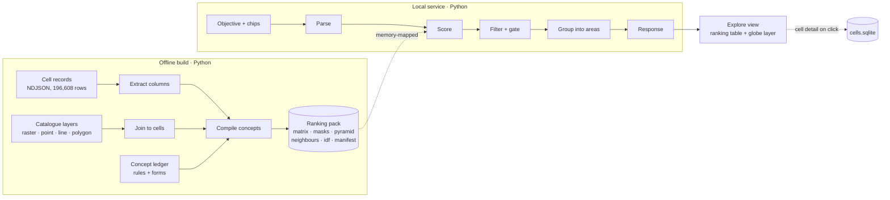
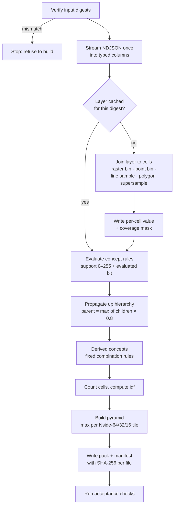
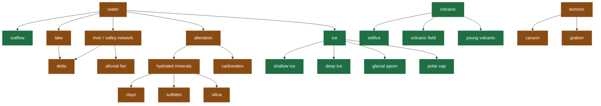
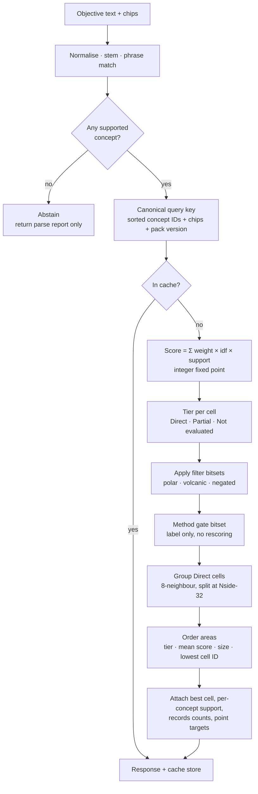
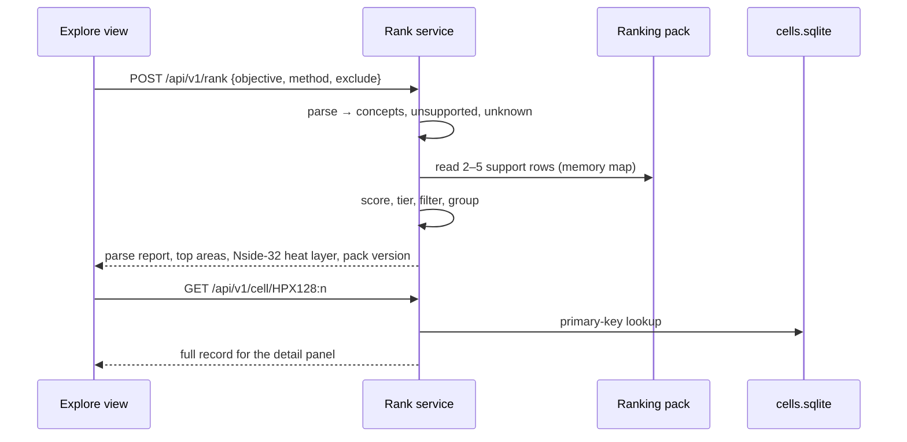
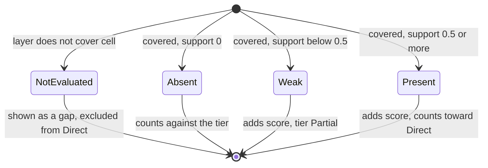
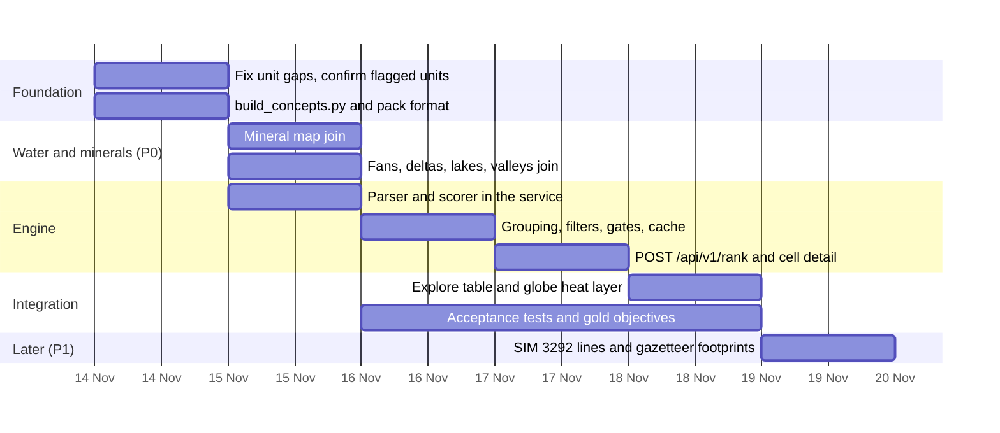

# Build plan: cell-ranking model

**Periapsis · Workstream B · 14 November 2026, Colombo**

**Verdict.** Build the ranker as an offline compiler plus a small query engine in the local Python service. The compiler turns cell records and catalogue layers into one 6–10 MB concept matrix. The engine answers an objective with a few array operations. Measured on the real 196,608 cells, one core: scoring takes 0.3 ms, tile aggregation 0.6 ms and grouping 6.5 ms, so a full answer is about 10 ms before caching. Thirteen missing layers unlock the concepts that have no data today. Eight have a download source. Five need dummy data until a file is obtained.

**Decisions taken.** Polar exclusion at 60° is accepted. Areas are Nside-32 tiles, about 108 km across. Water and mineral layers will be joined.

[Implementation prompt](IMPLEMENTATION-PROMPT.md) · [Cell plan and profile](PLAN-CELLS.md) · [Concept ledger](cell-concepts-v1-draft.json) · [Benchmark](cell-profile/bench.py)

## 1. The data that should be there

> **Update, 14 Nov afternoon.** Release `mars-cell-map-v0.2.0` already joins layers 2, 3, 6, 7, 8, 9 and 10, plus the NASA PDS hydrated-mineral sites. MOCAAS returned HTTP 410, so mineral classes are demo for now. The [implementation prompt](IMPLEMENTATION-PROMPT.md) carries the current status and supersedes this table where they differ.

The 31 unsupported concepts fall into thirteen missing layers. Status is **Source** when a download page was found, and **Dummy** when only a paper was found or nothing was found. Sources were located by web search on 14 November. None has been downloaded or licence-checked yet.

| # | Missing layer | Concepts it unlocks | Status | Source | Join | Priority |
| --- | --- | --- | --- | --- | --- | --- |
| 1 | Aqueous mineral map with classes | clays, sulfates, carbonates, silica, hydrated minerals, alteration, mineralogy | Source | [MOCAAS](https://www.ias.u-psud.fr/moccas/) database and GeoTIFFs, Carter et al. 2023 | Pixel bin, fraction per class | P0 |
| 2 | Paleolakes | lake | Source | [Goudge catalog of open- and closed-basin lakes](https://www.jsg.utexas.edu/goudge/shared-data/), CSV and shapefile | Point in cell | P0 |
| 3 | Chlorides | chlorides | Source | [Leask and Ehlmann 2021 CSV](https://data.caltech.edu/records/kasms-vp209) of the Osterloo 2010 deposits. [Bickel et al. 2024](https://doi.org/10.1038/s41597-024-03685-3) candidates as a second layer | Point in cell | P0 |
| 4 | Deltas and alluvial fans | delta, alluvial fan | **Dummy** | Paper only: Wilson et al. 2021, [doi:10.1029/2020GL091653](https://doi.org/10.1029/2020GL091653). Check its supporting table for coordinates | Point in cell | P0 |
| 5 | Valley networks | river, valley network | **Dummy** | Paper only: Hynek et al. 2010, [doi:10.1029/2009JE003548](https://doi.org/10.1029/2009JE003548). No download page found | Line length per cell | P0 |
| 6 | Structure lines | tectonic, graben, channels, ridges | Source | [SIM 3292 database ZIP](https://pubs.usgs.gov/publication/sim3292), 790 MB, same package as the unit polygons | Line length per cell | P1 |
| 7 | Named-feature footprints | chaos, canyon, fossae, named context | Source | [IAU/USGS Gazetteer](https://planetarynames.wr.usgs.gov/Nomenclature) Mars shapefile with centre and diameter | Disc overlap | P1 |
| 8 | Dune fields | dunes, aeolian | Source | [USGS Mars Global Digital Dune Database](https://www.usgs.gov/centers/astrogeology-science-center/science/mars-global-digital-dune-database), polygons | Polygon fraction | P1 |
| 9 | Cave candidates | lava tube, cave | Source | [Mars Global Cave Candidate Catalog](https://catalog.data.gov/dataset/mars-global-cave-candidate-catalog-archive-bundle-8a257), NASA PDS | Point in cell | P2 |
| 10 | Marsquakes | seismic | Source | [IRIS mars-event service](https://services.iris.edu/irisws/mars-event/docs/1/help), InSight Marsquake Service catalogue. Few events have locations | Point in cell | P2 |
| 11 | Mid-latitude glacial landforms | glacial, periglacial | **Dummy** | Paper only: Levy et al. 2014, [doi:10.1002/2014JE004685](https://doi.org/10.1002/2014JE004685). The SWIM and apron-unit concepts already cover part of this | Polygon fraction | P2 |
| 12 | Crustal magnetism | magnetism | **Dummy** | Paper only: Langlais et al. 2019, [doi:10.1029/2018JE005854](https://doi.org/10.1029/2018JE005854). Model needs evaluation to a grid | Raster sample | P2 |
| 13 | Olivine | olivine | **Dummy** | No source searched or found | Raster sample | P2 |

**Dummy-data rule.** A dummy layer exists only so the pipeline, API and Explore view can be built and tested end to end.

- Generate it from a fixed seed and record `"synthetic": true` with the seed in the layer receipt and the pack manifest.
- Use it for plumbing tests only. A concept backed by a dummy layer is labelled **DEMO** in every response and in the table.
- Never mix it into a ranking that is presented as a Mars result. The service refuses to build a release pack while any synthetic layer is present.
- Replace it with the real file as soon as one is pinned. The concept rule and thresholds stay the same.

Three record problems also need fixing in the existing build:

- **240 cells have no geologic unit.** The centroid misses every polygon. Use a nearest-polygon tolerance.
- **Every join is a centroid sample.** A 10 km delta inside a 27 km cell is missed unless the centroid lands on it. New layers must use overlap, not centroid containment.
- **The documentation tiers are all Unclassified.** The Records column will use product counts until `marsdoc` publishes real tiers.

Habitability, stratigraphy, sedimentary, hydrothermal, climate and ocean are interpretations. They get no layer. Where a defensible rule exists, they become **derived concepts** (section 4).

## 2. System overview

The pack is the only thing the service loads. Rebuilding it is the only way a ranking changes.

## 3. Offline build

**Join methods by layer type.**

| Layer type | Method | Output per cell | Why |
| --- | --- | --- | --- |
| Raster finer than a cell (MOCAAS, 100–500 m) | Convert each pixel centre to a nested index, then `bincount` per class | Fraction of pixels per class, plus pixels observed | One vector pass, exact area share |
| Raster coarser than a cell (TES, SWIM) | Containing native pixel, as today | Value, plus nodata mask | Already done in the records |
| Points (deltas, lakes, quakes) | Nested index of each point, `bincount` | Count | Constant time per point |
| Lines (valleys, faults) | Resample every 5 km, bin the samples | Length in km | No geometry clipping needed |
| Polygons (geologic units, footprints) | Test the 64 Nside-1024 child centres of each cell with an STR-tree | Fraction covered | Replaces the centroid-only test |

**From layer value to support.** Each rule maps a value to 0–1 with two reviewed thresholds, linear in between.

| Concept | Layer value | Support 0 at | Support 1 at |
| --- | --- | --- | --- |
| ice | SWIM consistency | 0 | 0.5 |
| rocky surface | thermal inertia | 350 | 500 |
| clays, sulfates, carbonates, silica | mineral-class area fraction | 0 | to be set from the layer's percentiles |
| delta, fan, lake | count in cell | 0 | 1 |
| valley network | length in cell | 0 km | 27 km (one cell width) |
| unit-based concepts | area fraction of the unit | 0 | 0.5 |

**The pack.**

| File | Shape and type | Size | Purpose |
| --- | --- | --- | --- |
| `support.npy` | concepts × 196,608, `uint8` | 6.3 MB at 32 concepts | Graded support |
| `evaluated.bits` | concepts × 24,576 bytes | 0.8 MB | Layer covered this cell |
| `pyramid.npz` | max per tile at Nside 64, 32, 16 | 2 MB | Upper bounds and globe layer |
| `neighbours.npy` | 196,608 × 8, `int32` | 6.3 MB | Exact HEALPix neighbours |
| `filters.bits` | polar, volcanic, sparse, method gates | under 0.2 MB | Chips |
| `records.npy` | CTX, HiRISE, DTM, CRISM counts | 1 MB | Records column |
| `lexicon.json`, `idf.json`, `manifest.json` | text | small | Forms, weights, digests, version |

## 4. Concepts

Green concepts have data today. Brown ones arrive with layers 1–7. A parent's support is the maximum of its children's support times 0.8, computed at build time, so a *water* query needs one row at query time.

**Derived concepts (fixed rules, flagged for review).**

| Concept | Rule | Reason |
| --- | --- | --- |
| sedimentary record | max of delta, fan, lake, layered | These are deposits by definition |
| habitability | minimum of water-evidence support (delta, lake or alteration) and Noachian-or-Hesperian support | Requires both water evidence and age, so one cannot stand in for the other |
| sample-rock gate | rocky support above 0, or thermal inertia measured and not dust-mantled | Access to rock, not science value |

Climate, ocean, stratigraphy and hydrothermal stay unsupported. No defensible rule exists from these layers.

## 5. Query engine

**Scoring rules.**

- `Match(cell) = Σ weight(q) · idf(q) · support(q, cell) / 255`. Age concepts weigh 0.35, the rest 1.0.
- `idf(q) = ln(1 + (N − n + 0.5) / (n + 0.5))`, where `n` counts cells with support of at least 0.5. Cells are equal-area, so rarity is area.
- **Direct** needs support of at least 0.5 on every supported concept. **Partial** has some. **Not evaluated** means a needed layer does not cover the cell. It is never scored zero.
- Unsupported words are returned as *no cell data yet*. Unknown words are returned as *not understood*.

**Layer states.** Every cell and concept pair is in exactly one state.

**Response shape.**

| Field | Content |
| --- | --- |
| `parse` | concepts with idf, negated, unsupported, unknown, confidence |
| `areas[]` | tile ID, cell count, tier, mean and best Match, best cell, per-concept support, records counts, method label |
| `heat` | 12,288 bytes, max Match per Nside-32 tile, for the globe |
| `excluded` | counts per reason |
| `version` | pack digest, ledger version, input digests |

## 6. Optimization and efficiency methods

Timings are from `cell-profile/bench.py` on the real records, one core, NumPy.

| # | Method | Where | Effect |
| --- | --- | --- | --- |
| 1 | Precompute everything that does not depend on the query | Build | Query touches 2–5 rows, never the 543 MB of records |
| 2 | Dense `uint8` matrix in nested order instead of posting lists | Pack | 6.3 MB for 32 concepts. No decoding, cache-friendly |
| 3 | Memory-map the pack | Service | Start-up in milliseconds, pages shared across workers |
| 4 | Integer fixed-point scoring | Score | 0.28 ms for 3 concepts, 0.8 ms for 8. Identical bytes on every machine |
| 5 | Hierarchy folded in at build time | Build | A parent concept costs one row, not a tree walk |
| 6 | Bitsets for filters, gates and coverage | Filter | 24.6 KB each. An AND takes about 1 µs |
| 7 | Tile aggregation by reshape | Group | Nested order makes a tile 16 consecutive cells. 0.57 ms for all 12,288 tiles |
| 8 | Max-pyramid upper bounds | Score | Score only tiles that can reach the top. 0.06 ms against 0.28 ms. Use when top-k is small |
| 9 | Grouping only over Direct cells with the stored neighbour table | Group | 6.5 ms for 19,482 cells into 3,573 areas |
| 10 | Partial sort for top-k | Rank | Avoids a full sort of 196,608 scores |
| 11 | Canonical query key and LRU cache | Service | Different wordings of one objective hit the same entry |
| 12 | Phrase trie compiled once | Parse | Linear in objective length |
| 13 | Areas and a 12 KB heat layer in the response, not cells | Response | Small payload. Cell detail is fetched on click |
| 14 | Detail by primary key from the existing `cells.sqlite` | Service | No record parsing at query time |
| 15 | Single streaming pass over NDJSON into typed columns | Build | Seconds, constant memory |
| 16 | `bincount` joins for rasters, points and line samples | Build | No per-feature geometry tests |
| 17 | STR-tree and 64 sub-samples per cell for polygons | Build | Area fractions instead of centroid hits |
| 18 | Content-addressed layer cache keyed by source digest and rule version | Build | Adding one layer rebuilds one layer |
| 19 | Deterministic ordering with cell ID as the last tie-break | Rank | Same input gives the same bytes |
| 20 | Pack version in every response and cache key | Service | A rebuilt pack can never serve stale results |

**Cost summary.**

| Stage | Complexity | Measured |
| --- | --- | --- |
| Parse | O(words) | under 0.1 ms |
| Score | O(concepts × N) | 0.3–0.8 ms |
| Tier and filter | O(concepts × N / 8) on bitsets | under 0.1 ms |
| Tile aggregate | O(N) | 0.6 ms |
| Group | O(Direct cells × 8) | 6.5 ms |
| Top-k | O(N) | 0.03 ms on tiles |
| **Total, uncached** | | **about 10 ms** |
| Repeat query | O(1) cache hit | microseconds |

Not worth doing at this size: GPU, a vector database, sparse posting compression, or a compiled extension. The whole matrix fits in the CPU cache several times over.

## 7. Schedule

| Step | Deliverable | Done when |
| --- | --- | --- |
| 1 | `build_concepts.py`, pack format, manifest | Pack rebuilds byte-identically from pinned inputs |
| 2 | Layers 1–5 joined with coverage masks (4 and 5 as dummy until files arrive) | Each layer has a receipt with counts and digests |
| 3 | Ledger v2 with the new concepts and thresholds | Every concept has a rule, a cell count and a status |
| 4 | Query engine and endpoint | *ancient water and delta deposits* returns Direct areas with deltas in Noachian terrain |
| 5 | Explore integration | Table, parse report and heat layer render from one response |
| 6 | Tests | All checks in section 8 pass in CI |

## 8. Acceptance checks

| Check | Pass condition |
| --- | --- |
| Input integrity | Build refuses any file whose digest differs from the manifest |
| Determinism | Two builds give identical pack digests. Shuffled input order gives identical responses |
| Known sites | Cells holding Jezero and Eberswalde are Direct for *delta*. Mawrth Vallis cells are Direct for *clays*. Arcadia cells are Direct for *shallow ice* |
| Negative controls | Olympus Mons cells are not Direct for *delta*. Polar cells report *not evaluated* for SWIM ice |
| Coverage honesty | No cell outside a layer's mask has support above zero for that layer's concepts |
| Sensitivity | Moving each threshold by ±20 % keeps at least 80 % of the top 20 areas on the gold objectives |
| Speed | Uncached query under 50 ms on the demo laptop |
| Abstention | An objective with no supported concept returns no ranking |

## 9. Risks

| Risk | Effect | Handling |
| --- | --- | --- |
| A source cannot be downloaded or licensed in time | Its concepts stay *no cell data yet* | Layers are independent. Ship what is pinned |
| Mineral map coverage is uneven | Absence is read as "no minerals" | Use the observed-pixel count as the coverage mask |
| Catalogues are biased to well-imaged areas | Well-studied sites rank first | Show the Records column beside Match and offer the less-documented sort |
| Thresholds are judgment calls | Rankings shift with a threshold | Sensitivity check, thresholds in the ledger, version in every response |
| Glacial and mass-wasting unit readings are unconfirmed | Wrong concept on about 2,300 cells | Confirm against the SIM 3292 unit text before release |

## Sources

- Carter et al., *A Mars orbital catalog of aqueous alteration signatures (MOCAAS)*, Icarus 389, 2023, [doi:10.1016/j.icarus.2022.115164](https://doi.org/10.1016/j.icarus.2022.115164) · [project page](https://www.ias.u-psud.fr/moccas/)
- Wilson et al., *The Global Distribution of Craters With Alluvial Fans and Deltas on Mars*, GRL, 2021, [doi:10.1029/2020GL091653](https://doi.org/10.1029/2020GL091653)
- Hynek, Beach and Hoke, *Updated global map of Martian valley networks*, JGR 115, 2010, [doi:10.1029/2009JE003548](https://doi.org/10.1029/2009JE003548)
- Tanaka et al., *Geologic Map of Mars*, USGS SIM 3292, 2014, [doi:10.3133/sim3292](https://doi.org/10.3133/sim3292)
