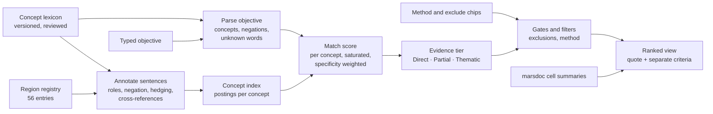

# Objective-driven region ranking

> **Scope update, 14 Nov.** The 56-region registry is retired. The ranked units are now the 196,608 documented HEALPix cells. See the [cell-ranking plan](PLAN-CELLS.md). The model below still applies, and the 56-region results remain prototype evidence.

**Periapsis · Workstream B · Design proposal · 14 November 2026, Colombo**

**Verdict.** Rank regions against a typed objective with a reviewed concept vocabulary, a rule-based objective parser and a fielded relevance score computed on concepts. Show science interest, documentation and traversal as separate criteria and never add them together. The same vocabulary can also score the 196,608 HEALPix cells through structured layers. A standard-library prototype runs on the current 56-region registry. It puts Jezero, Icaria Planum and Margaritifer Terra first for *ancient water and delta deposits*, stays deterministic across input orders, and keeps the same top region on six benchmark objectives under ±20 % changes to any parameter. The lexicon and weights are drafts. Isath must review them before any ranking is shown as a team result.

This document implements the `rank-regions` node of the [Data Pipeline architecture](../../web/src/pipeline-data.ts) and the science screening model in the [Scientific Model Design Review](../../reference/architecture/scientific-model-design-review.md). It does not change route costs, pack contracts or the documentation engine.

[Prototype](prototype/rank_regions.py) · [Draft lexicon](prototype/lexicon-v0.json) · [Evaluation](prototype/evaluate.py) · [Tests](prototype/test_prototype.py)

## Constraints already fixed by the architecture

- `rank-regions` consumes separate availability, scientific-value and suitability records. The architecture supplies no default weights and requires that unknown values are never replaced with zero. A new rubric means a new ranking revision.
- A region ranking is screening context for choosing investigations. It never enters per-cell route weights.
- The Explore view states *Criteria are shown separately and never summed*. This design keeps that rule. Only the objective-match criterion is a computed relevance score.
- No language model, embedding or learned classifier. Every result must be reproducible from pinned inputs and explainable from the source text it quotes.
- There are two populations with different evidence. The **56 registry regions** have survey text and no verified boundaries. The **196,608 cells** (HEALPix nested, Nside 128) have structured documentation summaries from `marsdoc` and no text.

## What the registry data shows

Measured on `web/src/atlas/regions.json` (survey SHA-256 `aceb66ec…`, gazetteer 2026-11-08).

| Finding | Consequence for the model |
| --- | --- |
| The survey science rating is 5 for 51 regions, 4 for 3 and missing for 2. | The rating cannot rank. Objective relevance has to come from the text. |
| Each rating names its domain: “Very High *for* ancient hydrology”, “High *for* volcanology-focused missions”. | Report a science level only when its domain matches the objective. Otherwise show *Not rated for this objective*. |
| The traversal rating is missing for 54 of 56. The qualitative text is present, for example “Low–Moderate on favorable floor surfaces; High–Very High at major obstacles”. | Parse a qualitative interval and show it with *no level*, as the Explore table already does. |
| About 49,800 words in total, median 860 per region. 84 distinct field keys, including variants such as *primary operational concern*, *primary operational concerns* and *main operational concern*. | An explicit field-alias table is needed. The corpus is small, so the full index can be built in a fraction of a second. |
| The extractor puts 312 prose entries in `operations` and only 17 in `science`, yet many “operations” entries describe geology. | Assign roles per sentence with cue rules, not per section. |
| Operational words dominate raw counts even in the opportunity, POI and terrain fields: *smooth* appears in 44 regions, *walls* in 35, *steep* in 31 and *corridors* in 24. | Weight text by role. Hazard and routing text contributes nothing to the objective match. |
| Science terms differ widely in specificity. In science-role text *ancient* occurs in 41 regions, *water* or a narrower concept in 44, *delta* in 4. | Weight each concept by how rare it is across regions. A rare, specific term must outweigh a common qualifier. |
| Isidis Planitia lists “Jezero delta” as a point of interest. | Evidence that names another registry region is attributed to that region and down-weighted. |
| Vastitas Borealis has its gazetteer centre at 87.73° N. | A centre-latitude polar rule excludes the whole circumpolar plain. Exclusions need footprint fractions once AOIs exist. |
| A sentence citing *Journal of Geophysical Research: Planets* matched *geophysics*. | Consume citation venues as stop phrases before concept matching. |

## How the model works



Everything left of *Concept index* runs offline when the registry or lexicon changes. Query time only parses the objective and reads the index.

### 1. Concept lexicon: the keyword parameters

Free keywords fail in three predictable ways. Synonyms miss (*clay* and *phyllosilicate*). Scale and specificity are ignored (*delta* against *water*). Nothing explains why a region ranked. The model therefore matches **concepts**, not words. The lexicon is a small controlled vocabulary in the style of a SKOS concept scheme. Each concept has a stable ID, a facet, its surface forms, `broader` parents and optional `related` siblings.

| Facet | Role in ranking | Draft concepts |
| --- | --- | --- |
| Process | Main relevance signal | water, fluvial, lacustrine, ocean, outflow, groundwater, hydrothermal, aqueous alteration, sedimentary, stratigraphy, habitability, ice, glacial, climate, volcanic, lava, explosive volcanism, tectonic, impact, aeolian, seismic, magnetism, geophysics, mass wasting |
| Landform | Main relevance signal | delta, alluvial and sediment fans, inverted channel, chaos, layered deposits, periglacial, polar layered deposits, volcanic edifice, canyon, impact basin |
| Material | Main relevance signal | mineralogy, hydrated minerals, clays, sulfates, carbonates, chlorides, hydrated silica, olivine, early crust |
| Age | Modifier, query weight 0.35 | ancient (Noachian), Hesperian, young (Amazonian), active today |
| Setting | Filters only, no relevance | polar |

The draft has 48 concepts. Examples of the hierarchy are `delta → fluvial → water`, `delta → sedimentary`, `clays → hydrated minerals → mineralogy` and `glacial → ice`. `delta` and `fans` are related siblings. The lexicon also holds the stop words, generic words such as *deposit*, *terrain* and *history*, the negation and hedge cues, the citation stop phrases, the field roles and aliases, the method requirements and the exclusion rules. These are the model's parameters, and they live in one versioned file instead of in code.

Governance: Isath owns the lexicon. A change to a concept, form or weight increments the lexicon version, re-runs the benchmark and creates a new ranking revision. Forms come from the registry vocabulary and planetary-science usage. Forms and relations are never inferred automatically.

### 2. Objective parser

Deterministic, with no model files:

1. **Normalise.** Unicode fold to ASCII lower case while keeping character offsets, so quotes come from the original text. Dashes and apostrophes split words, so *water–rock* reads as *water rock*.
2. **Stem.** Fixed inflection rules only (*deposits → deposit*, *fossae* through an explicit form). Derivations such as *volcanism*, *volcanology* and *volcanic* are listed as forms of one concept.
3. **Match.** Leftmost-longest phrase match over a token trie, so *lineated valley fill* beats *valley*. Citation stop phrases are consumed without producing a concept.
4. **Negation.** *not*, *without*, *excluding* and similar cues bind to the **next** concept only. *not volcanic ancient lake sediments* negates *volcanic* and keeps *ancient*, *lake* and *sediment*.
5. **Report.** Return the concept set, negated concepts, setting terms, unrecognised content words and a parse confidence (recognised over all content words). The view must show what was understood and what was ignored.
6. **Abstain.** If no concept is recognised, rank nothing and say so. *purple unicorn* returns no ranking. *purple unicorn dust storms* ranks on *wind and dust* and reports *purple, unicorn* as not understood at confidence 0.33.

The method and exclude chips are structured inputs and never pass through the parser.

Example: *ancient water and delta deposits* → `age-ancient` (weight 0.35), `water`, `delta`. *deposits* is a recognised generic word and *and* is a stop word.

### 3. Evidence index

Each region is split into pieces with a **role**. A role weight says how much that kind of text counts as evidence of scientific content.

| Role | Weight v0 | Source |
| --- | ---: | --- |
| Science assessment | 1.0 | `assessments.science.original` |
| Science opportunity | 1.0 | *primary / main scientific opportunity*, *overall scientific interest* |
| Science POI | 0.8 | *important / potential POIs*, POI table rows whose interpretation cites science, value or targets |
| Science prose | 0.8 | `sections.science` sentences |
| Terrain summary | 0.6 | *dominant terrain*, the *Terrain:* list in the location line |
| Context prose | 0.5 | Overview and survey sentences without routing cues |
| Documentation | 0.25 | Data-section sentences and documentation table rows |
| Operations | 0 | Routing and hazard sentences, traversal tables, exclusion zones, operational concerns |

A sentence is *operations* if it starts with *Routing implication* or contains a routing cue (*rover*, *traction*, *slope*, *hazard*, *corridor* …) and no science cue. A POI row is *science* if its interpretation mentions science, value, interest or targets, even when it also names a hazard. *Main Nili Fossae grabens · High-value tectonic targets; major crossing obstacles* is science evidence.

Every mention carries three flags:

- **Negated** when a negation cue precedes it. It is never counted.
- **Hedged** when *possible*, *interpreted*, *consistent with* and similar cues are near. It counts at 0.6.
- **Via** when its clause names another registry region. It counts at 0.5 and cannot make a match direct.

The index is an inverted list from concept to `(region, role, piece, span, flags)`. Building it for 56 regions takes about 0.2–0.3 s in pure Python.

### 4. Objective match

For query concept *q* and region *r*, group mentions by their relation to *q*: exact, narrower (by depth), broader (by depth) or related. Each mention contributes its role weight × hedge × cross-reference factor to its group's total `tf`.

```text
S_q(r)   = max over groups k of   ρ_k · tf_k · (k1 + 1) / (tf_k + k1)
idf(q)   = ln(1 + (N − df_q + 0.5) / (df_q + 0.5))
Match(r) = Σ_q  w_facet(q) · idf(q) · S_q(r)
```

- `ρ` is 1 for exact, 0.8 per level for narrower (*delta* supports *water*), 0.35 per level for broader (*sedimentology* weakly supports *delta*) and 0.5 for related (*fans* for *delta*).
- Saturating each group limits the contribution of repeated mentions, and taking the maximum prevents relation groups from stacking. Repeated mentions in a weaker relation can still outscore a direct mention in a low-weight field. Direct coverage determines the evidence tier independently of Match. This is BM25F-style saturation applied to concepts instead of words.
- `df_q` counts regions with exact or narrower, non-negated, own evidence for *q*. Over the 56 regions this gives `idf(delta) = 2.54` and `idf(water) = 0.25`, so the specific term dominates.
- Length normalisation is off (`b = 0`) because every region follows the same survey template. The evaluation includes this choice in its sensitivity sweep through `k1` and the role weights.

**Evidence tier.** Coverage is the idf-weighted share of query concepts with direct (exact or narrower, own) evidence. Tiers are *Direct* (all concepts), *Partial* (some) and *Thematic* (only broader or related). The default order is **tier, then Match, then region ID**. This is AND-first: for *clay and sulfate minerals*, Noctis Labyrinthus (both minerals) precedes Nili Fossae (clay and carbonate, no sulfate) although Nili Fossae has the higher Match. Equal tier and equal Match at six decimals share a rank. Jezero and Gale tie for *habitability* and both show rank 1.

**Matched text.** Quote the delimited clause of the piece that covers the most query weight, at most eight words. For example *Western delta*, *Eberswalde delta*, *Young lava-flow surfaces*. Text evidence from the survey keeps the **EST** badge.

### 5. Separate criteria, gates and filters

| Column | Computation | Sort |
| --- | --- | --- |
| Match | Tier and score above, with the quote and parse report | Default |
| Scientific interest | The survey level whose *for/at* domain shares a concept with the objective. Otherwise *Not rated for this objective (Very high for …)*. | Level, then Match |
| Documentation | Now: the survey *Documentation classification* sentence (EST). Target: `marsdoc` cell summaries over the region AOI, with lower and upper bounds kept and *Unclassified* when the bounds span tiers. | Tier, then Match. Ascending order finds less-documented candidates. |
| Traversal · profile | Ordinal interval parsed from the survey text, for example *Low to very high · no level*. Profile-specific. Text written for a rover is not reused for the astronaut profile. | Lower bound, upper bound, then Match |
| Local imagery | Availability record, for example *CTX 6 m subset* | — |

No column is ever added to another. A later option is a **nondominated** badge for the regions no other region beats on every criterion. It follows the finite-set Pareto comparison already adopted in the model review.

- **Exclude chips are filters.** Excluded regions stay visible, greyed, with the reason, as in the current view. *Polar*: footprint fraction poleward of a reviewed latitude. The prototype uses the centre at |lat| ≥ 65° until AOIs exist, or a primary theme of polar deposits. *Volcanic*: volcanism is the primary theme, meaning the first domain of the science assessment or the dominant-terrain field. This keeps Gusev, whose first domain is aqueous alteration. A negated objective concept acts the same way.
- **Method chips are gates, not weights.** *Sample rock* requires an exposed rock, sedimentary, mineral, stratigraphic or lava concept and profile access. *Investigate ice* requires an ice concept and profile access. *Remote survey* requires only imagery availability. The result is *compatible* or *not established*. It never re-scores Match. Local, unhedged concept evidence can satisfy the concept check. The prototype accepts verified region IDs for profile access and imagery through its Python API. The command-line prototype only reads the text registry, so method compatibility is not established there.

## Scaling to 196,608 cells

Cells carry no text, so they cannot be ranked by text. The same lexicon still applies: every structured global layer is mapped to concepts once, by a reviewed table, and stored as per-cell support.

| Candidate layer | Concepts it can support | Notes |
| --- | --- | --- |
| IAU/USGS gazetteer feature types | Fluctus → lava; Undae → aeolian; Labes → mass wasting; Dorsum, Rupes, Fossa → tectonic; Mons, Tholus, Patera → volcanic edifice; Chaos → chaos; Chasma → canyon; Crater → impact | The current archive is centre points. Footprints need diameters and are approximate. Per-feature overrides are required: *Valles Marineris* is a tectonic canyon even though *Valles* usually means channels. |
| USGS SIM 3292 global geologic map (1:20M) | Age facet; volcanic, polar, basin, highland and impact units | Unit → concept table reviewed by Isath. Map scale limits use to regional context. |
| Hydrated mineral detections from OMEGA/CRISM (Carter et al. 2013 and successors) | clays, sulfates, carbonates, hydrated silica, chlorides | Point detections. Absence outside observed footprints is unknown, not zero. |
| SWIM ice consistency maps | ice | Northern mid-latitudes only. Cells outside the mapped domain are unknown. |
| Registry text evidence | Any concept | Propagated to cells inside a region AOI at reduced weight and labelled as regional context. Needs AOIs. |

Cell scoring mirrors the region formula. `S_q(c)` is the maximum over layers of reliability × support, `idf` is computed over cells (equal area, so the count is an area), and the number of agreeing layers is reported beside the score instead of inflating it. A concept is evaluated only where an eligible layer covers the cell. Covered cells with no support score zero for that concept. Cells with partial query coverage show the unknown concepts and stay outside the full-coverage ranking. A cell with no covered query concept is **not evaluated**.

**Data structure.** Concept-major posting lists over the nested index: `uint32` cell plus `uint8` quantised support, with separate coverage masks per layer and concept. With a synthetic six concepts per cell, the 1.18 M postings take 8.3 MB, and a three-concept query plus a stable top-100 takes under 1 ms in NumPy. The same layout fits typed arrays in the browser. These are timing figures only. The support values are random.

**Hierarchy.** In nested order the four children of a cell are consecutive, so Nside-64 and coarser zoom levels are linear max or mean reductions. Region AOIs and product footprints should be stored as HEALPix Multi-Order Coverage maps (IVOA MOC). Region ↔ cell membership and region-level documentation aggregation then become sorted-range intersections.

**Use for the demo site.** The framework's open P0 decision is a genuinely less-documented site with a real science objective. With cell scoring, the query is *cells with Direct match for the objective whose documentation tier is Low or Very Low*, ordered by Match. These hits supply screening evidence for candidate-region assessment. See the [cell plan](PLAN-CELLS.md) for the registry handoff and shortlist review.

## Determinism and reproducibility

- Inputs are pinned by digest: registry SHA-256, lexicon version and SHA-256, and later the `marsdoc` policy version and layer digests. Results carry a ranking version derived from these.
- Scores are rounded to 1e-9 before comparison. Ties resolve by tier, Match and region ID, with shared ranks shown. Nothing depends on dictionary or file order.
- The tokenizer, stemmer and matcher are a few dozen lines with fixed rules, so the Python reference and a TypeScript port can be checked against shared golden fixtures.
- Measured: three permutations of the registry give one output digest across all six benchmark objectives.

## Prototype results

Draft lexicon v0, no exclusions, all 56 regions. These outputs demonstrate behaviour. They are not reviewed science rankings.

| Objective | Parsed concepts (df) | Top results |
| --- | --- | --- |
| ancient water and delta deposits | ancient (41), delta (4), water (44) | Jezero *“Western delta”* · Icaria Planum *“delta deposits and impact geology”* · Margaritifer Terra *“Eberswalde delta”* · Holden · Ma’adim Vallis |
| subsurface ice and glacial landforms | glacial (10), ice (19) | Deuteronilus Mensae · Nilosyrtis Mensae · Promethei Terra · Isidis Planitia · Argyre Planitia |
| young volcanism and lava flows | young (7), lava (15), volcanic (30) | Athabasca Valles · Cerberus Fossae *“Young lava-flow surfaces”* · Daedalia Planum · Alba Mons · Tharsis Montes |
| clay and sulfate minerals from aqueous alteration | alteration (12), mineralogy (18), clays (4), sulfates (6) | Noctis Labyrinthus (Direct) · Nili Fossae · Juventae Chasma · Mawrth Vallis · Aram Chaos (Partial) |
| tectonic faults and seismic activity | seismic (2), tectonic (34) | Cerberus Fossae · Elysium Planitia (Direct) · Nili Fossae · Tempe Terra · Sinai Planum (Partial) |
| habitability and biosignature preservation | habitability (3); *preservation* not understood | Jezero = Gale · Holden |

With *Exclude polar*, Vastitas Borealis, Planum Boreum and Planum Australe are listed as excluded with the reason. For *subsurface ice* alone, Deuteronilus Mensae and Arcadia Planitia rank first and second. SWIM's composite maps independently favour the same two areas. That agreement is encouraging but not independent validation, because the survey text may draw on the same literature.

**Sensitivity.** Each of 14 parameters (k1, seven role weights, three relation weights, hedge, cross-reference and age weight) was moved by −20 % and +20 % one at a time. The #1 region was unchanged for all six objectives in all 28 runs. The worst top-5 overlap was 0.8, for *science POI × 0.8*, *context prose × 1.2* and *terrain summary × 1.2*. Every other run kept the top five identical. Query time is about 10 ms in pure Python after the index is built.

**Known limits.** Text relevance measures what the survey *says*, not what is on the ground. The survey's sources include media-proxy links and unverified claims. Specificity is relative to 56 entries and will shift as the registry grows. AND-first ordering can place a strong single-concept site below weaker full matches. Arcadia ranks 11th for *subsurface ice and glacial landforms* because it lacks glacial evidence. Show tiers so this is visible. Exclusion by centre latitude is wrong for extensive regions until AOIs exist.

## Parameter register

All values are **draft v0, unreviewed**. Owner: Isath for scientific meaning, Abhimantha for integration.

| Parameter | v0 | Meaning |
| --- | --- | --- |
| Concepts, forms, broader, related | 48 concepts | Vocabulary and hierarchy |
| Facet query weights | 1.0, age 0.35, setting 0 | Modifiers count less than subjects |
| Role weights | see §3 | How much each text role counts |
| Relation weights ρ | exact 1.0, narrower 0.8/level, broader 0.35/level, related 0.5 | Hierarchy propagation |
| `k1`, `b` | 1.2, 0 | Saturation, no length normalisation |
| Hedge weight, window | 0.6, 6 tokens | Uncertain wording |
| Negation window | binds to next concept within 3 tokens | Scope |
| Cross-reference weight | 0.5 | Evidence naming another region |
| Tier rule | Direct / Partial / Thematic by direct coverage | AND-first ordering |
| Polar exclusion | \|lat\| ≥ 65° (centre, interim) | Replace with an AOI fraction |
| Method requirements | per chip | Gate definitions |

## Implementation plan

| Priority | Work | Owner |
| --- | --- | --- |
| P0 | Review the lexicon. Write a gold set of about 20 objectives with graded relevant regions. Track nDCG@5 and keep the six benchmark objectives as regression tests. | Isath |
| P0 | Port tokenizer, matcher and scorer to TypeScript for the Explore view, because the objective is parsed in the browser. Build the region index in a Node build script. Make the Python prototype the reference oracle: it emits golden fixtures and `check:data` asserts equality. | Abhimantha / Senula |
| P0 | Show the parse report (understood, negated, not understood), tier, quote and EST badge in the ranking table. Show ties as shared ranks. | Senula |
| P1 | Region AOIs as MOCs. Documentation column from `marsdoc` summaries aggregated over the AOI. Polar exclusion by AOI fraction. | Isath / Yumeth |
| P1 | Cell concept layers (gazetteer types, SIM 3292 units, mineral detections, SWIM) built in Python with the existing `marsdoc` grid. Concept postings shipped as a versioned binary with layer coverage masks. | Yumeth / Isath |
| P1 | Less-documented candidate query for the demo-site decision. Nondominated badge. | Abhimantha |
| P2 | Weighted-objective options only with declared normalisation and sensitivity tests, as the model review requires. | Workstream B |

**Open decisions.** (1) AND-first or relevance-first as the default order. (2) Whether *Exclude volcanic* means primary theme, as proposed, or any volcanic evidence. (3) The polar latitude and AOI fraction. (4) Whether registry text may be propagated to cells before AOIs are verified. (5) Which global layers are pinned for the event build. Yumeth must confirm sources and licences.

## Run the prototype

Standard library only, Python 3.11 or newer. From the repository root:

```sh
python3 -I docs/region-ranking/prototype/rank_regions.py web/src/atlas/regions.json \
  docs/region-ranking/prototype/lexicon-v0.json "ancient water and delta deposits" \
  --exclude polar --method sample-rock          # add --json for the full record
python3 -I docs/region-ranking/prototype/test_prototype.py -v
python3 -I docs/region-ranking/prototype/evaluate.py web/src/atlas/regions.json \
  docs/region-ranking/prototype/lexicon-v0.json   # NumPy optional, for the cell timing
```

## References

- W3C, [SKOS Simple Knowledge Organization System Reference](https://www.w3.org/TR/skos-reference/) (2009). Concept schemes with broader, narrower and related links.
- Robertson and Zaragoza, *The Probabilistic Relevance Framework: BM25 and Beyond*, Foundations and Trends in IR 3(4), 2009, [doi:10.1561/1500000019](https://doi.org/10.1561/1500000019). Saturation, idf and fielded BM25F.
- Tanaka et al., *Geologic Map of Mars*, USGS SIM 3292, 2014, [doi:10.3133/sim3292](https://doi.org/10.3133/sim3292).
- Carter et al., *Hydrous minerals on Mars as seen by the CRISM and OMEGA imaging spectrometers: Updated global view*, JGR Planets 118, 2013, [doi:10.1029/2012JE004145](https://doi.org/10.1029/2012JE004145).
- Morgan et al., *Availability of subsurface water-ice resources in the northern mid-latitudes of Mars*, Nature Astronomy 5, 2021, [doi:10.1038/s41550-020-01290-z](https://doi.org/10.1038/s41550-020-01290-z) · [SWIM project](https://swim.psi.edu).
- IVOA, [MOC: HEALPix Multi-Order Coverage map 2.0](https://ivoa.github.io/IvoaDocViewSite/idoc/moc/moc.html) (2022).
- IAU/USGS [Gazetteer of Planetary Nomenclature](https://planetarynames.wr.usgs.gov/) and its feature descriptor terms.
