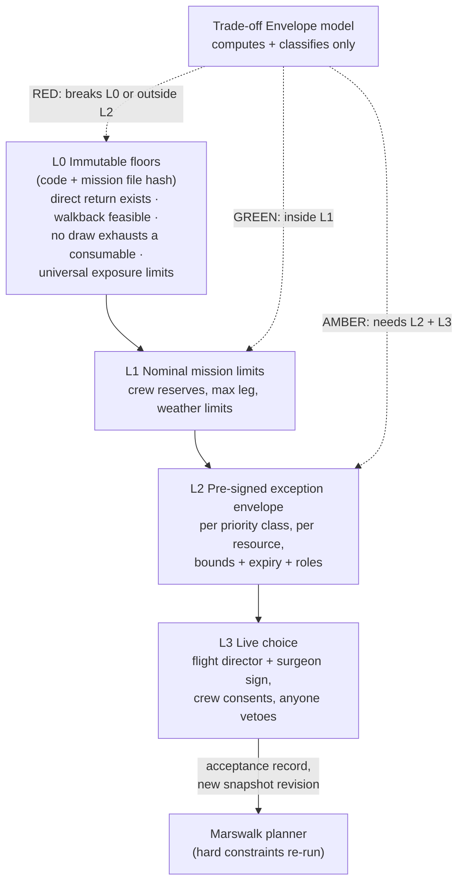
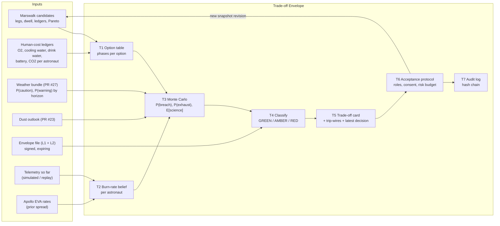
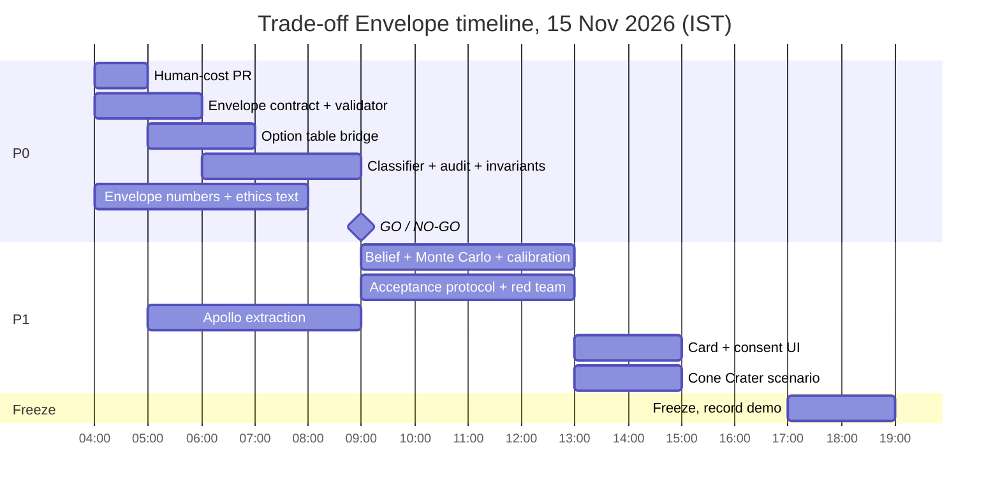

# Trade-off Envelope: plan for the third model (crew risk against the mission objective)

**Prepared 15 Nov 2026, 04:00 IST, against `AbhimanthaW/Periapsis` at `a6f4b42`.** Also read: the unmerged `feature/human-cost-calculator` branch (`02cc317`, no PR yet), PR #27 (weather forecast) and PR #23 (MDAD dust outlook).
**Status: proposal for review.** PR #29 exercises a deterministic P0 protocol with simulated inputs. The current architecture's exclusions remain binding, and decisions D1–D3 are open. A merged design record would not authorize L2 exceptions or telemetry-driven changes to the plan.

Labels:
- **[verified]**: checked in the repo or in a cited source.
- **[inference]**: engineering reasoning from verified facts.
- **[assumption]**: a value or choice we picked that still needs review.
- **[proposal]**: our recommendation.

---

## 0. Verdict first

1. **The idea is worth building, but not in the form it was asked for.** As written, it collides with four rules the repo already set for itself. `reference/architecture/scientific-model-design-review.md` excludes "health-based crew ranking, medical predictions, … autonomous ethical judgments" and "learned moral rules". `runtime/marswalk/optimization.py` lists `EXCLUDED_FROM_CORE` = AI/ML decision making, suit or life-support forecasts, universal safety scores, and medical suitability or crew ranking. [verified] A model that "makes mission-threatening decisions" based on "personalized astronaut health" breaks all four.
2. **"Supervised" must mean *human-supervised*, not supervised learning.** No public dataset records EVA trade-off decisions with their outcomes. If we write the labels ourselves, the model learns our own rules back and calls them ML. That is "functionally fake", and it is a learned moral rule. [inference]
3. **"Adhering to the mission objective" turns NASA's priority upside down.** Apollo's mission rules optimised the chance of completing objectives, but crew safety was the overriding factor in every decision. [verified, NASA TN D-7822] Judges with NASA backgrounds will notice. The defensible framing: *maximise mission value inside a crew-safety envelope that only authorised humans can widen, and only within bounds they agreed before the EVA.*
4. **Proposed model: the Trade-off Envelope.** For every option the planner already produces (return now, go to stop X, go to X then Y), it computes the probability that each astronaut eats into a consumable reserve, how much science the option delivers, and what is given up. Each option is then classed as GREEN (recommendable), AMBER (allowed only if named humans accept it, inside a pre-signed envelope) or RED (never executable). **The model never decides.** It prices the trade-off, enforces who may accept it, and sets the trip-wires that undo the acceptance.
5. **The only "learning" is honest and personal:** a Bayesian update of each astronaut's consumable burn rate from the EVA's own telemetry. The prior's spread comes from published Apollo EVA metabolic rates. This personalises *capability* (how fast this person is using O₂ today), never *acceptability* (how much risk this person "can handle").
6. **Scope:** about 20 hours remain. This is P1 behind the main differentiator. The P0 slice is deterministic and reuses existing code: envelope contract, option table, GREEN/AMBER/RED rules, audit log and invariant tests. Monte Carlo and the Bayesian update are P1, with a go/no-go at 09:00 IST (§13).
7. **Pitch it as a decision model, not as ML.** The weather and dust workstreams have separate evaluation and release gates. For model 3 the strong line is: *"We deliberately kept learning out of the life-and-death layer. The statistics price the risk, and humans own the decision."*

---

## 1. What was asked for, read two ways

> "A trade-off model that assesses risks and conducts supervised decisions, acknowledging the risks to an astronaut but with the mindset of adhering to the mission objective. The threshold is decided by a human operator who researches personalised astronaut health and the ability to handle certain risks, and it makes mission-threatening decisions, with serious guardrails."

| Phrase | Reading A (what it sounds like) | Reading B (what we can defend) |
|---|---|---|
| "supervised decisions" | Supervised ML trained on labelled decisions | Human-on-the-loop: the model proposes, a human disposes |
| "adhering to the mission objective" | Push on unless the risk is extreme | Deliver the most science the agreed envelope allows |
| "threshold decided by a human operator" | Operator types a number live | Envelope signed before the EVA; live choice only inside it |
| "personalised astronaut health" | Medical records drive risk tolerance | Measured capability drives *predictions*; limits stay universal |
| "ability to handle certain risks" | Some astronauts may take more risk | Some astronauts burn consumables faster, so their margins shrink sooner |
| "makes mission-threatening decisions" | The model decides | The model shows which choices threaten the mission, and why |

The plan builds Reading B. Every Reading A element is either reshaped or rejected below, with a reason.

---

## 2. Critique

**C1. It breaks the repo's own exclusions.** [verified] See §0.1. Two of the four can be met by design (no ML decision-making; no crew ranking or single safety score). One needs a team decision: the Monte Carlo consumables check *is* a "suit or life-support forecast". Decision D1 (§14) proposes narrowing that exclusion to *unvalidated* life-support forecasts that change the plan. A labelled, advisory forecast that only classifies options would then be allowed.

**C2. There are no labels to learn from.** [inference] Real EVA go/no-go outcomes are a few dozen Apollo EVAs, they were lunar, and none ended in harm that a label could mark. Synthetic labels encode our opinions. Reinforcement learning on a simulator learns whatever the reward says a life is worth. Both are rejected (§11.3).

**C3. Personal health data does not exist for us.** [verified] Astronaut clinical data sits in NASA's LSAH repository. Requests need a reviewed study, an IRB protocol and crew consent, with lead times of more than three months. Every crew number in the repo (`runtime/examples/crew-human-factors.json`) is simulated and says so. The model must work on simulated, operator-entered profiles and label them on screen.

**C4. Personalised acceptability contradicts current NASA policy.** [verified] NASA-STD-3001's career radiation limit is 600 mSv, and the standard states that it is universal for all ages and sexes. NASA moved away from age- and sex-based limits partly to give equal opportunity for mission assignment. A tool that lets an operator give one astronaut a looser limit than another reverses that. **Rule: personalisation may tighten a limit, never loosen it.** The human-cost branch already does the tightening part: higher-demand astronauts get larger reserves (`oxygen_raised_fraction`). [verified]

**C5. Real-time operator thresholds are the wrong place for exceptions.** [verified] The 2014 Institute of Medicine report for NASA found that relaxing health standards for exploration missions would be ethically unacceptable. It recommended that exceptions be rare, decided mission by mission, with fully informed and voluntary crew consent. A slider in a control room is the opposite. **Rule: exceptions live in a pre-signed envelope with bounds and an expiry. The live operator only chooses inside it.**

**C6. On Mars, a human operator on Earth cannot approve in time.** [verified] One-way light time is roughly 3 to 22 minutes, so a question and its answer take between about 6 and 45 minutes, before anyone has thought about it. A turn-back decision that must be made within 10 minutes cannot wait for Earth. The envelope must say who holds authority when Earth is too slow: a habitat operator on Mars, or GREEN-only.

**C7. One risk score hides the trade-off.** [verified] The human-cost calculator already reports a 0–100 "risk" that is the worst fraction of a usable budget spent. Its own README says it is *not* a failure probability. NASA's Human System Risk Board scores each risk separately on likelihood and consequence and sets a risk posture per risk. Summing O₂, heat, dust and dose into one number makes the decision look precise and hides which risk is driving it. **Rule: report per astronaut and per resource. Never sum.**

**C8. "Probability of harm" is not something we can compute.** [inference] We can estimate the probability of *using up part of a reserve*, under stated assumptions. We cannot estimate the probability of injury or death. The output must say "P(reserve breach)", never "survival probability".

**C9. Time.** [verified, competitor audit] The main differentiator (plan the walk, then plan the picture) still has P0 work, and the weather and dust models sit in unmerged stacked PRs. The human-cost calculator has no PR. A third model must reuse what exists and stay small, or it will not ship.

---

## 3. Design principles (what replaces Reading A)

1. **Price, don't decide.** The model's outputs are option classes, probabilities, margins and a trade-off card. Execution needs a human acceptance record.
2. **Safety is a constraint, not a currency.** No exchange rate between science and risk is computed. Priority classes (set by the science lead) unlock larger *pre-agreed* envelopes. That is how "mission objective" enters, transparently.
3. **Personalise capability, never acceptability.** Measured burn rates, pace and sustainable power change predictions. Limits are universal; an individual's limit can only be tighter.
4. **Fail closed.** Missing, stale or implausible input means the option cannot be AMBER. The worst case is GREEN-only, which always includes "return now" when the direct return passes.
5. **Pre-planned decisions, like flight rules.** Every acceptance comes with trip-wires computed in advance ("if EV2's O₂ is below X g when you leave stop 2, go home"). Apollo's mission rules let controllers take prompt, preplanned action for 80% of in-flight failures. [verified]
6. **Separate who values from who accepts.** The science lead sets priorities and cannot sign a risk acceptance. The flight director and crew surgeon accept. The crew member can always refuse.

---

## 4. Martian map logic

| | |
|---|---|
| **User** | Flight director and crew surgeon (Earth or habitat), and the two EVA crew members. |
| **Decision** | At this point in the walk: go home, keep to the plan, or take the extra stop that matters most to the mission, knowing exactly what it costs each person in reserve? |
| **Data** | Marswalk candidate plans and ledgers (runtime). Per-astronaut consumable ledgers (human-cost branch). Weather exceedance chances (PR #27) and dust outlook (PR #23). Published Apollo EVA metabolic rates and timeline variability, as the prior spread. Operator envelope (simulated). EVA telemetry (simulated or replayed). |
| **Transformation** | Option table → Bayesian burn-rate update → Monte Carlo over burn rate, task overrun, pace and weather truncation → per-astronaut P(reserve breach) and expected science → envelope classification → trip-wires. |
| **Output** | Options drawn on the map in three classes, a trade-off card ("+1 priority-1 stop costs EV2 this much reserve"), a latest-decision marker, and a crew consent prompt. |
| **Action** | Accept or decline an AMBER option, with a reason and two signatures; or go home. Trip-wires then watch the accepted plan. |

---

## 5. Authority layers



- **L0** cannot be changed anywhere in the app. Changing it means a code change and review.
- **L1** brings together the configured nominal limits. Marswalk's `AuthorizedLimit` currently validates only `max_leg_s`. P0 reserve floors come from the simulated human-cost policy, with weather assessed by the existing deterministic weather rules.
- **L2** is new: an envelope file with bounds such as "for priority-1 objectives, the O₂ reserve floor may drop from 30% to 22%" [assumption: numbers]. It has an expiry, the roles that signed it, and the crew members who consented to it.
- **L3** is the live acceptance. It writes a new immutable snapshot revision, and the existing hard-constraint pass runs again on it. An acceptance never bypasses `enforce_hard_constraints`; it changes the authorised limits that the pass reads.

---

## 6. The model

### 6.1 Data flow



### 6.2 Components

**T0. Envelope contract** `tradeoff-envelope-v1` (§9.1). Validated as strictly as `load_profile`: unknown keys are refused, units are explicit, expiry is in the future, every L2 bound is tighter than L0, and every personal override is tighter than the mission value. [proposal]

**T1. Option table.** For each Marswalk candidate (`direct_return`, `science:X`, `multi:X+Y`), build ordered phases (outbound, dwell, transfer, return) with durations and positive elevation gain from the legs. Feed them to `humancost.evaluate()` to get per-astronaut, per-resource ledgers at nominal rates. This is the bridge the human-cost README already flags as "after a separate integration review". [verified] Deterministic; no new science.

**T2. Burn-rate belief (the learning part).** For astronaut *i*, let ρᵢ be the ratio of actual to predicted metabolic power.
- Prior: log ρᵢ ~ N(0, s₀²). s₀ is estimated from the published per-EVA Apollo lunar metabolic rates (NTRS 19910001262, Table II), as their log-dispersion around the planned rate. [assumption: method; Shree extracts the table]
- Observation: after each phase, z = log(E_obs / E_pred), where E_obs is metabolic energy inferred from O₂ used so far and E_pred is the model's prediction for the same elapsed phases. z ~ N(log ρᵢ, σ²_obs). σ_obs comes from sensor accuracy. [assumption]
- Posterior on log ρᵢ: precision 1/s₀² + 1/σ²_obs, mean weighted accordingly. Only the latest cumulative z is used, so the same data is not counted twice.
- Closed form, deterministic and explainable: "EV2 is using O₂ 14% faster than planned; the model is 80% sure the true figure is between 6% and 22%." [template, not a result]

Why this is the right personalisation: O₂ use, cooling water and CO₂ production all scale with metabolic rate, and the human-cost model already derives them from metabolic power. [verified] Apollo 14 had its EVA limit raised beyond 4 hours *because* measured metabolic rates on Apollo 11 and 12 were lower than predicted. [verified] Updating a plan from measured burn rate is how NASA actually did it.

Transfer caveat [verified]: metabolic rates on Apollo lunar tasks were up to 50% lower than similar tasks with newer suits in a ground analogue. The Apollo data sets the *spread*, not the Mars mean, and the prior's centre stays with the profile.

**T3. Monte Carlo.** N = 4,000 draws per option [assumption], seeded so that the same inputs give the same bytes.
- ρᵢ from the T2 posterior, shared across O₂, cooling water and CO₂ (they are correlated through metabolism), plus small resource-specific noise.
- Dwell overrun φ. On Apollo 16, lunar tasks took on the order of 70% longer than in the last 1-g training session. [verified] The prior on φ comes from the Apollo 14–17 planned-against-actual timeline study (NTRS 20170007261). [assumption: Shree extracts]
- Walking pace factor ψ around the Mars Tobler pace. Wide, because the pace model is illustrative. [assumption; `plan.py` ASSUMPTIONS already says so]
- Weather truncation: from PR #27's chance of crossing the warning limit within the option's time window, draw whether a WARNING arrives and when. If it does, the option is cut short at that time and the crew returns. This lowers expected science. It never changes the hard rules, so the existing "forecasts never change the plan" rule holds. [proposal]
- For each draw, run the existing prefix ledger: a reserve breach at any phase counts, even if the end balance looks fine. [verified, `resources.py`]
- Outputs per option and per astronaut: P(reserve breach) with a 95% Wilson interval; P(exhaust), meaning any consumable reaches zero before home; P(complete); and E[science] = Σ priority value × P(task completed).

**T4. Classification.** Uses the *upper* end of each interval, so sampling noise can only make the answer more cautious.

| Class | Rule (all must hold) |
|---|---|
| **GREEN** | All current hard constraints pass (`enforce_hard_constraints`); P(breach)ᵤₚₚₑᵣ ≤ p_nominal for every astronaut and resource; no draw exhausts anything; inputs fresh and plausible. |
| **AMBER** | Hard constraints pass under the L2 bounds for this objective's priority class; p_nominal < P(breach)ᵤₚₚₑᵣ ≤ p_exception(priority); no draw exhausts anything; the direct return passes; no WARNING is active; the risk budget (T6) has room; the envelope has not expired; the required roles are reachable within the decision window (C6). |
| **RED** | Anything else, with the first failing rule as the reason. Shown, never executable. |

p_nominal and p_exception are envelope values, for example 1% and 5% for priority 1 [assumption, Isath to set, swept in §10]. "Return now" is never AMBER: if it is not GREEN, the model reports that loudly, because no option is safer.

**T5. Trade-off card, trip-wires and latest decision time.**
- Card: compared with the best GREEN option, what the AMBER option adds (stops, priority, E[science]) and what it costs (per-astronaut P(breach), minutes of margin, which resource drives it).
- Trip-wires: for an accepted option, invert T3 to find the state at which P(breach) would cross p_exception. Example: "if EV2 has less than X g O₂ when leaving stop 2, return immediately". These are pre-planned decisions in the flight-rule sense, written to the acceptance record and checked against live telemetry.
- Latest decision time (P2): the last moment at which the option is still GREEN or AMBER if the crew keeps walking the current leg. Drawn as a marker on the route.

**T6. Acceptance protocol.**
- AMBER needs: flight director and crew surgeon signatures, each with a reason; consent from every affected crew member; any of them can veto.
- The science lead sets priorities and cannot sign.
- An acceptance expires (for example when the trip-wire fires, when the next phase ends, or after a set time) [assumption].
- **Risk budget:** total accepted excess risk in one EVA, Σ(P_accepted − p_nominal), must stay within the envelope's budget. This stops "salami slicing", where many small acceptances add up to one large one. [proposal]
- Latency routing: if the decision window is shorter than twice the current one-way light time plus a response allowance, Earth roles are unavailable. Authority falls to the habitat delegate named in the envelope, or the decision is GREEN-only.

**T7. Audit log.** An append-only JSON lines file. Each record holds the inputs' hashes, the model version, the options and classes, who signed, the reasons, the trip-wires, and the hash of the previous record. Any edit breaks the chain. This is what lets a reviewer ask "why did you let them go to the rim?" afterwards.

---

## 7. Personalisation: allowed and forbidden

| Allowed (changes predictions or tightens) | Source | Forbidden (and why) |
|---|---|---|
| Measured burn rate this EVA (T2) | Telemetry | Predicting medical events from vitals (excluded: medical predictions) |
| Sustainable and peak metabolic power, mass, suit joint power | Surgeon-entered profile (simulated) | Choosing *which* astronaut takes a risk based on fitness (excluded: crew ranking) |
| Larger personal reserve for higher demand | Human-cost `raised_fraction` (exists) | A looser personal limit than the mission limit (C4: universal limits) |
| Personal trip-wire set by the surgeon (for example a heart-rate ceiling held for N minutes, which withdraws AMBER) | Surgeon | The model setting or inferring that ceiling |
| Dose received so far against the universal career limit | Exposure history (simulated) | Ranking crew by remaining dose budget to pick who goes |
| Personal consent or refusal of an AMBER category | Crew | Any default that assumes consent |

The heart-rate trip-wire has a real precedent. On Apollo 14 EVA-2, the climb to Cone Crater pushed Shepard's heart rate to about 150 beats per minute. The flight surgeon asked for a pause and asked the geologists how important reaching the rim was, and Mission Control then ended the search. [verified] That is a human-set threshold triggering a human trade-off, which is what this design does.

**Privacy [proposal, following the IOM report's support for health-data confidentiality, verified]:** surgeon-entered parameters and their rationale are visible only in the surgeon view. The flight director and crew see derived margins and probabilities.

---

## 8. Guardrails

| # | Guardrail | Enforced by | Test |
|---|---|---|---|
| G1 | The model never executes; it outputs classes and cards | No write path from T4/T5 to the planner except T6 | Static check: T3/T4 import nothing that mutates a snapshot |
| G2 | L0 floors cannot be relaxed in-app | Constants plus a mission file hash | An envelope that relaxes L0 is refused |
| G3 | Personal values may only tighten | T0 validation | A looser personal override is refused |
| G4 | Two signatures from different roles, plus crew consent; anyone vetoes | T6 | Missing role or one veto leads to no acceptance |
| G5 | Fail closed on stale, missing or implausible input | T4 | Stale telemetry means no AMBER |
| G6 | No crew ranking, no single safety score | Output schema has no such field | Schema test |
| G7 | Acceptances expire; trip-wires revert to "return now" | T6 + runtime check | Trip-wire breach reverts the plan in replay |
| G8 | Risk budget per EVA | T6 | Ten small acceptances cannot exceed the budget |
| G9 | Value and acceptance roles separated | T6 | A science-lead signature is refused |
| G10 | Hash-chained audit | T7 | Editing any record breaks verification |
| G11 | Sensor plausibility: a stuck-low O₂ sensor must not make an option look safer | Rate bounds; disagreement between O₂ use and CO₂ or heart-rate trends means abstain | Injected stuck-low fault leads to no AMBER |
| G12 | Latency-aware authority | T6 | A decision window shorter than the round trip means Earth roles are not offered |

G11 matters most. The dangerous failure is not a wrong forecast; it is bad data that makes a risky option look GREEN. The weather plan already found the same pattern: MEDA's wind sensor failed during the Jan 2022 storm. [verified, weather plan]

---

## 9. Data contracts (proposal)

### 9.1 Envelope

```json
{
  "schema": "tradeoff-envelope-v1",
  "provenance": "simulated",
  "envelope_id": "eva-07-envelope",
  "expires_utc": "2026-11-15T18:00:00Z",
  "nominal": {"p_breach_max": 0.01},
  "exceptions": [
    {"priority_class": 1, "p_breach_max": 0.05,
     "reserve_floor_fraction": {"oxygen": 0.22, "cooling_water": 0.12, "battery": 0.15},
     "requires_roles": ["flight_director", "crew_surgeon"], "requires_crew_consent": true}
  ],
  "risk_budget_per_eva": 0.06,
  "personal_overrides": [
    {"astronaut": "EV2", "reserve_floor_fraction": {"oxygen": 0.35}, "set_by": "crew_surgeon",
     "reason": "<free text>", "visibility": "surgeon_only"}
  ],
  "authority": {"earth_roles": ["flight_director", "crew_surgeon"],
                "habitat_delegate": "habitat_operator", "response_allowance_s": 120},
  "signatures": [{"role": "flight_director", "id": "<id>", "signed_utc": "<utc>", "sha256": "<hash>"}]
}
```
All numbers are placeholders [assumption]. "Floor" means the fraction of the starting store that must remain.

### 9.2 Assessment output (per option)

```json
{
  "schema": "tradeoff-assessment-v1",
  "option_id": "science:delta-rim",
  "class": "AMBER",
  "first_failing_rule": null,
  "science": {"priority": 1, "expected_value": null, "p_complete": null},
  "per_astronaut": [
    {"id": "EV2", "driver": "oxygen",
     "p_breach": {"estimate": null, "upper95": null}, "p_exhaust_draws": 0,
     "margin_s": null, "burn_rate": {"p10": null, "p50": null, "p90": null}}
  ],
  "versus": {"option_id": "science:fan-edge", "class": "GREEN"},
  "tripwires": [{"astronaut": "EV2", "resource": "oxygen", "at": "leave stop 2", "min_remaining_g": null}],
  "latest_decision_utc": null,
  "inputs": {"telemetry_age_s": null, "weather_bundle": "<ref>", "envelope_sha256": "<hash>"},
  "model": {"id": "tradeoff-envelope", "version": "<sha256>", "seed": 0, "draws": 4000},
  "limits": ["burn-rate prior from Apollo lunar EVAs", "pace model illustrative", "crew data simulated"]
}
```
Null fields are template slots, **not results**.

---

## 10. Validation and gates

There is no real outcome data. Validation therefore splits into four kinds and says which is which.

| Check | What it proves | Method | Gate [assumption, Isath review] |
|---|---|---|---|
| Invariants | Software logic | Property tests: more consumption never upgrades a class; a tighter envelope never adds options; adding reserve never lowers safety; RED is never executable; "return now" is always offered when its direct return passes; one veto blocks acceptance | 100% pass |
| Statistical calibration | The Monte Carlo and T2 are coded correctly | Simulation-based calibration: generate synthetic EVAs with a known true ρ, φ and ψ, then compare predicted P(breach) with observed frequency. Reliability diagram and Brier score | Brier skill > 0 against both baselines below; reliability within the binomial band |
| Baselines | That the model adds anything | (a) deterministic ledger at nominal rates, which is today's behaviour and gives 0 or 1; (b) a fixed +30% consumption safety factor [assumption] | Report both; if (b) is as well calibrated, say so |
| Prior grounding | Spread is real, not invented | s₀ and φ recomputed by hand from the Apollo tables | Shree's hand value matches code to 0.01 |
| Sensitivity | Which assumption flips the decision | Tornado chart over s₀, φ, ψ, p_nominal, p_exception | Reported, no gate |
| Red team | Guardrails hold under abuse | Salami slicing, stale telemetry, stuck-low O₂, expired envelope, wrong role, crew veto, tampered audit, envelope relaxing L0 | Every case ends in GREEN-only or refusal |
| Historical scenario | The model's behaviour is sensible on a real trade-off | **Cone Crater replay** (Apollo 14 EVA-2), reconstructed from the ALSJ and the mission report, with every reconstructed value labelled | Narrative only. Do not claim it "predicted" the call |

**The Cone Crater scenario** [verified facts; reconstruction is a proposal]: the crew climbed toward the rim, were about fifteen minutes behind the timeline, and could not tell how close they were. Mission Control ended the search, and orbital imagery later showed their tracks stopping about 30 m short of the rim. The demo question: at the moment Houston called them back, does the model class "continue to rim" as AMBER or RED, and which resource and which person drive it? Lunar gravity, A7L suits and a 1.3 s light time all differ from Mars. Say so on the slide.

Keep four kinds of uncertainty separate in the report, as the weather plan does: **data** (simulated crew, sensor accuracy), **model** (prior spread, independence assumptions), **assumption** (envelope numbers, pace) and **software** (invariants, red team).

---

## 11. Additional features

### 11.1 Recommended, ranked

| # | Feature | Why it beats a basic Mars dashboard | Method | Priority |
|---|---|---|---|---|
| A1 | **Trade-off card** with per-astronaut cost | Shows what is given up, which nobody else in the field shows | T5 | **P0** |
| A2 | **Trip-wires as pre-planned decisions** | Turns an acceptance into a contract the system enforces | Invert T3 | **P1** |
| A3 | **Live burn-rate personalisation** | Personal, measured and honest; matches how Apollo extended EVAs | T2 | **P1** |
| A4 | **Crew consent prompt** on the three-line crew view (PR #27) | The crew can refuse, which is the IOM principle in the product | UI + T6 | **P1** |
| A5 | **Latency-aware authority** | Mars-specific: names who can decide in time | T6 + light time | **P1** |
| A6 | **Latest decision marker** on the route | Converts a probability into a place and a time | Re-run T3 along the leg | P2 |
| A7 | **"What would have to be true"**: the burn rate, timeline or weather at which an AMBER option turns GREEN | Tells the crew what to change (slow down, skip a task) | Root-find on T3 | P2 |
| A8 | **Risk budget gauge** across the EVA, and dose across sols | Shows the cost of today's acceptance to tomorrow's objectives | T6 | P2 |
| A9 | **Sensitivity tornado** in the "Why?" panel | Shows which assumption drives the class | §10 | P2 |
| A10 | **Decision debrief**: replay the audit log against what happened | Learning loop for humans, not for the model | T7 | P2 |
| A11 | **Link to the ranker**: the region-ranking priority sets the option's priority class, through the science lead | Joins the Explore page to the walk | Contract field | P2 |

### 11.2 Wire to existing pieces

- Weather (PR #27): exceedance chances feed T3 truncation. Forecasts still never change the plan.
- Dust outlook (PR #23): a high storm chance over the EVA window lowers `p_exception` or removes AMBER for that sol [proposal, needs Isath].
- Rover walkback (`walkback.py`): rover options inherit the walkback check as an L0 floor.

### 11.3 Rejected

- **Supervised classifier of "correct" decisions:** no real labels; synthetic labels are our opinions (C2).
- **Reinforcement learning agent:** it learns whatever price of risk the reward function encodes. That is a learned moral rule.
- **LLM ethics reasoner or narrator:** the project rule is no LLMs, and the design review rejects autonomous ethical judgment.
- **Health prediction from vitals:** excluded as medical prediction. Vitals only drive surgeon-set trip-wires.
- **"Survival probability" headline:** not computable (C8).
- **Crew ranking or "who should go":** excluded, and contrary to the IOM's equality-of-opportunity responsibility.
- **A slider for live thresholds:** replaced by the pre-signed envelope (C5).

---

## 12. Integration and code layout (proposal, Abhimantha to confirm)

```
runtime/tradeoff/
  __init__.py
  envelope.py      # T0: load + validate tradeoff-envelope-v1, tighten-only checks, expiry, signatures
  options.py       # T1: Marswalk candidates -> humancost phases -> nominal ledgers
  belief.py        # T2: conjugate normal update on log burn rate
  montecarlo.py    # T3: seeded draws, prefix ledgers, Wilson intervals
  classify.py      # T4: GREEN / AMBER / RED with first failing rule
  card.py          # T5: trade-off card, trip-wires, latest decision (P2)
  accept.py        # T6: roles, consent, veto, risk budget, latency routing
  audit.py         # T7: hash-chained JSON lines
runtime/examples/tradeoff-envelope-simulated.json
runtime/examples/tradeoff-cone-crater-reconstruction.json   # labelled reconstruction
runtime/tests/test_tradeoff_*.py                            # invariants, calibration, red team
evidence/tradeoff/                                         # Apollo table extracts, calibration report
```
numpy only, as in PR #27. No new lock file.

**Dependencies:** `feature/human-cost-calculator` must get a PR and review first, because T1 needs `humancost.evaluate()`. T3's weather truncation needs PR #27. Without them, T1 can run on the Marswalk time ledger alone, and T3 can skip weather and say so.

---

## 13. Scope, owners and timeline

| Priority | Work | Owner / reviewer | Done when |
|---|---|---|---|
| P0 | Open a PR for the human-cost branch | Abhimantha / Senula | PR open and reviewed |
| P0 | T0 envelope schema + validator + simulated example | Yumeth / Isath | Invalid envelopes refused with reasons |
| P0 | T1 option table bridge | Abhimantha / Yumeth | Every candidate has per-astronaut ledgers |
| P0 | T4 deterministic classifier (nominal ledger + fixed safety factor; no Monte Carlo yet) and T7 audit | Yumeth / Senula | Invariant tests pass |
| P0 | Envelope numbers and their reasons; ethics framing and citations | Isath + Thusal / Shree | Each number is labelled with its source or as an assumption |
| GO/NO-GO 09:00 IST | P0 green? | Abhimantha | Go: start P1. No-go: ship P0 only |
| P1 | T2 + T3, calibration test, baselines | Yumeth / Isath | Reliability diagram and Brier scores written to JSON |
| P1 | T6 acceptance: roles, consent, veto, expiry, risk budget, latency | Yumeth / Senula | Red-team suite passes |
| P1 | Apollo table extraction (rates, planned vs actual) | Shree / Thusal | Values hand-checked, with NTRS IDs |
| P1 | Trade-off card in the command-centre view, consent prompt in the crew view | Abhimantha / Shree QA | Card fields come from real JSON |
| P1 | Cone Crater reconstruction scenario | Thusal + Isath / Shree | Every value sourced or labelled reconstructed |
| P2 | A6–A11 | — | Only if P1 is done by 15:00 |
| P3 | §11.3 | — | Cut |



Hard stop: if the human-cost PR is not reviewed by 08:00, T1 runs on the time ledger only, and the card shows time margin rather than per-resource cost.

---

## 14. Decisions needed

| # | Decision | Recommended | Who |
|---|---|---|---|
| D1 | Narrow `EXCLUDED_FROM_CORE` "suit or life-support forecasts" to "unvalidated life-support forecasts that change the plan", and update the design review to match | Yes, with the advisory-only rule written into the code docstring | Abhimantha |
| D2 | May the model propose L2 limit exceptions at all, or only probabilistic trade-offs within L1? | Allow L2, bounded and pre-signed | Abhimantha + Isath |
| D3 | Envelope numbers: p_nominal, p_exception per priority, floors, risk budget | Set and sweep; label as assumptions | Isath |
| D4 | Pitch model 3 as a "decision model" rather than ML | Yes | Isath + Thusal |
| D5 | Use the Cone Crater reconstruction in the demo | Yes, labelled as a reconstruction | Thusal |

---

## 15. Judge questions to rehearse

- *Why isn't this ML?* — There are no outcome labels for EVA trade-offs. The learned part is the personal burn rate, which has real data. We kept learning out of the decision on purpose.
- *Who decides?* — Named humans, inside an envelope they signed before the walk. The crew can always refuse.
- *Isn't "mission first" dangerous?* — It would be. Our rule is mission value inside a safety envelope, the same priority order as Apollo's mission rules.
- *Is the astronaut health data real?* — No. It is simulated and labelled. Real crew data is held in NASA's LSAH archive behind IRB review and crew consent.
- *Why not let fitter astronauts take more risk?* — NASA's radiation limit is universal for all ages and sexes, partly for equal opportunity. We personalise predictions and allow only tighter limits.
- *What if the Earth operator is 20 minutes away?* — The envelope names a habitat delegate. If no one can decide in time, the system offers GREEN options only.
- *How do you know P(breach) means anything?* — It is calibrated on simulations with a known truth, its spread comes from Apollo data, and we show the sensitivity chart. We do not claim it is calibrated for Mars.
- *Largest limitation?* — The burn-rate prior comes from a dozen-odd lunar EVAs in Apollo suits.

---

## 16. Evidence register

| Claim | Label | Evidence |
|---|---|---|
| Design review excludes health-based crew ranking, medical predictions, autonomous ethical judgments, learned moral rules | verified | `reference/architecture/scientific-model-design-review.md` |
| `EXCLUDED_FROM_CORE` includes AI/ML decision making, suit or life-support forecasts, universal safety scores, medical suitability or crew ranking | verified | `runtime/marswalk/optimization.py` |
| `AuthorizedLimit` records value, unit and `authorized_by` | verified | `runtime/marswalk/config.py` |
| Prefix ledger counts a breach in any phase | verified | `runtime/marswalk/resources.py` |
| Human-cost "risk" is worst utilisation scaled 0–100, not a failure probability | verified | `runtime/humancost/README.md` on `feature/human-cost-calculator` |
| Human-cost raises reserves for higher-demand astronauts | verified | `calculator.py` `_reserves(..., raised)` on the same branch |
| Crew numbers in the repo are simulated | verified | `runtime/examples/crew-human-factors.json` |
| Apollo mission rules: crew safety the overriding factor; preplanned action for 80% of in-flight failures | verified | NASA TN D-7822, Apollo Experience Report: The Role of Flight Mission Rules |
| NASA career radiation limit 600 mSv, universal for all ages and sexes | verified | NASA-STD-3001 Vol 1 Rev B/C via OCHMO technical brief |
| Universal limit supports equal opportunity for assignment | verified | National Academies 2021 report coverage (UCSF) |
| IOM: relaxing standards ethically unacceptable; exceptions rare, mission by mission; informed, voluntary consent; health-data confidentiality | verified | IOM 2014, *Health Standards for Long Duration and Exploration Spaceflight* (doi 10.17226/18576) and coverage |
| HSRB scores each human system risk on likelihood and consequence and sets risk posture | verified | Antonsen et al. 2023, npj Microgravity |
| LSAH data requests need a reviewed study, IRB protocol and crew consent, >3 months | verified | NTRS 20170009502 (EVA Technology Workshop 2017) |
| One-way Earth–Mars light time about 3–22 minutes | verified | Standard figure; ESA Mars Express blog gives about 4–24 minutes |
| Apollo 14 EVA limit raised beyond 4 h after lower metabolic rates on Apollo 11 and 12 | verified | NTRS 19720019460 (chapter on the PLSS and crewman metabolic rates) |
| Apollo lunar EVA metabolic rates tabulated | verified | NTRS 19910001262, Table II |
| Apollo 16 lunar tasks took on the order of 70% longer than in the last 1-g training session | verified | NTRS 19730008098 |
| Apollo 14–17 planned against as-performed timelines and metabolic rates analysed | verified | NTRS 20170007261 |
| Apollo metabolic rates up to 50% lower than a ground analogue with newer suits | verified | NTRS 20220009964 |
| Cone Crater: heart rate about 150, surgeon asked for a pause and asked how important the rim was; MCC ended the search; tracks stop about 30 m short | verified | AmericaSpace 2016; collectSPACE; Universe Today on LRO imagery; ALSJ summary |
| A shared metabolic factor correlates O₂, cooling water and CO₂ | inference | Human-cost model derives all three from metabolic power |
| A stuck-low sensor is the dangerous failure | inference | Fail-closed reasoning; MEDA precedent in the weather plan |
| All envelope numbers, N = 4,000, the +30% baseline, timeline | assumption | Team choice, Isath review |

---

## 17. Sources

- Periapsis repo at `a6f4b42`: `runtime/marswalk/{config,optimization,resources,plan,walkback,weather}.py`, `reference/architecture/scientific-model-design-review.md`, `docs/development.md`; branch `feature/human-cost-calculator` at `02cc317`; PRs #23 and #27
- [Apollo Experience Report: The Role of Flight Mission Rules (TN D-7822)](https://www.nasa.gov/wp-content/uploads/static/history/alsj/tnD7822MissionRules.pdf)
- [OCHMO technical brief: radiation protection (NASA-STD-3001)](https://www.nasa.gov/wp-content/uploads/2023/03/radiation-protection-technical-brief-ochmo.pdf)
- [National Academies 2021 radiation limit report, UCSF summary](https://epibiostat.ucsf.edu/node/6756)
- [IOM 2014, Health Standards for Long Duration and Exploration Spaceflight (NCBI Bookshelf)](https://ncbi.nlm.nih.gov/books/NBK222146) · [summary chapter](https://www.nationalacademies.org/read/18576/chapter/2) · [SpaceNews coverage](https://spacenews.com/?p=69325) · [JHU Hub coverage](https://hub.jhu.edu/2014/04/03/nasa-space-missions-ethics)
- [Antonsen et al. 2023, Updates to the NASA human system risk management process (npj Microgravity)](https://pmc.ncbi.nlm.nih.gov/articles/PMC10485075/)
- [LSAH/LSDA data access, EVA Technology Workshop 2017 (NTRS 20170009502)](https://ntrs.nasa.gov/api/citations/20170009502/downloads/20170009502.pdf)
- [ESA Mars Express blog: one-way light time](https://blogs.esa.int/mex/?p=257)
- [PLSS and crewman metabolic rates on Apollo 11–14 (NTRS 19720019460)](https://ntrs.nasa.gov/api/citations/19720019460/downloads/19720019460.pdf)
- [Tabulated Apollo and Skylab EVA metabolic rates (NTRS 19910001262)](https://ntrs.nasa.gov/api/citations/19910001262/downloads/19910001262.pdf)
- [Apollo 16 time and motion study (NTRS 19730008098)](https://ntrs.nasa.gov/citations/19730008098)
- [Operational assessment of Apollo lunar surface EVA (NTRS 20170007261)](https://ntrs.nasa.gov/citations/20170007261)
- [Physical demand during simulated lunar EVA, ARGOS (NTRS 20220009964)](https://ntrs.nasa.gov/citations/20220009964)
- [Apollo 14 Lunar Surface Journal summary](https://nasa.gov/wp-content/uploads/static/history/alsj/a14/a14.summary.html) · [AmericaSpace: Apollo 14 part 4](https://www.americaspace.com/2016/02/14/familiar-to-millions-of-americans-45-years-since-apollo-14-part-4/) · [collectSPACE](https://www.collectspace.com/news/news-020601a.html) · [Universe Today: LRO image of the tracks](https://www.universetoday.com/37870/latest-lro-image-solves-apollo-14-mystery/amp)
