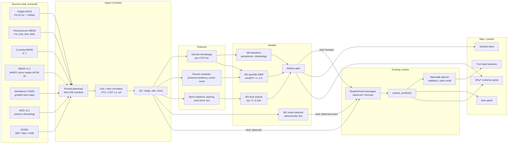
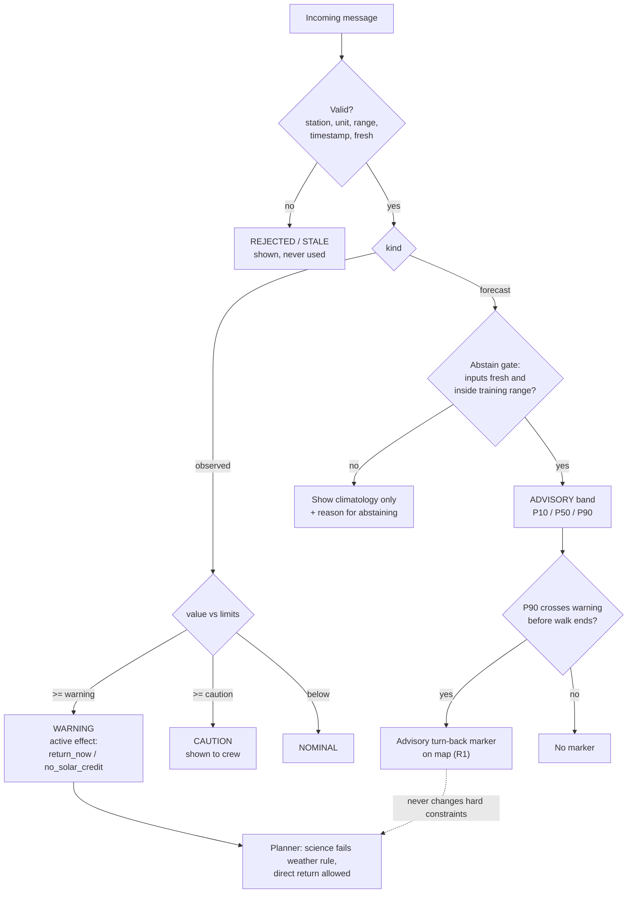
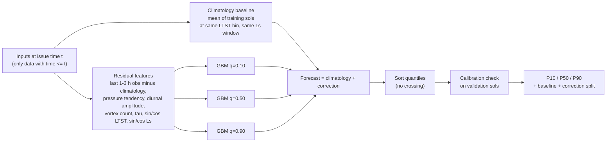
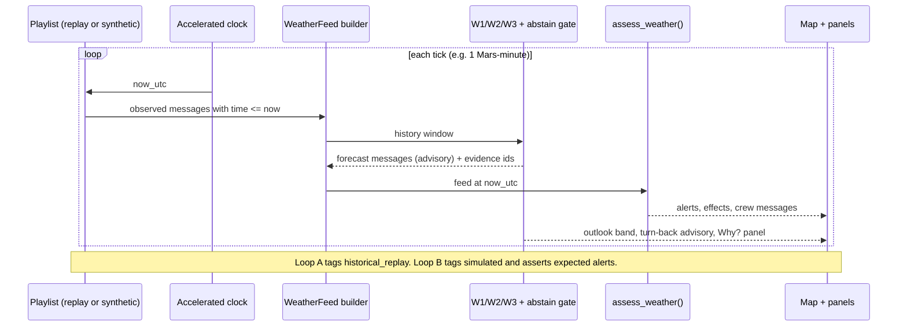
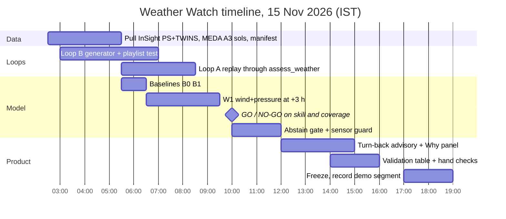

# Weather Watch: plan for a Martian weather warning model

**Prepared 15 Nov 2026, 02:30 IST, against `AbhimanthaW/Periapsis` at `a6f4b42` (PR #19 merged).**
**Status: plan for review. Nothing in this document has been built or measured yet.**

Labels used throughout:
- **[verified]**: checked in the repo or in a cited source.
- **[inference]**: engineering reasoning from verified facts.
- **[assumption]**: a value or choice we picked that still needs review.
- **[proposal]**: our recommendation.

---

## 0. Verdict first

1. **The idea fits the challenge, but the inputs it asks for do not exist yet.** No astronaut sensors are on Mars, and there is no public real-time feed of satellite imagery. The plan below replaces both with real NASA records played back as if they were live, and states that on screen. [verified, §3]
2. **The ML core should be a short-range local forecast with a known track record, not a storm oracle.** The model forecasts wind, pressure and temperature 1–6 hours ahead, with P10/P50/P90 bands, and it must beat two simple baselines on sols it never saw. If it does not beat them, we show that result. [proposal]
3. **We use satellite-derived products, not raw imagery.** The Mars Dust Activity Database (MDAD) already contains expert-drawn storm masks from MARCI daily global maps. Teaching a CNN to read raw imagery is research-grade work: a published Mask R-CNN detector reached about 62% mAP50. It is P3 for this hackathon. [verified, §3]
4. **Forecasts stay advisory.** `runtime/marswalk/weather.py` already rules that a forecast never changes the plan; only fresh observed values do. The model plugs into that rule as a source of `kind: "forecast"` messages and does not override it. The repo's own design review rejects "unsupported weather or safety forecasts". This plan is how a forecast becomes *supported*: a baseline, a held-out test, calibrated bands and an abstain rule. [verified]
5. **Scope warning.** About 21 hours remain, and the competitor audit lists P0 work for the main differentiator. Treat this as **P1**: time-box it to Yumeth + Shree + Isath for about 10 hours, and do not take Abhimantha off the P0 path. A go/no-go check at **10:00 IST** decides between shipping the model and shipping replay plus baselines only (§12). [proposal]

---

## 1. Where this sits in the challenge and the repo

- **Challenge relevance [verified, third-party copy of the challenge text]:** the map should give a Marswalk explorer the details of routes and destinations, *updates on current conditions*, and the data needed to finish safely. Current conditions and a short outlook answer that clause directly.
- **What already exists [verified, `a6f4b42`]:**
  - `runtime/marswalk/weather.py` validates base-station messages. It rejects unknown stations or units, out-of-range values, future timestamps and stale messages. It classifies each message as NOMINAL, CAUTION, WARNING, ADVISORY (forecast) or LINK_LOST. Active effects are `return_now` and `no_solar_credit`.
  - `runtime/examples/weather-*.json` holds five feeds: four simulated, plus one MEDA sol 36 replay.
  - `documentation/marsdoc/eva/historical-v1.json` holds a hash-verified MEDA sol 36 record (pressure 737.47 Pa, 9.08 m/s wind, solar zenith) with PDS product IDs.
  - The default limits in `weather.py` are wind 15/20 m/s (caution/warning) and dust optical depth 1/2. The file itself labels them **prototype assumptions for review (Isath)**.
- **Competitors:** at least one other team advertises an "MCS dust storm / wind forecast" with AI. A forecast alone does not set us apart. What does: a measured skill score against baselines, calibrated uncertainty, an explicit abstain rule, and the forecast drawn onto the walk-back map (R1 in §5).

---

## 2. Martian map logic

| | |
|---|---|
| **User** | Crew member on a Marswalk, and the habitat operator watching the walk. |
| **Decision** | Keep working at this stop, move to the next one, or start back now? Which sol and which hours are best for the next walk? |
| **Data** | Surface met-station records (InSight APSS, Perseverance MEDA, Curiosity REMS), satellite-derived dust products (MDAD storm masks, Montabone column dust optical depth maps), Mars Climate Database v6.1 as a physics reference, and DONKI space-weather notifications as context. |
| **Transformation** | Validate each message, then a climatology baseline, then an ML correction with quantile bands, then calibration and an abstain check. Then deterministic rules decide what the crew sees. |
| **Output** | A "Now" panel of observed conditions with their age, a 1–6 h outlook band, a dust and power outlook over sols, and a **weather-adjusted turn-back advisory** on the map. Each has a "Why?" evidence panel. |
| **Action** | Start the return earlier, skip a far stop, move the walk to the morning, or keep going with known margin. |

---

## 3. What was asked for compared with what exists

| Asked for | Reality | What we use instead |
|---|---|---|
| Astronaut sensors | No crew on Mars. [verified] | Real station records played back as the "suit/base station" stream, tagged `historical_replay`. InSight PS is the best fast stream: 10 Hz pressure, with TWINS wind at 0.1 and 1 Hz. Files span sol 1 (30 Nov 2018) to sol 1188 (29 Mar 2022). MEDA samples at about 1 Hz in sessions that cover over half of each sol, and its wind sensor was damaged by dust devils. [verified] |
| Real-time satellite imagery | MARCI makes daily global maps. The public outputs are weekly MSSS weather reports and archived products, with no live feed. During solar conjunction, data is not sent to Earth for weeks. [verified] | **MDAD v1.1** on Zenodo: per-sol storm masks drawn from MARCI daily global maps for MY28–32, about 115 MB as netCDF. **Montabone CDOD maps**: gridded column dust optical depth from TES, THEMIS and MCS, MY24 onward, with MY34 reconstructed separately. Both are satellite products processed by experts. [verified] |
| ML that parses the imagery itself | Published work exists: Mask R-CNN on MOC daily maps (mAP50 ≈ 62%), and patch classifiers (AUC 0.947–0.978). These took research effort and expert labels. [verified] | P3. We use the masks as features. A CNN that we cannot validate in 20 hours would be "visually impressive but functionally fake". [proposal] |
| Real-time weather access | No live Mars weather feed is public. The old InSight weather API is not a source, because InSight ended in Dec 2022. [verified] | The replay loop (§8) drives the same `WeatherFeed` code path that a live feed would use. |

**Dataset compatibility trap [inference]:** MDAD stops at MY32 Ls 171° (about 2014). InSight (MY34–36) and MEDA (MY36 onward) do not overlap it. Curiosity REMS (from Aug 2012, MY31) overlaps MDAD for roughly one Mars year (Yumeth to confirm the exact sol range). Phoenix MET (MY29, a few months at a polar site) also overlaps but is too short and too unrepresentative to be useful here. So:
- the **short-range model (W1)** trains on InSight and is tested at Jezero on MEDA, and does not use MDAD;
- the **dust outlook (W3)** trains on Gale REMS plus MDAD plus CDOD for MY31–32. For later years it uses CDOD maps only.

Do not join MDAD to InSight by Ls alone and call it the same storm.

---

## 4. Feature table: requested features and how well they work in practice

Ratings are our engineering judgement **[inference]** from the cited evidence. "Lead time" is the warning time that is realistic, not the time we would like to have.

| # | Feature | Data | Method | Practical effectiveness | Realistic lead time | Evidence | Priority |
|---|---|---|---|---|---|---|---|
| F1 | **Now panel**: latest observed wind, pressure, temperature and dust optical depth, with age and provenance | Replay of InSight, MEDA or REMS | Deterministic: existing `assess_weather` | **High.** It is the only output that may change the plan, and staleness and link loss are already handled. | 0 (observation) | `weather.py` [verified] | **P0** (exists; wire it to the replay loop) |
| F2 | **Short-range outlook**: wind, pressure and air temperature at +1, +3 and +6 h with P10/P50/P90 | InSight PS/TWINS (train), MEDA (cross-site test) | Climatology baseline plus gradient-boosted quantile correction (W1) | **Medium.** Mars weather repeats strongly from sol to sol, so climatology is a hard baseline and ML gains may be small. The value is a calibrated band, not a single number. Wind matters mainly for dust lifting and equipment, not for knocking people over (see note A). | Hours | Published ML on REMS pressure and temperature; ML benchmarks on OpenMARS (TCN/TiDE best for temperature and pressure); MarsNet preprint beat climatology and persistence [verified] | **P1** (the ML core) |
| F3 | **Dust-devil / vortex alert** | Pressure stream (InSight 10 Hz, MEDA 1 Hz) | Deterministic pressure-drop detector. ML only if it beats the detector on the labelled InSight catalogue (W2). | **High for detection, low as a warning.** A single station sees the vortex as it arrives. Drops last about 1–200 s at Jezero. Lead time needs an upwind sensor (R5). | Seconds (one station) | Jezero: about 4.9 vortices per sol over 0.5 Pa, 75% of drops over 2 Pa are dusty, one had a 9 Pa drop and 25 m/s winds. InSight catalogue: 853 events over 0.8 Pa. [verified] | **P1** (deterministic) / P2 (ML) |
| F4 | **Regional dust storm approaching** | MDAD masks + CDOD maps + local optical depth | Distance and bearing to the nearest active storm mask, its area trend, the Ls storm season, then the W3 dust outlook | **Medium for days-ahead awareness.** Large storms follow seasonal patterns (A/B/C types) and known tracks, and major sequences build up over days. The exact onset date is not reliably predictable, and global storms are not predictable. | Sols | Kass et al. 2016; Battalio & Wang 2021 (14,974 storms, 228 sequences) [verified] | **P1** |
| F5 | **Dust and power outlook**: optical depth over the next 1–5 sols, then rover solar credit | CDOD maps, MEDA RDS, REMS | Persistence + Ls climatology + W3 correction. Direct-beam transmittance exp(−τ/μ), which is physics. | **Medium–high.** Dust opacity changes slowly outside storm onsets. Plugs into the existing `no_solar_credit` effect. exp(−τ/μ) is a lower bound because diffuse light still powers panels. | Sols | Montabone 2015; Jezero storm Jan 2022 peaked near τ ≈ 2 [verified]; transmittance bound [inference] | **P1** |
| F6 | **Satellite imagery parsed by our own CNN** | MARCI daily global maps | CNN segmentation | **Low within this hackathon.** Accuracy cannot be validated in time, and MDAD already gives the labels. | n/a | mAP50 ≈ 62% in published work [verified] | **P3** (cut) |
| F7 | **Radiation (SEP) alert** | DONKI notifications (SEP, flares, CMEs) | Deterministic flag that feeds the existing `sep_alert` limit | **Low–medium as a Mars warning.** DONKI is analysed mostly from near-Earth and STEREO viewpoints. Mars may not be on the same magnetic field line, so the flag means "heliophysics says check", not "dose arriving". This is not an ML problem. | Minutes to hours | May 2024: about 8,100 µGy at Gale against about 700 µGy on a typical day [verified]; connectivity caveat [inference] | **P2** |

**Note A: why wind speed alone is a weak crew hazard [inference from verified density].** Mars surface density is about 0.016 ± 0.006 kg/m³ (NASA fact sheet); at Earth sea level it is about 1.225 kg/m³. Dynamic pressure q = ½ρv². At 20 m/s on Mars q ≈ 3.2 Pa, about the push of a 2–3 m/s breeze on Earth. The real wind hazards are sand and dust transport, lower visibility, and damage to equipment. Wind-blown sand damaged one of Curiosity's two wind sensors (landing debris damaged the other), and sand carried in whirlwinds damaged both of Perseverance's [verified]. **Action for Isath:** state this reason next to the 20 m/s `return_now` limit, or change the limit to a dust-lifting or visibility criterion.

---

## 5. Additional features we recommend, and ideas we reject

| # | Recommended feature | Why it beats a basic Mars dashboard | Method | Priority |
|---|---|---|---|---|
| **R1** | **Weather-adjusted turn-back advisory on the map**: "If the P90 wind or dust outlook passes the warning limit at T, start back by T − return time − reserve." Drawn as a second, earlier turn-back marker. | Links the forecast to the walk-back decision the product is built around. The forecast changes *advice*, not hard constraints, so the existing rule holds. | Deterministic: the existing walk-back return time plus the forecast window | **P1 (main weather differentiator)** |
| **R2** | **Skill scoreboard**: every forecast shows its held-out record against persistence and climatology. | Most teams say "AI forecast". We show whether it works, including when it does not. | Precomputed evaluation JSON | **P1** |
| **R3** | **Abstain / out-of-range gate**: if Ls, optical depth or sensor coverage is outside the training range, or an input is stale, the model returns climatology and says why. | Stops confident nonsense during dust storms, which barely appear in the training data. | Deterministic range checks on training feature ranges, plus a missing-input check | **P1** |
| **R4** | **Sensor-health guard**: stuck values, spikes, impossible rates of change, wind disagreeing with the pressure-drop pattern | Real precedent: MEDA's wind sensor failed during the Jan 2022 storm, at the moment wind mattered most. | Deterministic rules first. Isolation forest only if rules miss injected faults. | **P1** (rules) |
| **R5** | **Upwind sentinel lead time**: given sensors upwind (habitat mast, rover), lead time ≈ distance ÷ ambient wind. Vortices at InSight drift with the ambient wind. | Turns F3 from detection into a warning, and states its limit: about 40 s for a sentinel 200 m away in a 5 m/s wind. | Geometry | **P2** |
| **R6** | **Convective-hours window**: dust-devil activity peaks around noon at Jezero; suggest morning walks. | Planning advice that needs no ML. | Climatology from MEDA and InSight vortex catalogues | **P2** |
| **R7** | **Storm-season calendar** from Ls (A/B/C regional storm windows) | Long-range planning context. | Lookup table built from Kass et al. 2016 | **P2** |

**Rejected [proposal]:** an LLM "weather narrator" (project rule: no LLMs); a global dust storm predictor (no defensible skill); 3D storm animation; one summed "AI risk score" that mixes wind, dust and radiation (keep the criteria separate, as in the ranker rule); raw-image CNN (F6).

---

## 6. Architecture

### 6.1 Data flow



### 6.2 How a message turns into what the crew sees

This keeps the existing `weather.py` rule unchanged and adds only the abstain branch and R1.



### 6.3 Inside W1



Splitting the output into baseline and correction is the explanation: "climatology says X; the model adds Y because of these inputs." No black-box attribution library is needed, and SHAP is not installed. [proposal]

---

## 7. Model specifications

### W0: baselines (must exist before any ML)
- **B0 persistence:** the value at t + h equals the last observed value.
- **B1 diurnal climatology:** the mean of training sols in the same LTST bin (30 min) within ±10° Ls. [assumption: bin sizes, to sweep]
- **B2 MCD v6.1** at the site coordinates, for the same Ls and local time (physics reference, P2). The MCD warns that it averages over periods and is not suited to extremes, so use it only for means. [verified]

### W1: short-range station forecaster (the ML core)
- **Targets:** wind speed (TWINS derived), pressure (PS calibrated), air temperature, at horizons +1, +3 and +6 Mars hours.
- **Training data:** InSight, sol ~14 to ~1188, wherever TWINS and PS overlap. Wind coverage thins later in the mission as power fell; Yumeth records the actual valid-sol mask. [verified files to sol 1188; coverage gaps: assumption to check]
- **Model:** `sklearn.ensemble.HistGradientBoostingRegressor(loss="quantile")`, one per quantile and target and horizon. scikit-learn 1.9.1 is available in the workspace but is **not** in the repo's lock files, so add it to a new `weather-ml` project (lock it on a team machine). [verified]
- **Why GBM rather than LSTM or Transformer:** tabular residual features, little data per regime, fast training, deterministic with a fixed seed, native missing-value handling. The OpenMARS benchmark found TCN/TiDE best on reanalysis, but that is reanalysis data at 2-hour steps, not station data. Treat deep sequence models as P2 challengers. [inference]
- **Splits (no random split):** contiguous blocks by sol: train ≈ first 60%, validation the next 20%, test the last 20%. Leave a gap of at least the forecast horizon between blocks. Season leakage check: also report a leave-one-season-out (Ls quadrant) score. **Cross-site test:** apply the InSight-trained model to MEDA Jezero sols without retraining. Report how much worse it gets; sensor heights and terrain differ. [proposal]
- **Leakage rules:** features use only times ≤ t; climatology is fitted on training sols only; no centred smoothing windows.
- **Abstain (R3):** if any input lies outside the training range from the 1st to the 99th percentile, if τ is above the training maximum, or if the last observation is older than `max_age_s`, return B1 with `abstained: true` and the reason.

### W2: vortex detector
- **Deterministic baseline (P1):** detrend pressure against a running baseline, then flag sudden drops above 0.5 Pa that last 1 to 200 s. Thresholds follow the published InSight and MEDA surveys. The window length and thresholds are swept, not asserted. [verified method family; assumption: exact constants]
- **Labels:** the Lorenz et al. InSight vortex catalogue (PDS, sols 1–390). Test at Jezero against the Hueso et al. 2023 statistics: about 4.9 per sol over 0.5 Pa, peak near noon. [verified]
- **ML challenger (P2):** a GBM on window features. Keep it only if precision and recall beat the baseline on held-out sols.
- **Output:** an `observed` event message: CAUTION, "vortex passed, ΔP = …". It is never a forecast.

### W3: dust outlook over sols
- **Target:** column dust optical depth at the site for the next 1–5 sols, plus the event "τ rises by more than Δ" [assumption: Δ = 0.3, to sweep].
- **Inputs:** current and recent τ (CDOD at the site cell; MEDA RDS or REMS where available), Ls, and MDAD features where the years overlap: distance and bearing to the nearest storm mask, area trend over 3 sols, whether the storm lies on a known track toward the site.
- **Baselines:** persistence, and climatology for the Ls window across other Mars years.
- **Validation:** leave-one-Mars-year-out. Report the event Brier skill score and a reliability diagram. Report storm and non-storm periods separately.
- **Honest scope:** this gives an outlook in sols. It cannot give the hour a storm arrives.

---

## 8. Test data you can loop: replay and synthetic

Two loops with different jobs. **Never report skill on synthetic data.** [proposal]

### 8.1 Loop A: replay of real records (the demo)
Real archived records play through the same `WeatherFeed`, `assess_weather` and planner path at an accelerated clock, for example 1 sol in 90 s.

| Scenario | Source | What it shows |
|---|---|---|
| A1 Quiet sol | InSight, a low-dust northern-summer sol | Nominal Now panel; the outlook band hugs climatology. |
| A2 Afternoon convective sol | InSight sols with many catalogued vortices | W2 detections; the convective window (R6). |
| **A3 Jezero regional storm, sols 313–318 (5–11 Jan 2022, Ls 153–156°)** | MEDA | Peak τ near 2, winds up to 20 m/s, then the **wind sensor fails**. The demo shows the sensor-health guard and fail-closed behaviour on a real event. [verified event] |
| A4 Cross-site | MEDA quiet sols with the InSight-trained W1 | Honest skill degradation and the abstain gate. |
| A5 SEP context | DONKI SEP notification of 20 May 2024 + RAD published dose | `sep_alert`; F7 framed as context. |

Every message carries `provenance: "historical_replay"`, a `note` with the PDS product ID, and the original timestamp offset.

### 8.2 Loop B: synthetic stress tests (unit and UI tests only)
A seeded generator (`seed` → identical bytes, as the repo's reproducibility checks expect) produces feeds in the `runtime/examples/weather-*.json` format.

- **Background:** diurnal harmonics (3–4 terms) for P, T and wind, **fitted to real InSight or MEDA sols**. Store the coefficients with the sols they came from, so the dummy data is grounded in real behaviour without claiming to be real.
- **Injected events with ground-truth labels:**

| Event | Shape | Parameter ranges (from cited observations) |
|---|---|---|
| Vortex | Lorentzian pressure dip ΔP / (1 + (2(t−t₀)/Γ)²) plus a wind spike. Gaussian and Lorentzian fits are both used for MEDA drops. | ΔP 0.3–9 Pa, duration 1–200 s, peak near noon |
| Regional storm | τ ramps from background to about 2 over 1–2 sols; the diurnal pressure amplitude grows and daytime T_max falls | Taken from the A3 storm |
| Gust front | Wind step to 15–25 m/s for 5–20 min | Assumption, labelled |
| Sensor faults | Stuck value, dropout, spike, wrong unit, future timestamp, duplicate station | Each one must land as REJECTED, STALE or caught by the guard |
| Link loss | No messages for longer than `max_age_s` | Must give LINK_LOST, and science UNKNOWN when `required` |

- **Loop playlist:** B-nominal → B-vortex-burst → B-gust → B-storm-onset → B-sensor-fail → B-link-lost → repeat. Each step asserts the expected alert levels. This becomes a pytest that runs in CI, and the same playlist drives the UI in demo mode.



---

## 9. Validation and acceptance gates

| Check | Metric | Pass gate to ship as "validated advisory" [assumption, review with Isath] |
|---|---|---|
| W1 point skill | Skill score SS = 1 − MAE_model / MAE_ref against B1 and B0, per target and horizon | SS > 0 against **both** baselines on the test block. Otherwise show "climatology is better here" and ship B1. |
| W1 uncertainty | P10–P90 coverage; pinball loss | Coverage between 70% and 90% (target 80%) |
| W1 events | For "wind ≥ caution within 3 h": probability of detection, false alarm ratio, Brier skill score against climatology frequency | BSS > 0 |
| W1 cross-site | The same metrics on MEDA | Reported, with no gate. Expect degradation. |
| W2 | Precision and recall against the InSight catalogue; rate per sol at Jezero against Hueso 2023 | Recall ≥ 0.8 for ΔP > 0.8 Pa on held-out sols |
| W3 | Event Brier skill score, reliability diagram, leave-one-Mars-year-out | BSS > 0 outside storm periods; storm periods reported separately |
| Pipeline | Loop B asserts every injected fault and event | 100% of assertions pass |
| Reproducibility | Retraining with the same seed and pinned inputs gives the same bytes | Hash match |
| Hand check | Shree recomputes 3 forecasts and 3 baseline values by hand from the raw CSVs | Agreement to 0.01 |

Keep these four kinds of uncertainty separate in the report: **data** (sensor accuracy, e.g. TWINS ±1 m/s; gaps), **model** (quantile bands, cross-site loss), **assumption** (limits, bin sizes, Δτ) and **software** (Loop B, hash checks).

---

## 10. Evidence panels

### 10.1 In-app "Why?" panel (one per forecast or alert)
Values in angle brackets are template slots, **not results**.

```
┌─ Why this advisory? ─────────────────────────────────────────────┐
│ FORECAST · advisory only · cannot change the plan                 │
│ Wind at +3 h  (site ‹Jezero›, LTST ‹13:00›, Ls ‹155°›)            │
│   P50 ‹v› m/s   band P10 ‹a› – P90 ‹b› m/s                        │
│   = climatology ‹c› m/s  + model correction ‹+d› m/s              │
│ Main inputs: pressure tendency ‹x Pa/h› · vortices last hour ‹n›  │
│              · tau ‹t› (CDOD cell ‹id›)                           │
│ Track record (held-out sols ‹s1–s2›, ‹InSight›):                  │
│   skill vs climatology ‹+k%› · vs persistence ‹+m%›               │
│   P10–P90 coverage ‹c%›                                           │
│ Data used: ‹TWINS derived› · historical_replay · age ‹3 min›      │
│ Abstain check: passed (inputs inside training range)              │
│ Limits: trained at Elysium; storms rare in training data;         │
│   wind is a dust/equipment hazard, not a push hazard (note A)     │
│ Sources: [PDS product id] [model card] [evaluation report]        │
└───────────────────────────────────────────────────────────────────┘
```

**Data contract (proposal):** each forecast message keeps today's `WeatherMessage` fields (`kind: "forecast"`, `valid_to_utc`, `provenance`) and adds an optional `evidence` object:

```json
{
  "model_id": "w1-wind-h3",
  "model_version": "sha256:<training-manifest>",
  "quantiles": {"p10": null, "p50": null, "p90": null},
  "baseline": {"name": "B1-diurnal-climatology", "value": null},
  "correction": null,
  "inputs": [{"name": "pressure_tendency_pa_per_h", "value": null, "source": "<PDS product id>"}],
  "abstained": false,
  "abstain_reason": null,
  "track_record_ref": "evidence/weather-ml/w1-report.json#wind/h3",
  "limits": ["trained_site=InSight", "storms_under_represented"]
}
```

`weather.py` dataclasses are frozen, so this needs a backward-compatible optional field. Abhimantha decides the integration and Senula reviews the consumer side, as `docs/development.md` requires.

### 10.2 Evidence register for this plan
Thusal and Shree own this table and add a row for each new claim.

| Claim in this plan | Label | Evidence |
|---|---|---|
| Forecasts never change the plan in the current runtime | verified | `runtime/marswalk/weather.py` docstring and `rule()` |
| Current wind/dust limits are prototype assumptions | verified | same file, `DEFAULT_LIMITS` docstring |
| InSight PS 10 Hz; TWINS 0.1/1 Hz, ±1 m/s | verified | Jackson et al. (arXiv 2107.12456) |
| InSight TWINS/PS files span sol 1–1188 | verified | PDS Atmospheres InSight page |
| MEDA about 1 Hz, sessions cover over half a sol, cadence varied | verified | Rodriguez-Manfredi 2021; Martínez et al. EPSC-DPS 2025 |
| Sand damaged both MEDA wind sensors and one REMS wind sensor | verified | NASA "Wild Winds of Jezero"; Hueso et al. 2023 |
| Jezero storm Jan 2022: τ ≈ 2, winds to 20 m/s, sensor damaged | verified | Lemmon et al. 2022, GRL |
| Vortex stats at Jezero (4.9/sol > 0.5 Pa; 9 Pa, 25 m/s max) | verified | Hueso et al. 2023, JGR Planets |
| InSight vortex catalogue, 853 events over 0.8 Pa | verified | PDS Atmospheres vortex page (Lorenz et al.) |
| MDAD: 14,974 storms, MY24–32; v1.1 masks MY28–32 on Zenodo | verified | Battalio & Wang 2021; Zenodo 7480334 |
| A/B/C regional storms recur most years; C most variable | verified | Kass et al. 2016, GRL |
| Montabone CDOD gridded maps, open access via the MCD site | verified | Montabone et al. 2015, 2020 |
| MCD v6.1 released Dec 2022; not suited to extremes | verified | EPSC 2024-516; LMD access page |
| Mask R-CNN dust storm detection, mAP50 ≈ 62% | verified | Alshehhi & Gebhardt 2022 |
| ML forecasting on REMS and OpenMARS has been done | verified | de Cabo-Garcia et al.; Uprety et al. 2025 |
| MarsNet (preprint, Nov 2026) beat climatology and persistence | verified as reported; **not peer-reviewed** | arXiv 2611.12787 via Astrobiology.com |
| May 2024 SEP: about 8,100 µGy at Gale | verified | NASA, 10 Jun 2024 |
| DONKI provides SEP/CME/flare notifications via an API, from M2M SWAO | verified | CCMC DONKI page |
| Mars surface density about 0.016 ± 0.006 kg/m³ | verified | NASA NSSDCA Mars fact sheet |
| 20 m/s on Mars ≈ 2–3 m/s Earth wind pressure | inference | ½ρv² with the values above |
| MDAD does not overlap InSight/MEDA years | inference | MDAD MY24–32 against mission dates |
| Upwind sentinel gives about distance ÷ wind of lead time | inference | vortices advected by ambient wind (Spiga et al. 2021) |
| Gate thresholds in §9 | assumption | team choice, Isath review |

---

## 11. Code layout (proposal, to confirm with Abhimantha)

```
weather_ml/                      # new uv project; scikit-learn pinned here
  ingest/insight.py              # PS calibrated + TWINS derived → npz + manifest
  ingest/meda.py                 # derived env tables (pattern from historical-v1.json)
  ingest/mdad.py                 # Zenodo v1.1 netCDF masks → per-sol site features
  ingest/cdod.py                 # Montabone maps → site-cell time series
  timebase.py                    # UTC ↔ LTST/Ls (reuse Mars24 in runtime/marswalk/environment.py)
  baselines.py                   # B0, B1 (+B2 optional)
  w1_train.py  w1_predict.py
  w2_vortex.py
  w3_dust.py
  gate.py                        # abstain rules
  evaluate.py                    # → evidence/weather-ml/*.json
  feed.py                        # → WeatherFeed JSON (kind=forecast, evidence object)
  replay.py  synth.py            # Loop A / Loop B
  tests/                         # Loop B playlist assertions, leakage tests, hash test
evidence/weather-ml/             # model cards, evaluation reports, source manifest
```

---

## 12. Scope, owners and timeline

| Priority | Work | Owner / reviewer | Done when |
|---|---|---|---|
| P0 | Loop A replay of A1 and A3 through the existing `assess_weather` | Yumeth / Senula | The A3 storm replays end to end; the sensor failure shows as STALE or REJECTED |
| P0 | Loop B generator + playlist pytest | Shree / Yumeth | All injected faults and events assert correctly; seed reproduces bytes |
| P1 | B0/B1 baselines + W1 on InSight wind and pressure, +3 h only first | Yumeth / Isath | Test-block skill scores and coverage written to JSON |
| P1 | Abstain gate (R3) + sensor-health rules (R4) | Yumeth / Isath | Out-of-range and stale cases fall back with a reason |
| P1 | Turn-back advisory (R1) + Why? panel | Abhimantha (small integration) / Shree QA | The marker appears on replay A3; the panel fields come from real JSON |
| P1 | Limits review (note A), science text, source checks | Isath + Thusal / Shree | Each limit has a reason or is marked as an assumption |
| P1 | W2 deterministic vortex detector | Yumeth / Isath | Recall reported against the InSight catalogue |
| P2 | W3 dust outlook; R5–R7; MCD baseline; DONKI flag | Isath / Yumeth | Reported with leave-one-year-out skill |
| P3 | Raw-image CNN, deep sequence models, LLM narrator | — | Cut |



**Go/no-go at 10:00 IST [proposal]:**
- **Go:** W1 has SS > 0 against both baselines at +3 h and coverage within the gate. Ship it as a "validated advisory".
- **No-go:** ship Loop A + B1 climatology outlook + sensor guard + R1 driven by climatology. The pitch becomes "we tested ML and climatology won at this horizon". That is still defensible.
- **Hard stop:** if InSight ingestion is not working by 08:00, drop W1 and keep Loop A + B on the existing MEDA record and A3.

---

## 13. Risks and limitations

- **No live data:** every demo input is replayed or synthetic, and is labelled so on screen.
- **Training site bias:** W1 learns Elysium Planitia. Jezero is dustier, with more vortices and stronger winds from its terrain. The cross-site test measures this rather than hiding it.
- **Storms are rare in training data:** the abstain gate exists for this reason. Do not claim storm-time forecast skill unless it is measured separately.
- **Sensor heights and types differ** (InSight TWINS booms sit about 1 m above the solar panels; MEDA's wind sensors are on the rover mast), so cross-site wind numbers are not directly comparable.
- **Limits are assumptions** until Isath signs them off (note A).
- **SEP is not a weather-model problem.** It stays a deterministic, context-only flag.

---

## 14. Judge questions to rehearse

- *Why is ML needed when Mars weather is so regular?* — It is not needed for the mean; climatology handles that. ML is used only for the correction and the bands, and we show where it adds skill and where it does not.
- *Where do the astronaut sensors come from?* — From nowhere yet. We replay InSight and Perseverance stations through the exact code path a suit or base station would use.
- *Is that satellite imagery real-time?* — No. It is MDAD storm masks drawn from MARCI daily maps, used as the satellite layer. We say why we did not train our own image model.
- *Can it predict a global dust storm?* — No, and nobody can reliably. It gives a dust outlook over sols with measured skill, and a storm-season calendar.
- *What happens when a sensor breaks?* — Replay A3: a real storm broke the real wind sensor, and our system failed closed.
- *What is the biggest limitation?* — One training site, and very few storm examples.

---

## 15. Sources

- Periapsis repo at `a6f4b42`: `runtime/marswalk/weather.py`, `runtime/examples/weather-*.json`, `documentation/marsdoc/eva/historical-v1.json`, `reference/architecture/scientific-model-design-review.md`, `docs/development.md`
- Challenge text, as quoted in a public team write-up: [dev.to/walsal201/astromind](https://dev.to/walsal201/astromind-4ji4) (third-party copy; verify against the official page)
- [PDS Atmospheres: InSight TWINS/PS](https://atmos.nmsu.edu/data_and_services/atmospheres_data/INSIGHT/insight.html)
- [PDS Atmospheres: InSight vortex catalogue (Lorenz et al. 2023)](https://atmos.nmsu.edu/data_and_services/atmospheres_data/INSIGHT/vortex.html)
- [Jackson et al., Inferring vortex and dust devil statistics from InSight (arXiv 2107.12456)](https://arxiv.org/pdf/2107.12456)
- [Spiga et al. 2021, daytime convective vortices at InSight (JGR Planets)](https://digital.inta.es:8443/jspui/handle/20.500.12666/534?locale=en)
- [Rodriguez-Manfredi et al. 2021, MEDA instrument (Space Sci. Rev.)](https://link.springer.com/content/pdf/10.1007%2Fs11214-021-00816-9.pdf)
- [Martínez et al., MEDA data through sol 1450 (EPSC-DPS 2025)](https://meetingorganizer.copernicus.org/EPSC-DPS2025/EPSC-DPS2025-1461.html)
- [MEDA meteorology at Jezero (Nature Geoscience, 2023)](https://link.springer.com/article/10.1038/s41561-022-01084-0)
- [Hueso et al. 2023, vortices and dust devils at Jezero (JGR Planets)](https://digital.inta.es:8443/jspui/bitstream/20.500.12666/883/1/JGR%20Planets%20-%202023%20-%20Hueso%20-%20Convective%20Vortices%20and%20Dust%20Devils%20Detected%20and%20Characterized%20by%20Mars%202020.pdf)
- [Lemmon et al. 2022, dust, sand and winds in a Jezero storm (GRL)](https://digital.inta.es:8443/jspui/handle/20.500.12666/842?mode=full)
- [NASA: Perseverance studies the wild winds of Jezero](https://www.nasa.gov/missions/mars-2020-perseverance/perseverance-rover/nasas-perseverance-studies-the-wild-winds-of-jezero-crater/)
- [Battalio & Wang 2021, Mars Dust Activity Database (Icarus)](https://people.earth.yale.edu/sites/default/files/battalio_wang_2021_the_mars_dust_activity_database_mdad.pdf)
- [MDAD v1.1 on Zenodo](https://zenodo.org/records/7480334)
- [Kass et al. 2016, interannual similarity in the dust storm season (GRL)](https://doaj.org/article/4d324487327f4137befd976a815987b8)
- [JPL: seasonal dust storm pattern](https://www.jpl.nasa.gov/news/nasa-mars-orbiters-reveal-seasonal-dust-storm-pattern/)
- [Montabone et al. 2015, eight-year dust climatology (arXiv 1409.4841)](https://arxiv.org/pdf/1409.4841)
- [Mars Climate Database access and caveats](https://www-mars.lmd.jussieu.fr/mars/access.html) · [MCD v6.1 (EPSC 2024)](https://meetingorganizer.copernicus.org/EPSC2024/EPSC2024-516.html)
- [Alshehhi & Gebhardt 2022, Mask R-CNN dust storm detection](https://doaj.org/article/d8aa0fd6ed6943ffa9ce3c16b38c2868) · [Gichu & Ogohara 2019](https://doaj.org/article/a938e688bd434b9c9cfaa896bdafa724)
- [de Cabo-Garcia et al., ANN forecasting with REMS](https://meetingorganizer.copernicus.org/EGU2019/EGU2019-11304-1.pdf)
- [Uprety et al. 2025, Mars weather as multivariate time-series forecasting](https://ceur-ws.org/Vol-4128/paper2.pdf) · [OpenMARS dataset](https://ordo.open.ac.uk/articles/dataset/OpenMARS_continuous_MY28-35_standard_database/24573205)
- [MarsNet preprint (Nov 2026), via Astrobiology.com](https://astrobiology.com/?p=64903)
- [MSSS MARCI weather reports (example; conjunction gap)](https://www.msss.com/msss_images/2017/07/26)
- [CCMC DONKI](https://ccmc.gsfc.nasa.gov/tools/DONKI)
- [NASA: Mars lights up during epic solar storm (May 2024)](https://www.nasa.gov/missions/maven/nasa-watches-mars-light-up-during-epic-solar-storm/) · [Space.com: typical vs storm dose](https://www.space.com/mars-aurora-radiation-solar-storm-curiosity-rover)
- [NASA NSSDCA Mars fact sheet](https://nssdc.gsfc.nasa.gov/planetary/factsheet/marsfact.html)
