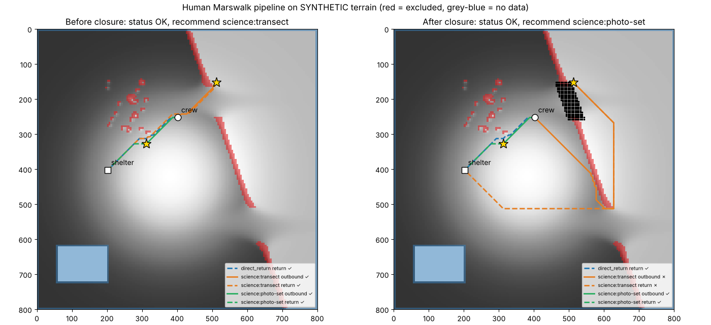

# Navigation and local pack runtime

`python_engine/` and its six original tests are byte-preserved from the delivered Senula routing source. Its A* uses dimensionless synthetic cell costs, eight neighbours and diagonal corner checks. It does not use elevation differences or directed travel seconds. Its plotting demo requires Matplotlib in a separate environment. The original server file is empty.

`mission.py` is a separate bounded consumer for pack v1. It uses the shared structural and semantic checks, including the external site hash when supplied. It loads source-backed Jezero as an elevation preview and runs the audited closure and reserve calculations in explicitly enabled fixture simulation. The fixture's four-neighbour edge model uses a fixed base of one second per metre plus two seconds per metre of ascent. These are software control values. This runtime keeps the legacy algorithm intact and leaves physical mobility and tactical routing unsupported.

From the repository root run:

```sh
uv run --project documentation --locked python -m pytest runtime/tests contracts/tests -q
uv run --project documentation --locked python -m runtime.mission inspect /path/to/preview-pack
uv run --project documentation --locked python -m runtime.mission simulate contracts/fixtures/synthetic-v1 --closure mid
```

Add `--site-sha256` with an independently recorded digest when validating a released pack. Exit 2 reports a refused pack or request as structured JSON on stderr. A valid simulation that cannot return reports its decision state in JSON on stdout.

## Local planning HTTP foundation

From the repository root, provision the locked environment once with
`uv sync --project documentation --locked --python 3.12`, then start:

```sh
uv run --project documentation --locked --offline python -m runtime.planning_api
```

The service listens on `127.0.0.1:8000`. It validates the committed simulation
pack and resolves an evidence query at startup when explicitly configured. It requires no web
build or downloaded raster. The system architecture's loader, request
validation, response serialization and freshness boundaries apply here. Its
richer mission option fields describe future solver and UI integration.

| Endpoint | Contract |
| --- | --- |
| `GET /healthz` | HTTP 200 with `{"status":"ready"}` after startup validation. |
| `GET /api/v1/site` | Synthetic pack and scenario IDs, fixed inputs, initial remaining time, predefined closure cells, checkpoint and shelter cells, and grid shape and affine. |
| `POST /api/v1/plan` | Accepts a strict v1 JSON request. Returns the existing simulation output plus request ID, schema version and route index order. With `--engine marswalk`, the same fields come from the Marswalk planner, plus `engine` and the full `marswalk` plan. |
| `GET /api/v1/evidence` | Separate result from the documentation resolver, with reported provenance and supported fallbacks. The API returns `classification: provenance_unverified` because it does not independently verify the package's provenance. Returns HTTP 503 with `EVIDENCE_NOT_CONFIGURED` until a package and query are configured. |

### Marswalk engine behind the plan endpoint

`runtime.mission.simulate` stays the default planner. To serve the same endpoint from
`runtime.marswalk`, start the service with:

```sh
uv run --project documentation --locked --offline python -m runtime.planning_api --engine marswalk
```

The fixture uses the Marswalk control profile: 4-neighbour moves at 1 s/m plus 2 s per metre
climbed. That is the fixture's own cost rule, so every v1 field the mission view reads is
unchanged. `test_marswalk_engine_matches_mission_contract` covers all fixture closure
combinations, both orders for two closures, and representative remaining times, including
the return and science feasibility thresholds. Equal-time routes may use different cells.
The response adds `engine: "marswalk"` and `marswalk`, the full
`marswalk-plan-v1` object: candidates, ledgers, Pareto front, terrain counts, assumptions
and solver statistics. The mission view's schema ignores both fields until the UI reads them.
This engine choice does not change the pack contract. Routing remains synthetic only.

```sh
curl -sS http://127.0.0.1:8000/api/v1/site
curl -sS http://127.0.0.1:8000/api/v1/plan -H 'Content-Type: application/json' -d '{
  "schema_version": 1,
  "request_id": "closure-1",
  "pack_id": "rw-synthetic",
  "pack_version": "1.0.0",
  "scenario_id": "synthetic-closure-v1",
  "checkpoint_id": "crew",
  "shelter_id": "home",
  "closure_ids": ["mid"],
  "completed_task_ids": ["survey-done"],
  "remaining_s": 100,
  "reserve_s": 15
}'
curl -sS http://127.0.0.1:8000/api/v1/evidence
```

Only remaining time and predefined closures vary in the fixture. Time fields
are integer seconds. Pack version, checkpoint, shelter, completed tasks and
reserve must match site metadata. The result carries ordered `[row, col]` cell
pairs in `direct_return.cells` and the reverse-direction control. The affine
maps the center of cell `[r,c]` from `[c+0.5,r+0.5]` to local metres. Keep
fixture geometry off real Mars geography.

A valid scenario produces HTTP 200, including `NO_RETURN_ROUTE` and
`RETURN_OVER_RESERVE`. Both have a null recommendation. An over-reserve result
may still contain a computed return path for inspection. Malformed input or
unknown closures return 400. A mismatch with fixed scenario state returns
409. Errors use `{schema_version,request_id,error,message}`, with a null
request ID when unavailable. The eventual client must discard superseded
request IDs, clear stale recommendations and key session state by pack version.

### Integration handoffs

- **Senula:** Use the four HTTP replay outcomes in
  [test_planning_api.py](tests/test_planning_api.py) as regression controls.
  Keep the routing computation behind the adapter. Review any changes to
  route geometry, units, feasibility or refusal semantics before wiring a
  new solver. The fixture's travel times are test values.
- **Yumeth:** For a real site, hand over a schema-valid evidence package,
  capability query, source manifest, local display assets and checksums.
  Start with `--evidence-package PATH --evidence-query PATH` to test the
  approved pair through the same resolver. The response identifies this as
  operator-configured evidence. The primary demo targets a less-documented
  site and remains unqualified. Jezero is used as an explicit test control.
  Site qualification remains a scientific review. Changes to routing pack capabilities require producer/consumer
  review under [mission pack v1](../contracts/README.md).
- **Isath:** Use `site`, `plan` and `evidence` responses as inputs to the UI
  design. The service is ready for local contract checks. Same-origin web
  wiring, rendering, browser replay and second-machine offline rehearsal
  remain release work.

Run the headless acceptance checks with
`uv run --project documentation --locked --offline python -m pytest runtime/tests/test_planning_api.py -q`.

## Human Marswalk pipeline (`runtime/marswalk/`)

A deterministic implementation of the **Human Marswalk** architecture view:
Mission configuration (01) → Human traversal time (04) + Traversability (03)
→ Terrain routing (09) → Resource budgets (07) → Mission optimization (10).
It is a separate module. `mission.py`, `planning_api.py` and their regression
outputs are unchanged, and the planning API is not wired to it yet. That
integration needs the route-geometry, units and refusal review described in
the Senula handoff above.

| Module | Architecture boxes |
| --- | --- |
| `config.py` | Mission snapshot, Human operating profile, Authorized operating limits |
| `mobility.py` | Human traversal time: asymmetric, illustrative pace (`tobler_scaled`), plus the fixture `control_linear` model |
| `traversability.py` | Terrain scale and support, Coverage and support masks, Scale-aware roughness (P1), Characterize surface evidence (P1), Slope screening, Obstacles and exclusions, Baseline routing inputs |
| `routing.py` | Shared mobility contract, Directed terrain graph (CSR, 4/8 neighbours, no corner cutting), two directed Dijkstra runs, Route reconstruction, Diverse candidate routes |
| `resources.py` | Compute return-time margin (B − R − travel), Route resource ledger with prefix checks |
| `optimization.py` | Compose candidate plans, Reevaluate science tasks, Enforce hard constraints, Compare Pareto alternatives, Select next action, Bounded multi-stop planning (P1), Excluded from core |
| `plan.py` | Orchestration and the `marswalk-plan-v1` JSON output |

Dijkstra runs in SciPy when it is importable and otherwise uses an equivalent
pure-Python implementation over the same CSR arrays. The locked environment
has no SciPy, so CI exercises the fallback. Both produce identical times.
With exact ties they may choose different but equally fast cells. Each plan
reports the backend it used. A 1.6 km × 1.6 km grid at 5 m runs a full plan
in about 0.1 s with SciPy and 0.3 s without it.

```sh
# synthetic scenario, no pack needed: decision table before and after a closure
uv run --project documentation --locked --offline python -m runtime.marswalk demo
# add --png marswalk-demo.png from an environment that has Matplotlib (it is not in the lock)
# the pack v1 fixture with the human profile (8 neighbours, illustrative pace). At this
# 10 m toy scale it reports RETURN_OVER_RESERVE after the closure; that is expected
uv run --project documentation --locked --offline python -m runtime.marswalk plan contracts/fixtures/synthetic-v1 --closure mid
# reproduce runtime.mission's control model exactly (4 neighbours, 1 s/m + 2 s per m ascent)
uv run --project documentation --locked --offline python -m runtime.marswalk plan contracts/fixtures/synthetic-v1 --closure mid --pace-model control_linear --neighbours 4
# tests, including a cross-check against runtime.mission.simulate for every closure set
uv run --project documentation --locked --offline python -m pytest runtime/tests/test_marswalk.py -q
```

Options: `--pace-scenario slow` (speed × 0.7), `--crew-status issue`
(no science; return now), `--multistop` (ordered two-task plans),
`--alternatives K` (diverse outbound routes for the recommendation),
`--slope-limit-deg` (runtime slope policy on top of the pack screen) and
`--backend scipy|python`.

Outcome codes: `OK`, `NO_RETURN_ROUTE`, `RETURN_OVER_RESERVE` and
`INSUFFICIENT_TERRAIN_EVIDENCE`. A direct return that violates a hard limit yields
`NO_RETURN_ROUTE` when it otherwise fits the time budget. The candidate retains
the evaluated leg and the failed rule for inspection. Insufficient terrain
evidence means only unverified terrain could connect the crew to the shelter,
so no route is drawn. Each leg reports `ok`,
`no_path_under_constraints`, `insufficient_terrain_evidence`,
`endpoint_excluded` or `out_of_bounds`. Each constraint reports
`pass`/`fail`/`unknown`, and an unknown required value blocks the plan.
Science requires a passing direct return. Each published outbound alternative
passes the mission constraints with the same remaining legs and dwell phases.
For in-memory terrain, provide `TerrainSupport.pack_version` matching the
snapshot. Checked packs supply it automatically. The supported authorized
limit is mission-wide `max_leg_s`, expressed in seconds (`s`).

Limits: pace parameters and thresholds are illustrative assumptions, not
calibrated Mars-suit data or proof of safety. Only time is budgeted. The
return check assumes no rescue. Closures are simulated field reports. The
following are deliberately excluded: AI/ML decisions, live telemetry, suit
forecasts, safety scores, medical suitability or crew ranking, and assumed
vehicle rescue.

### Rover mobility (05) and environmental models (06)

| Module | Architecture boxes |
| --- | --- |
| `config.py` | Rover operating profile (`RoverProfile`): hypothetical or cited vehicle record. Refuses a sourced record without a citation, efficiency outside (0, 1], reserve > charge > capacity and non-finite values |
| `rover.py` | Rover traversal time (incline, local tilt and clearance checked first; unsupported terrain fails closed), Rover drive energy (uphill work + rolling resistance + drivetrain losses + auxiliary load, no regeneration credit, stationary science load), Traction/slip/sinkage reported `not_calibrated` |
| `environment.py` | Historical weather & RAD (`Observation`, context only), Solar geometry & shadow (Mars24 sun position and terrain ray-march: `lit`/`shadow`/`unresolved`/`night`), Power availability scenario (`declared_curve`, `solar_derived`, `non_solar`, `none`), Environmental activation, Comms and forecast research reported `not_modelled` |
| `resources.py` | Battery energy ledger: checks discharge power and reserve on each drive edge and each dwell. Applies consumption before charging and caps charge at capacity. |

An explicit operating scenario needs a declared purpose, authorization,
matching scenario ID and, if time-limited, coverage for the full planning
window. An active `return_now` prevents science and allows the shelter
return. An active `block_cells` behaves like a closure. Historical records
are context only, and predictions stay unverified until a qualified
prediction product is integrated. A required operating input that is
unverified leaves science `unknown` (`unverified_environment`). A required
unverified closure also prevents a return recommendation
(`RETURN_ENVIRONMENT_UNVERIFIED`).

Rover plans require a declared `PowerScenario` and battery charge and
discharge ratings. A power curve must identify its source and cover the
evaluated timeline. Battery-only operation uses `PowerScenario("none")`.
If the fastest feasible-by-time legs fail energy, the planner checks a
bounded set of alternatives built from minimum-energy, power-admissible
and mixed time/energy routes. `RETURN_ENERGY_SEARCH_EXHAUSTED` preserves the
evaluated geometric return and identifies the bounded search result.
`RETURN_ENERGY_UNVERIFIED` indicates missing energy inputs.

The sun position uses Mars24 (Allison & McEwen 2000) with TT − UTC pinned at
69.184 s, which is valid from 2017. It reproduces the start of Mars Year 36
(Ls 0 on 7 Feb 2021), Perseverance's touchdown at about 15:53 LMST, the
±25.4° declination range and the 1.381–1.666 AU distance range. It stands in
for pinned SPICE kernels. Packs carry no site coordinates, so a plan must
declare `time_utc`, `site_lat_deg` and `site_lon_east_deg` for solar geometry.
Solar generation is credited only during stationary dwell with resolved
illumination, based on samples no more than 60 seconds apart. It needs a
separately declared upper bound on intervening terrain, including terrain
outside the grid, in the same vertical datum. Unresolved visibility,
shadow, night and driving receive zero solar credit. These are synthetic
planning assumptions.

```sh
# Choose a new output directory for the rover fixture.
uv run --project documentation --locked --offline python -m contracts.fixtures.generate /tmp/marswalk-rover-pack --rover
uv run --project documentation --locked --offline python -m runtime.marswalk plan /tmp/marswalk-rover-pack --platform rover --power battery-only --closure mid

uv run --project documentation --locked --offline python -m runtime.marswalk demo --platform rover
uv run --project documentation --locked --offline python -m runtime.marswalk demo --sep-alert
uv run --project documentation --locked --offline python -m pytest runtime/tests/test_marswalk_rover_env.py -q
```

The pack CLI also accepts `--power demo-solar` with `--time-utc`,
`--site-lat-deg` and `--site-lon-east-deg`. Provide
`--horizon-upper-bound-m` only when that bound is declared for the scenario.

The demo rover is a hypothetical record (`hypothetical_crew_rover`). It is
not a NASA vehicle specification. The demo solar array, dust transmittance
and the simulated solar-particle-event drill are declared assumptions, and
no radiation dose is inferred.

Demo output (synthetic terrain, before and after the simulated north-ramp
closure). Regenerate with `python -m runtime.marswalk demo [--platform rover] --png PATH`
from an environment that has Matplotlib:




### Site gates, profiles as data, rover walkback and weather

The full algorithm, with dimensions and the remaining simulated inputs, is in
[docs/marswalk-algorithm.md](docs/marswalk-algorithm.md).

| Module | What it adds |
| --- | --- |
| `site.py` | Phase 0. Reads grid dimensions from the data and refuses before routing: no eligible local DTM (`NO_TERRAIN_EVIDENCE`), grid or native spacing above 20 m (`TERRAIN_TOO_COARSE`), more than 1,000,000 cells (`GRID_TOO_LARGE`) or no analytical payload (`TERRAIN_NOT_AVAILABLE`). It reports rock clearance as unverified and includes an assumed horizontal feature scale. It includes loaders for the Arcadia MOLA handoff, the Jezero CTX control and the HEALPix cells on main. |
| `profiles.py` | Human and rover profiles from JSON, with strict field names and optional kWh battery fields. Example files are in `runtime/examples/`. `HumanProfile` gains `v_flat_mps` (rejected above the 1.16 m/s walk-to-run limit) and an optional `max_slope_deg`. |
| `walkback.py` | Mode B. A third Dijkstra from the shelter on the walking graph (0.75 m/s, 15°). Every rover route cell must satisfy elapsed + walk home ≤ B − R. `breakdown_snapshot` replans on foot after a rover failure. A failing direct return gives `RETURN_WALKBACK_EXCEEDED`. |
| `weather.py` | Base-station messages are validated and classified as advisory (forecast), caution, warning (active) or link lost. Active wind and SEP alerts force a return. Dust removes rover solar credit. A required feed that loses its link leaves science unknown. |

On grids of at least 250,000 cells the outbound search stops at B − R. The
home search stays exact. `POST /api/v1/plan` accepts an optional `profile`
object with `--engine marswalk`.

```sh
uv run --project documentation --locked --offline python -m runtime.marswalk sites
uv run --project documentation --locked --offline python -m runtime.marswalk demo --platform rover --rover-fails-at-min 12
uv run --project documentation --locked --offline python -m runtime.marswalk demo --weather runtime/examples/weather-wind-warning.json
uv run --project documentation --locked --offline python -m runtime.marswalk demo --platform rover --profile runtime/examples/profile-rover-hypothetical.json
uv run --project documentation --locked --offline python -m pytest runtime/tests/test_marswalk_site_walkback_weather.py -q
```
